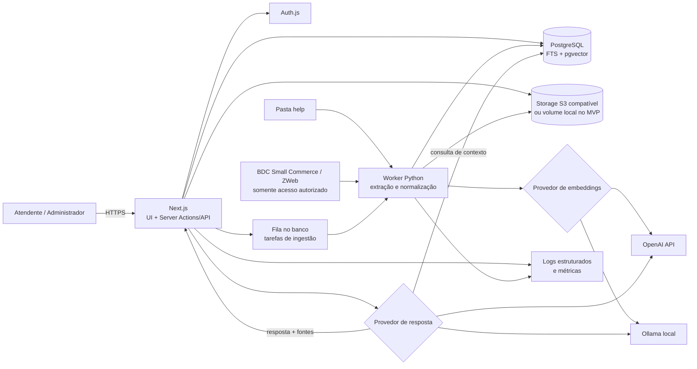

# Roadmap — Central Inteligente de Suporte

> Plano orientado a um desenvolvimento individual, com complexidade progressiva. O MVP concentra-se em importar e organizar documentos, pesquisar, contabilizar acessos e responder com IA usando somente as fontes autorizadas. Recursos de automação, análise avançada e integrações mais sofisticadas ficam para fases posteriores.

<details>
<summary>1. Visão geral do projeto</summary>

### Objetivo

Construir uma central única e rápida para consultar conteúdos do **Small Commerce**, do **ZWeb** e materiais **internos**, ajudando o atendente a encontrar, visualizar, copiar e aplicar procedimentos durante um atendimento.

### Tarefas necessárias

- Consolidar documentos da pasta `help` e artigos das bases autorizadas.
- Classificar cada conteúdo por sistema, fonte, módulo, categoria, tags e nível de acesso.
- Oferecer pesquisa tradicional e, no MVP, respostas por IA com referências.
- Registrar visualizações, pesquisas, favoritos e feedbacks.
- Permitir o cadastro e a manutenção de novas soluções.
- Exibir de forma inequívoca a origem e o sistema relacionado a cada resultado.

### Tecnologias utilizadas

- Next.js e TypeScript.
- Tailwind CSS e shadcn/ui.
- PostgreSQL com pgvector.
- Drizzle ORM.
- Auth.js.
- Python para ingestão e extração.
- API da OpenAI ou, no modo privado, Ollama.
- Docker e Docker Compose.

### Resultado esperado

Uma aplicação web responsiva, utilizável durante o atendimento, com navegação rápida, rastreabilidade das fontes e uma base técnica que possa crescer sem exigir microsserviços no início.

### Critérios de aceitação

- Small Commerce, ZWeb e conteúdo interno aparecem identificados por rótulos e filtros próprios.
- Um usuário autenticado encontra e abre um documento em poucos passos.
- A IA exibe as fontes usadas ou declara que não há informação suficiente.
- O projeto pode ser iniciado localmente com documentação objetiva.

### Nível de dificuldade

**Médio**, executado por incrementos.

### Dependências

Definição do escopo, acesso à pasta `help`, regras de acesso às bases externas e ambiente de desenvolvimento.

</details>

<details>
<summary>2. Problema que será resolvido</summary>

### Objetivo

Reduzir o tempo gasto procurando procedimentos espalhados, evitar respostas inconsistentes e transformar o uso diário dos materiais em dados úteis para melhorar a base de conhecimento.

### Tarefas necessárias

- Medir a situação atual: tempo médio de busca, fontes mais usadas e principais lacunas.
- Mapear formatos encontrados em `help` e os fluxos mais frequentes de atendimento.
- Identificar conteúdos duplicados, desatualizados, conflitantes ou sem proprietário.
- Definir a taxonomia inicial: sistema, módulo, categoria, erro, tags e confidencialidade.
- Definir indicadores de sucesso do produto.

### Tecnologias utilizadas

- Planilha ou documento de inventário na descoberta.
- Scripts Python somente para inventário automatizado de arquivos.
- PostgreSQL posteriormente para métricas de uso.

### Resultado esperado

Um problema mensurável, uma taxonomia inicial e prioridades alinhadas ao trabalho real do suporte.

### Critérios de aceitação

- Existe uma lista dos formatos e fontes que serão atendidos no MVP.
- Foram selecionadas pelo menos 20 perguntas reais para validação futura.
- Há metas iniciais, por exemplo: reduzir o tempo mediano de busca e diminuir pesquisas sem resultado.
- Conteúdos que não podem ser enviados a serviços externos estão identificados.

### Nível de dificuldade

**Baixo**.

### Dependências

Participação de usuários do suporte e amostra representativa da pasta `help`.

</details>

<details>
<summary>3. Escopo inicial e funcionalidades futuras</summary>

### Objetivo

Evitar complexidade prematura e criar uma sequência clara entre MVP, versão operacional e evolução avançada.

### Tarefas necessárias

**MVP**

- Login e perfis básicos (`admin` e `atendente`).
- Importação manual ou por comando da pasta `help` para PDF, DOCX, TXT e Markdown.
- Cadastro, edição, arquivamento e classificação de documentos.
- Pesquisa por texto, título, tags, sistema, módulo e categoria.
- Visualização ou download seguro do arquivo original.
- Contagem de acessos, recentes e ranking de mais acessados.
- Perguntas à IA com RAG, citações e resposta de insuficiência.
- Feedback simples: `resolveu` ou `não resolveu`.

**Versão operacional**

- Favoritos, mensagens prontas, painel de lacunas e cadastro rápido de soluções.
- Integração autorizada e incremental com as bases Small Commerce e ZWeb.
- Busca híbrida refinada e gestão de duplicatas/versões.
- Permissões por documento ou grupo.

**Futuro**

- OCR de imagens e PDFs digitalizados.
- Sugestões automáticas de tags e relacionamentos.
- Fluxo editorial com aprovação, validade e proprietário do conteúdo.
- Integração com sistema de chamados, extensão de navegador e análises avançadas.
- Reclassificação de ranking por aprendizado estatístico, somente após dados suficientes.

### Tecnologias utilizadas

Backlog versionado em Markdown ou ferramenta de tarefas; Git para controlar as entregas.

### Resultado esperado

Um primeiro produto útil que possa ser entregue sem depender de crawler complexo, OCR ou treinamento de modelo.

### Critérios de aceitação

- Cada funcionalidade está atribuída a MVP, versão operacional ou futuro.
- O MVP pode ser demonstrado com arquivos locais, mesmo sem integração automática com as bases externas.
- Mudanças de escopo exigem troca explícita por outro item, não apenas acréscimo.

### Nível de dificuldade

**Baixo**.

### Dependências

Etapas 1 e 2.

</details>

<details>
<summary>4. Arquitetura recomendada</summary>

### Objetivo

Adotar uma arquitetura simples de operar por uma pessoa, separando a aplicação web do processamento pesado de documentos.

### Arquitetura visual



### Tarefas necessárias

- Construir um **monólito modular** em Next.js para interface, regras de negócio e API.
- Executar extração, chunking e embeddings em um worker Python separado.
- Usar PostgreSQL também como fila simples no MVP, evitando Redis.
- Guardar binários no storage e metadados/texto/embeddings no PostgreSQL.
- Isolar provedores de IA atrás de interfaces, permitindo OpenAI ou Ollama.
- Definir módulos: autenticação, conteúdo, busca, ingestão, métricas e IA.

### Tecnologias utilizadas

Next.js, TypeScript, Python, PostgreSQL, pgvector, storage S3 compatível, OpenAI/Ollama e Docker Compose.

### Resultado esperado

Uma arquitetura implantável em um único servidor no início, mas com worker e storage substituíveis quando o volume crescer.

### Critérios de aceitação

- Web, banco, worker e storage iniciam por Docker Compose.
- Uma falha no processamento de um arquivo não derruba a interface.
- Trocar o provedor de IA exige configuração, não reescrita das regras do produto.
- Segredos não são incluídos em imagens Docker nem enviados ao navegador.

### Nível de dificuldade

**Médio**.

### Dependências

Etapa 3 e decisões de privacidade da etapa 16.

</details>

<details>
<summary>5. Explicação e justificativa das tecnologias</summary>

### Objetivo

Escolher componentes produtivos sem criar uma plataforma maior do que o produto.

### Tarefas necessárias

| Componente | Escolha principal | Justificativa |
|---|---|---|
| Aplicação | Next.js + TypeScript | Interface e back-end no mesmo projeto, Server Actions, boa produtividade e tipagem ponta a ponta. |
| UI | Tailwind CSS + shadcn/ui | Componentes acessíveis e customizáveis, sem impor uma biblioteca visual fechada. |
| Banco | PostgreSQL | Dados relacionais, busca textual, JSON e vetores no mesmo banco. |
| Busca vetorial | pgvector | Evita um banco vetorial separado no MVP e permite filtros relacionais junto da similaridade. |
| ORM | **Drizzle ORM** | Mais próximo de SQL, leve e adequado para recursos nativos do PostgreSQL, como `tsvector`, índices GIN e consultas com pgvector. Exige escrever algumas consultas SQL, mas oferece mais controle que Prisma para a busca híbrida. |
| Autenticação | Auth.js | Integra-se ao Next.js, aceita credenciais ou OIDC e preserva a opção de implantação própria. |
| Extração | Python | Ecossistema maduro para PDF, DOCX e HTML com PyMuPDF, python-docx e BeautifulSoup. |
| Storage | Volume local no MVP; MinIO em produção privada | O volume simplifica o início; MinIO oferece API S3 e implantação própria. Supabase Storage é alternativa gerenciada. |
| IA | OpenAI API | Respostas e embeddings com pouca infraestrutura. Modelos e dimensões devem ser configuráveis. |
| IA privada | Ollama | Mantém prompts e documentos na rede local, sujeito a capacidade de hardware e avaliação de qualidade. |
| Testes | Vitest + Playwright + conjunto de avaliação RAG | Cobre regras, fluxos reais e qualidade das respostas. |

### Tecnologias utilizadas

As tecnologias listadas na tabela, fixadas por versões no lockfile e nas imagens Docker.

### Resultado esperado

Uma stack coerente, com poucas peças móveis e uma rota de migração para ambiente totalmente privado.

### Critérios de aceitação

- Há um registro das decisões arquiteturais e de suas alternativas.
- O projeto não depende diretamente de APIs de um provedor fora do módulo de IA/storage.
- Recursos específicos do PostgreSQL possuem migrações e testes.

### Nível de dificuldade

**Baixo** para decisão; **médio** para integração.

### Dependências

Etapa 4.

</details>

<details>
<summary>6. Configuração do ambiente</summary>

### Objetivo

Permitir que um novo ambiente seja reproduzido com o mínimo de configuração manual.

### Tarefas necessárias

- Criar repositório Git e convenções de branch, commit e revisão.
- Inicializar Next.js com TypeScript, ESLint, Tailwind CSS e shadcn/ui.
- Criar o worker Python com ambiente e dependências bloqueadas.
- Configurar Docker Compose com `web`, `worker`, `postgres` e, quando necessário, `minio`.
- Habilitar as extensões PostgreSQL `vector`, `unaccent` e `pg_trgm`.
- Criar `.env.example`, validação de variáveis na inicialização e volumes persistentes.
- Adicionar comandos para migração, seed, importação, testes e backup.
- Criar dados de demonstração sem informações reais de clientes.

### Estrutura de pastas sugerida

```text
central-suporte/
├── apps/
│   └── web/
│       ├── src/app/
│       ├── src/components/
│       ├── src/features/
│       │   ├── auth/
│       │   ├── documents/
│       │   ├── search/
│       │   ├── analytics/
│       │   └── ai/
│       ├── src/lib/
│       └── tests/
├── services/
│   └── ingestion/
│       ├── extractors/
│       ├── chunking/
│       ├── embeddings/
│       ├── connectors/
│       └── tests/
├── packages/
│   ├── db/
│   │   ├── schema/
│   │   ├── migrations/
│   │   └── queries/
│   ├── contracts/
│   └── config/
├── data/
│   ├── imports/
│   └── samples/
├── infra/
│   ├── docker/
│   └── backup/
├── docs/
│   ├── architecture/
│   ├── operations/
│   └── rag-evaluation/
├── compose.yaml
├── .env.example
└── README.md
```

### Tecnologias utilizadas

Node.js, pnpm, Python, Docker, Docker Compose, PostgreSQL e Git.

### Resultado esperado

Ambiente local reproduzível, com dados persistentes e comandos documentados.

### Critérios de aceitação

- O projeto sobe a partir de um clone limpo seguindo o README.
- Migrações e seed executam sem edição manual do banco.
- Segredos reais não estão versionados.
- Um health check confirma web, banco, worker e storage.

### Nível de dificuldade

**Médio**.

### Dependências

Etapas 4 e 5.

</details>

<details>
<summary>7. Modelagem do banco de dados</summary>

### Objetivo

Representar conteúdos, origem, classificação, uso, permissões e rastreabilidade das respostas sem duplicar dados desnecessariamente.

### Tarefas necessárias

Criar a modelagem inicial abaixo. Usar UUIDs, `created_at`, `updated_at` e, quando aplicável, `deleted_at` para arquivamento lógico.

| Tabela | Campos principais | Observações |
|---|---|---|
| `usuarios` | `id`, `nome`, `email`, `role`, `ativo`, timestamps | `role`: `admin`, `editor`, `atendente`. Adaptável ao Auth.js. |
| `fontes` | `id`, `nome`, `tipo`, `sistema`, `url_base`, `politica_acesso`, `ativo` | `tipo`: `help`, `small_bdc`, `zweb_bdc`, `interno`; `sistema`: `small`, `zweb`, `interno`, `compartilhado`. |
| `categorias` | `id`, `nome`, `slug`, `parent_id`, `sistema` | Hierarquia opcional e escopo por sistema. |
| `documentos` | `id`, `fonte_id`, `categoria_id`, `titulo`, `slug`, `sistema`, `modulo`, `tipo_mime`, `storage_key`, `url_origem`, `texto_normalizado`, `checksum`, `versao`, `status`, `confidencialidade`, `publicado_em`, timestamps | `status`: `processando`, `publicado`, `erro`, `arquivado`. Não guardar binário no banco. |
| `tags` | `id`, `nome`, `slug`, `sistema` | Tag canônica. |
| `documento_tags` | `documento_id`, `tag_id` | Chave composta e índices nos dois sentidos. |
| `documento_relacionamentos` | `origem_id`, `destino_id`, `tipo`, `peso` | Ex.: complementa, substitui, erro-relacionado. |
| `documento_chunks` | `id`, `documento_id`, `ordem`, `secao`, `texto`, `token_count`, `metadata`, `embedding`, `embedding_model`, `search_vector` | `embedding` usa `vector(N)`; `N` corresponde ao modelo configurado. `search_vector` usa `tsvector`. |
| `visualizacoes` | `id`, `usuario_id`, `documento_id`, `ocorrido_em`, `sessao_id`, `origem_acao` | Evento imutável para data, horário e usuário. |
| `favoritos` | `usuario_id`, `documento_id`, `created_at` | Restrição única por usuário/documento. |
| `pesquisas` | `id`, `usuario_id`, `termo`, `filtros`, `quantidade_resultados`, `latencia_ms`, `ocorrido_em` | Permite detectar buscas sem resultado. Aplicar retenção e sanitização. |
| `rag_respostas` | `id`, `usuario_id`, `pergunta`, `resposta`, `sistema`, `modelo`, `status_fundamentacao`, `latencia_ms`, `created_at` | Pode armazenar texto reduzido ou anonimizado conforme a política. |
| `rag_resposta_fontes` | `resposta_id`, `chunk_id`, `posicao`, `score`, `trecho_exibido` | Registra exatamente as fontes apresentadas pela IA. |
| `feedbacks` | `id`, `usuario_id`, `documento_id`, `resposta_id`, `tipo`, `comentario`, `created_at` | Deve referenciar documento ou resposta; `tipo`: `resolveu`, `nao_resolveu`, `correcao`. |
| `importacoes` | `id`, `fonte_id`, `status`, `iniciada_em`, `finalizada_em`, `totais`, `erro` | Auditoria de cada lote de ingestão. |
| `tarefas_ingestao` | `id`, `documento_id`, `tipo`, `status`, `tentativas`, `disponivel_em`, `erro` | Fila simples com bloqueio transacional. |

Índices essenciais:

- GIN em `documento_chunks.search_vector`.
- HNSW ou IVFFlat em `documento_chunks.embedding`, escolhido após medir o volume; para uma base pequena, busca exata pode ser suficiente.
- B-tree em sistema, status, categoria, fonte, datas e chaves estrangeiras.
- Único em `(fonte_id, checksum)` ou em um identificador externo estável.
- GIN em `pesquisas.filtros` apenas se consultas em JSON justificarem o custo.

### Tecnologias utilizadas

PostgreSQL, pgvector, Drizzle ORM e migrações SQL versionadas.

### Resultado esperado

Esquema capaz de servir pesquisa, RAG, métricas e auditoria mantendo as fontes rastreáveis.

### Critérios de aceitação

- Migrações sobem e descem com segurança em ambiente de teste.
- Restrições impedem favorito duplicado e feedback sem alvo.
- Um documento pode ter vários chunks e uma resposta pode citar vários chunks.
- Consultas comuns usam índices verificados com `EXPLAIN ANALYZE` em uma massa representativa.

### Nível de dificuldade

**Alto**.

### Dependências

Etapas 4 a 6.

</details>

<details>
<summary>8. Importação dos documentos da pasta help</summary>

### Objetivo

Transformar arquivos heterogêneos em conteúdo pesquisável, preservando o original, a estrutura e a rastreabilidade.

### Tarefas necessárias

- Executar inventário somente leitura: caminho, tamanho, extensão, data, checksum e possíveis duplicatas.
- Suportar inicialmente `.pdf`, `.docx`, `.txt` e `.md`; registrar os demais como não suportados.
- Extrair texto com PyMuPDF, python-docx e leitores de texto com detecção de codificação.
- Normalizar espaços, quebras, cabeçalhos repetidos e caracteres inválidos sem destruir listas, títulos ou códigos.
- Derivar metadados do caminho e permitir revisão manual antes da publicação.
- Calcular checksum e tornar a importação idempotente: novo, inalterado, atualizado ou removido da origem.
- Armazenar o arquivo original com chave não adivinhável e o texto normalizado no banco.
- Colocar cada documento em estados de processamento e registrar erros por arquivo.
- Tratar imagens e PDFs sem texto como pendência; OCR fica fora do MVP.
- Executar chunking e embeddings de modo assíncrono, com tentativas limitadas.

Fluxo de ingestão:

```text
descobrir → validar tipo/tamanho → checksum → extrair → normalizar
→ classificar/revisar → salvar → dividir em chunks → gerar embeddings → publicar
```

### Tecnologias utilizadas

Python, PyMuPDF, python-docx, biblioteca de detecção de MIME, PostgreSQL e storage.

### Resultado esperado

Uma importação repetível que não cria duplicatas e permite diagnosticar cada falha.

### Critérios de aceitação

- Reexecutar o mesmo lote não duplica documentos nem chunks.
- Pelo menos 95% dos arquivos suportados da amostra são extraídos sem erro fatal.
- O original pode ser comparado ao texto extraído e ao registro de origem.
- Arquivos com falha ficam visíveis em relatório, sem interromper o restante do lote.
- Nenhum arquivo fora da pasta autorizada é lido.

### Nível de dificuldade

**Alto**.

### Dependências

Etapas 6 e 7; acesso de leitura à pasta `help`.

</details>

<details>
<summary>9. Integração com as bases de conhecimento</summary>

### Objetivo

Indexar conteúdo das bases Small Commerce e ZWeb de forma autorizada, incremental e compatível com suas políticas.

### Tarefas necessárias

- Confirmar termos de uso, permissões, autenticação, robots.txt quando aplicável e disponibilidade de API, feed ou exportação oficial.
- Priorizar API/exportação fornecida pelos responsáveis; usar coleta HTML somente com autorização expressa.
- Criar um conector por base, mantendo seletores e regras isolados.
- Importar título, URL canônica, sistema, categoria, datas e corpo do artigo.
- Respeitar limites de requisição, sessões e páginas restritas; nunca contornar controles de acesso.
- Usar ETag, `Last-Modified`, checksum ou data de atualização para sincronização incremental.
- Guardar URL e identificador externo; apresentar link para o original.
- Arquivar localmente um item removido da origem, sem apagar imediatamente seu histórico.
- Criar relatório de alterações e revisão antes de publicar atualizações relevantes.

### Tecnologias utilizadas

Python, HTTP client, BeautifulSoup para HTML autorizado e agendamento por cron ou job do worker.

### Resultado esperado

Conteúdos externos claramente separados, atualizáveis e rastreáveis até sua página original.

### Critérios de aceitação

- Existe autorização documentada ou mecanismo oficial para cada integração ativa.
- Um artigo do Small nunca é identificado como ZWeb e vice-versa.
- A sincronização incremental não replica itens inalterados.
- Falhas de autenticação ou mudança de HTML geram alerta e não publicam conteúdo corrompido.

### Nível de dificuldade

**Alto** e variável conforme as bases.

### Dependências

Etapas 7 e 8; validação jurídica/administrativa de acesso. Não bloqueia o MVP baseado em `help`.

</details>

<details>
<summary>10. Sistema de pesquisa tradicional</summary>

### Objetivo

Entregar resultados rápidos e previsíveis antes de depender da IA.

### Tarefas necessárias

- Indexar título, seção e texto dos chunks com PostgreSQL Full-Text Search em português.
- Complementar correspondências parciais e tolerância a pequenas diferenças com `pg_trgm`.
- Aplicar pesos maiores para título, erro conhecido, módulo e tags.
- Oferecer filtros por sistema, fonte, módulo, categoria, tag, tipo e período.
- Implementar paginação por cursor e trechos destacados.
- Registrar termo, filtros, latência e quantidade de resultados.
- Sugerir correção ou termos relacionados sem substituir silenciosamente a busca original.
- Respeitar permissões antes de pontuar e exibir resultados.

Exemplo inicial de relevância textual:

```text
título 4x + tags/erro 3x + módulo/seção 2x + corpo 1x
```

### Tecnologias utilizadas

PostgreSQL FTS, `unaccent`, `pg_trgm`, Drizzle e Server Actions/API do Next.js.

### Resultado esperado

Busca por palavras-chave com filtros claros, tempo de resposta consistente e explicação visual de onde houve correspondência.

### Critérios de aceitação

- As perguntas conhecidas da etapa 2 retornam conteúdo relevante nos primeiros resultados.
- Filtros de sistema nunca misturam conteúdo não solicitado.
- A busca atende a meta de latência definida com base representativa, inicialmente p95 abaixo de 500 ms no ambiente-alvo.
- Pesquisas com zero resultado são registradas corretamente.

### Nível de dificuldade

**Médio**.

### Dependências

Etapas 7 e 8.

</details>

<details>
<summary>11. Contabilização de visualizações e métricas</summary>

### Objetivo

Entender quais conteúdos ajudam, quais perguntas se repetem e onde a base é insuficiente.

### Tarefas necessárias

- Registrar evento de abertura com usuário, documento, data/hora, sessão e origem da ação.
- Definir regra anti-inflação, por exemplo: uma visualização contabilizada por usuário/documento a cada 10 minutos, mantendo ou descartando eventos repetidos conforme a política.
- Exibir conteúdos mais acessados por período, sistema e módulo.
- Exibir pesquisas mais realizadas e pesquisas sem resultado.
- Relacionar feedbacks às respostas e documentos.
- Calcular soluções mais bem avaliadas com volume mínimo; evitar que um único voto lidere o ranking.
- Criar agregações diárias se o volume tornar consultas em eventos lentas.
- Aplicar retenção e anonimização às métricas antigas.

Métricas iniciais:

- Aberturas totais e usuários únicos por conteúdo.
- Conteúdos mais acessados em 7, 30 e 90 dias.
- Termos de pesquisa mais usados e taxa de zero resultado.
- Taxa de clique após pesquisa.
- Taxa de `resolveu` por documento e por resposta RAG.
- Latência p50/p95 da pesquisa e da IA.
- Perguntas recusadas por falta de evidência.

### Tecnologias utilizadas

PostgreSQL, consultas SQL agregadas, Next.js e painel com componentes shadcn/ui.

### Resultado esperado

Painel operacional que oriente a manutenção da base, sem se tornar uma plataforma analítica separada.

### Critérios de aceitação

- Abrir um documento gera evento auditável com horário e usuário.
- Os rankings respeitam período e filtros.
- Uma pesquisa sem resultado aparece no painel após o processamento definido.
- Métricas não expõem conteúdo ou dados pessoais a usuários sem permissão.

### Nível de dificuldade

**Médio**.

### Dependências

Etapas 7 e 10.

</details>

<details>
<summary>12. Desenvolvimento da interface</summary>

### Objetivo

Criar uma interface veloz, legível e adequada ao uso simultâneo com um atendimento.

### Tarefas necessárias

- Criar layout com busca em destaque, filtros acessíveis e atalhos por teclado.
- Exibir badges consistentes: `Small Commerce`, `ZWeb` e `Interno`.
- Criar páginas de login, início, resultados, detalhe do documento, pergunta à IA, recentes, favoritos, métricas e administração.
- No detalhe, mostrar título, metadados, conteúdo, arquivo original, documentos relacionados, copiar procedimento e feedback.
- Permitir copiar conteúdo como texto simples, com confirmação visual e sem HTML indesejado.
- Adicionar cadastro rápido de solução, com rascunho e publicação restrita a perfil autorizado.
- Tratar carregamento, vazio, erro, ausência de permissão e conteúdo desatualizado.
- Garantir navegação por teclado, foco visível, contraste e responsividade.

### Endpoints ou Server Actions necessários

Preferir Server Actions para mutações originadas pela própria interface e Route Handlers para worker, integrações ou clientes externos.

| Ação | Forma sugerida | Finalidade |
|---|---|---|
| `searchContent(query, filters, cursor)` | Server Action | Pesquisa tradicional paginada. |
| `getDocument(id)` | Server Component/query | Detalhe com validação de acesso. |
| `registerView(documentId, sessionId)` | Server Action | Registra abertura com deduplicação. |
| `toggleFavorite(documentId)` | Server Action | Cria/remove favorito. |
| `submitFeedback(target, type, comment)` | Server Action | Avalia documento ou resposta. |
| `askKnowledgeBase(question, filters)` | Server Action/stream | Executa RAG e transmite a resposta. |
| `createDocument(input)` / `updateDocument(id, input)` | Server Action | Administração editorial. |
| `requestReindex(documentId)` | Server Action | Agenda novo processamento. |
| `GET /api/documents/:id/file` | Route Handler | Entrega arquivo com autorização e auditoria. |
| `POST /api/ingestion/jobs/:id/result` | Route Handler interno | Worker atualiza processamento, autenticado por segredo de serviço. |
| `POST /api/connectors/:source/sync` | Route Handler/admin | Dispara sincronização autorizada. |
| `GET /api/health` | Route Handler | Verifica dependências sem vazar segredos. |

### Tecnologias utilizadas

Next.js, TypeScript, Tailwind CSS, shadcn/ui, React Server Components, Server Actions e Zod.

### Resultado esperado

Uma interface em que a pesquisa e o uso de um procedimento exigem poucos cliques e deixam a origem sempre visível.

### Critérios de aceitação

- Fluxos principais funcionam com teclado e em tela de notebook.
- Copiar um procedimento produz texto utilizável no atendimento.
- Estados vazios orientam o usuário sem mascarar ausência de conteúdo.
- Todas as mutações validam dados e autorização no servidor.

### Nível de dificuldade

**Médio**.

### Dependências

Etapas 6, 7, 10 e 11.

</details>

<details>
<summary>13. Integração da inteligência artificial</summary>

### Objetivo

Adicionar respostas fundamentadas, resumos e textos curtos sem permitir que o modelo substitua a fonte de verdade.

### Tarefas necessárias

- Criar interfaces `EmbeddingProvider` e `AnswerProvider` com implementações OpenAI e Ollama.
- Manter modelo, temperatura, limites e dimensões em configuração versionada.
- Criar modos: responder pergunta, resumir documento e gerar mensagem curta para cliente.
- Exigir filtro ou inferência segura do sistema; quando ambíguo, perguntar se é Small ou ZWeb.
- Separar instruções internas de texto recuperado e tratar o conteúdo como dado não confiável contra prompt injection.
- Registrar modelo, versão do prompt, contexto recuperado, fontes e status de fundamentação.
- Estimar e limitar custo, tokens, concorrência e tempo de resposta.
- Aplicar política de dados antes de enviar qualquer trecho a um serviço externo.

### Tecnologias utilizadas

SDK do provedor de IA no servidor, OpenAI API como opção principal, Ollama como alternativa privada, Zod para saída estruturada e streaming do Next.js.

### Resultado esperado

Respostas curtas e úteis, com citações clicáveis e comportamento previsível quando a informação não existe.

### Critérios de aceitação

- Nenhuma chave de API chega ao navegador.
- Toda afirmação operacional relevante possui fonte cadastrada ou a resposta é recusada.
- O usuário consegue alternar entre resposta técnica e mensagem curta para o cliente.
- Conteúdos sem permissão nunca são enviados ao modelo para aquele usuário.

### Nível de dificuldade

**Alto**.

### Dependências

Etapas 7, 8, 10 e 16.

</details>

<details>
<summary>14. Implementação do RAG e da busca vetorial</summary>

### Objetivo

Recuperar os melhores trechos por texto e significado, montar contexto rastreável e gerar respostas somente com esse contexto.

### Tarefas necessárias

**Estratégia de chunks**

- Dividir primeiro por estrutura: título, subtítulo, seção, lista e procedimento.
- Usar, como ponto de partida, **500 a 900 tokens por chunk** e **80 a 120 tokens de sobreposição**.
- Manter passos numerados juntos sempre que couberem no limite.
- Nunca misturar documentos ou sistemas em um chunk.
- Repetir metadados úteis no registro: título, seção, sistema, módulo, fonte, URL/página e nível de acesso.
- Guardar número da página para PDF e caminho da seção para HTML/DOCX.
- Medir a estratégia com perguntas reais; ajustar por tipo documental em vez de adotar um tamanho universal.

**Armazenamento de embeddings**

- Gerar um embedding por chunk e armazená-lo em `documento_chunks.embedding`.
- Registrar provedor, modelo, dimensão, versão do chunker e data de geração.
- Fixar `vector(N)` à dimensão do modelo escolhido no ambiente; a troca de dimensão exige coluna/migração e reindexação controlada.
- Não regenerar embeddings quando checksum do texto e configuração forem iguais.

**Busca híbrida**

1. Validar usuário, filtros e sistema.
2. Executar candidatos por FTS/trigrama e por distância vetorial.
3. Combinar listas com **Reciprocal Rank Fusion (RRF)**, evitando comparar escalas incompatíveis diretamente.
4. Aplicar pequenos bônus, limitados, para título, tags, atualização, taxa de resolução e uso recente.
5. Diversificar para não retornar cinco chunks quase idênticos do mesmo documento.
6. Selecionar os melhores trechos dentro do orçamento de contexto.
7. Opcionalmente reranquear no futuro, após medir se o ganho compensa custo e latência.

Exemplo conceitual:

```text
score = RRF(text_rank, vector_rank)
      + bonus_limitado(titulo, tag, avaliacao, recencia)
```

Popularidade e avaliação são desempates, não substitutos da relevância: um documento muito aberto não deve vencer um trecho claramente mais pertinente.

**Registro das fontes**

- Salvar cada chunk usado em `rag_resposta_fontes`, com posição e score.
- Exibir título, seção/página, sistema e link para o documento.
- Vincular marcadores da resposta, como `[1]`, a fontes efetivamente presentes no contexto.

**Estratégia contra respostas inventadas**

- Definir limiar mínimo de recuperação calibrado pelo conjunto de avaliação.
- Exigir evidência suficiente e coerente; resultados fracos ou contraditórios levam a uma resposta de insuficiência.
- Instruir o modelo a usar apenas o contexto e a não completar lacunas com conhecimento externo.
- Solicitar saída estruturada com resposta, IDs de fonte e estado `answerable`.
- Rejeitar citações para IDs ausentes do contexto.
- Permitir a frase: **“Não encontrei informação suficiente nas fontes cadastradas.”** e sugerir termos/filtros, sem improvisar.
- Mostrar trechos-fonte para que o atendente valide antes de enviar ao cliente.

### Tecnologias utilizadas

PostgreSQL FTS, pgvector, embeddings OpenAI ou locais, SQL/Drizzle e geração estruturada.

### Resultado esperado

Um pipeline RAG auditável, com recuperação híbrida, filtros rigorosos por sistema e recusa segura.

### Critérios de aceitação

- Respostas citam somente chunks realmente recuperados e autorizados.
- Perguntas fora da base são recusadas no conjunto de testes.
- Small Commerce e ZWeb não são misturados quando o filtro de sistema está ativo.
- Métricas de recuperação, como Recall@K/MRR, e qualidade final atingem os limites definidos na etapa 17.

### Nível de dificuldade

**Alto**.

### Dependências

Etapas 8, 10 e 13.

</details>

<details>
<summary>15. Sistema de feedback e melhoria das respostas</summary>

### Objetivo

Melhorar recuperação, conteúdo e prompts a partir de uso real, sem precisar treinar um modelo inicialmente.

### Tarefas necessárias

- Coletar `resolveu`, `não resolveu` e comentário/correção opcional.
- Relacionar feedback à pergunta, resposta, fontes e versão do prompt/modelo.
- Criar fila de revisão para respostas negativas e pesquisas sem resultado recorrentes.
- Transformar correções aprovadas em novo conteúdo ou nova versão, nunca em mudança automática invisível.
- Ajustar pesos de ranking com dados agregados e limites contra viés de popularidade.
- Comparar versões de prompt e ranking em conjunto de avaliação antes de promover.
- Exibir ao administrador documentos muito usados e mal avaliados.

### Como ocorre o “aprendizado” inicial

O sistema **não precisa treinar nem ajustar um modelo de IA no início**. A evolução vem de:

- RAG sobre documentos melhores e mais atualizados.
- Histórico de buscas, cliques e uso.
- Feedbacks e correções validadas por pessoas.
- Melhoria de tags, chunks, sinônimos, prompts e ranking.
- Prioridade moderada para fontes mais utilizadas e mais bem avaliadas.

Fine-tuning ou aprendizado de ranking só deve ser considerado futuramente, quando houver exemplos suficientes, governança e comparação que demonstre benefício real.

### Tecnologias utilizadas

PostgreSQL, painel Next.js, jobs de agregação e conjunto versionado de avaliação.

### Resultado esperado

Um ciclo de melhoria explicável, em que feedback negativo gera ação editorial ou técnica mensurável.

### Critérios de aceitação

- Todo feedback pode ser rastreado à resposta/documento correto.
- Alterações automáticas de ranking são limitadas, reversíveis e auditáveis.
- Correções só entram na base publicada após revisão autorizada.
- É possível comparar qualidade antes e depois de uma mudança.

### Nível de dificuldade

**Médio** no fluxo básico; **alto** para otimização automática futura.

### Dependências

Etapas 11, 13, 14 e 17.

</details>

<details>
<summary>16. Segurança, permissões, privacidade e LGPD</summary>

### Objetivo

Proteger documentos internos, dados de clientes, credenciais e histórico de uso durante todo o ciclo de vida.

### Tarefas necessárias

- Definir papéis `admin`, `editor` e `atendente` e aplicar autorização no servidor.
- Adicionar `confidencialidade` e, se necessário, grupos de acesso por documento/fonte.
- Filtrar documentos permitidos **antes** da busca vetorial, construção do prompt, resumo ou download.
- Usar TLS, cookies seguros, proteção CSRF, headers de segurança, rate limiting e sessões com expiração.
- Armazenar segredos em variáveis/secret manager; rotacionar chaves e separar ambientes.
- Criptografar volumes/backups quando aplicável e usar URLs assinadas ou download mediado.
- Não registrar tokens, senhas, arquivos completos ou prompts sensíveis em logs.
- Detectar e remover CPF, e-mail, telefone, chaves, senhas e dados de clientes antes de serviços externos, conforme política.
- Definir base legal, finalidade, minimização, retenção, descarte, direitos do titular e responsável por solicitações LGPD.
- Manter trilha de auditoria para ações administrativas e acesso a conteúdo restrito.
- Revisar fornecedores de IA/storage, residência de dados, retenção e uso de dados por contrato/configuração.
- Executar varredura de dependências e threat modeling básico, incluindo prompt injection e exfiltração por documentos.

### Alternativa local e privada com Ollama

- Executar Ollama na rede privada para geração e embeddings, sem enviar chunks para uma API externa.
- Escolher modelos de geração e embedding compatíveis com o hardware e manter a dimensão configurável.
- Bloquear saída de rede do worker/modelo quando a política exigir isolamento.
- Manter PostgreSQL, MinIO e aplicação no ambiente controlado.
- Avaliar qualidade, latência, consumo de RAM/VRAM e segurança do modelo antes de uso real.
- Mesmo localmente, aplicar autorização, minimização, retenção, logs seguros e proteção contra prompt injection.

### Tecnologias utilizadas

Auth.js, PostgreSQL, TLS/reverse proxy, storage privado, secret manager, logs estruturados e Ollama opcional.

### Resultado esperado

Um sistema em que cada acesso e envio a IA respeita finalidade, autorização e política de dados.

### Critérios de aceitação

- Testes provam que um usuário não recupera, cita nem baixa conteúdo sem permissão.
- Dados sensíveis não aparecem em logs de aplicação.
- Há política documentada de retenção, backup, restauração e descarte.
- A decisão OpenAI versus Ollama é formalizada por classe de conteúdo.
- Incidentes possuem responsável e procedimento de resposta.

### Nível de dificuldade

**Alto**.

### Dependências

Começa na etapa 2 e condiciona todas as integrações, ingestão e IA.

</details>

<details>
<summary>17. Testes e validação</summary>

### Objetivo

Validar regras de negócio, segurança, fluxos completos, desempenho e qualidade do RAG antes do uso operacional.

### Tarefas necessárias

- Escrever testes unitários para normalização, permissões, ranking, validação e métricas.
- Testar integrações com banco, storage, Auth.js e provedores simulados.
- Usar arquivos de amostra para regressão dos extratores e chunker.
- Criar testes Playwright: login, buscar, filtrar, abrir, copiar, favoritar, perguntar, avaliar e administrar.
- Criar conjunto de avaliação com perguntas reais, sistema correto, resposta esperada, fontes relevantes e casos sem resposta.
- Medir recuperação com Recall@K/MRR e resposta com fundamentação, correção, citação, recusa e mistura entre sistemas.
- Testar prompt injection contida nos documentos.
- Medir carga e latência com volume semelhante ao esperado.
- Fazer teste de restauração de backup, não apenas de criação.

Matriz mínima de avaliação RAG:

| Classe | Exemplo de expectativa |
|---|---|
| Respondível | Responde corretamente e cita fonte relevante. |
| Não respondível | Recusa sem inventar. |
| Ambígua entre sistemas | Pede o sistema ou aplica filtro explícito. |
| Fontes conflitantes | Expõe a divergência e evita afirmar além das evidências. |
| Conteúdo restrito | Não recupera nem revela existência indevida. |
| Prompt injection em documento | Ignora instruções do documento e o trata somente como fonte. |

### Tecnologias utilizadas

Vitest, Playwright, banco de teste, mocks dos provedores e scripts de avaliação RAG versionados.

### Resultado esperado

Uma esteira automatizada e uma avaliação humana curta que impeçam regressões críticas.

### Critérios de aceitação

- Fluxos críticos e regras de autorização passam na CI.
- Zero vazamento entre perfis e sistemas no conjunto de segurança.
- 100% dos casos não respondíveis do conjunto crítico são recusados; metas de precisão/recuperação dos demais casos são definidas após a linha de base e aprovadas pelo responsável de suporte.
- A restauração recupera banco e arquivos e passa uma verificação funcional.

### Nível de dificuldade

**Alto**.

### Dependências

Evolui junto de todas as fases; avaliação RAG depende das etapas 13 e 14.

</details>

<details>
<summary>18. Implantação e backups</summary>

### Objetivo

Colocar a aplicação em operação de forma repetível, observável e recuperável.

### Tarefas necessárias

- Criar imagens multi-stage e executar processos como usuário sem privilégios.
- Implantar Docker Compose com web, worker, PostgreSQL e storage, atrás de proxy HTTPS.
- Separar ambientes de desenvolvimento, homologação e produção.
- Executar migração como etapa controlada de implantação.
- Implementar health checks, reinício, limites de recurso e rotação de logs.
- Produzir backup periódico do PostgreSQL e do storage, com cópia externa ao servidor.
- Definir RPO/RTO iniciais; sugestão para MVP: RPO de 24 horas e RTO de 4 horas, ajustados ao negócio.
- Criptografar backups, restringir acesso e testar restauração mensalmente.
- Monitorar disponibilidade, erros de ingestão, fila, latência, zero-resultados, falhas da IA, consumo e espaço em disco.
- Documentar atualização, rollback, restauração e rotação de chaves.

### Tecnologias utilizadas

Docker, Docker Compose, reverse proxy com TLS, `pg_dump`/backup compatível, storage S3/MinIO e logs JSON.

### Resultado esperado

Implantação previsível e recuperação verificada após falha de aplicação, banco ou storage.

### Critérios de aceitação

- Uma versão homologada é implantada seguindo um runbook.
- Reiniciar serviços não perde banco nem arquivos.
- Alertas alcançam o responsável por falha crítica ou falta de espaço.
- Uma restauração completa é demonstrada dentro do RTO definido.

### Nível de dificuldade

**Alto**.

### Dependências

Etapas 6, 16 e 17.

</details>

<details>
<summary>19. MVP</summary>

### Objetivo

Entregar rapidamente uma versão útil e segura, desenvolvível por uma pessoa de nível inicial/intermediário com apoio pontual nas áreas de segurança e RAG.

### Tarefas necessárias

**Incluído**

- Autenticação e papéis básicos.
- Cadastro das fontes e taxonomia mínima.
- Importação de PDF, DOCX, TXT e Markdown da pasta `help`.
- Revisão e publicação de documentos.
- Busca textual com filtros por sistema, fonte e categoria.
- Tela de documento e download controlado.
- Registro de visualizações, recentes e mais acessados.
- RAG com busca híbrida simples, citações e recusa por falta de evidência.
- Feedback `resolveu`/`não resolveu`.
- Logs, backup e testes dos fluxos críticos.

**Fora do MVP**

- Crawler automático das duas bases, salvo se houver API/exportação simples e autorização.
- OCR, fine-tuning, reranker dedicado, aprendizado automático e microsserviços.
- Integração com chamados, notificações complexas e aplicativo móvel.
- Analytics avançado e permissões muito granulares.

### Tecnologias utilizadas

Stack principal deste roadmap, usando volume local ou MinIO conforme o ambiente e um único provedor de IA por implantação.

### Resultado esperado

Produto piloto capaz de provar que a central reduz o tempo de procura e oferece respostas citadas sobre uma coleção controlada.

### Critérios de aceitação

- O fluxo `importar → publicar → pesquisar → abrir → perguntar → avaliar` funciona de ponta a ponta.
- Um piloto usa o sistema com uma coleção real previamente sanitizada.
- Casos sem fonte suficiente são recusados.
- Métricas do piloto permitem decidir as prioridades da próxima versão.

### Nível de dificuldade

**Médio/alto**, mas viável pela redução consciente do escopo.

### Dependências

Partes essenciais das etapas 6 a 8, 10 a 14 e 16 a 18.

</details>

<details>
<summary>20. Melhorias futuras</summary>

### Objetivo

Evoluir a solução somente onde o uso real demonstrar valor.

### Tarefas necessárias

- Integrar as bases Small Commerce e ZWeb de modo incremental e autorizado.
- Adicionar favoritos, mensagens prontas e cadastro rápido aprimorado.
- Executar OCR de imagens/PDFs digitalizados e extrair tabelas com validação.
- Criar sinônimos por sistema, detecção de erros e sugestão de módulo.
- Adicionar fluxo editorial: rascunho, revisão, publicação, validade e proprietário.
- Detectar duplicatas, contradições e documentos possivelmente desatualizados.
- Avaliar reranking, expansão de consulta e modelos locais melhores.
- Integrar sistema de chamados para sugerir artigos sem copiar dados sensíveis indevidamente.
- Criar relatórios de lacunas por equipe, produto e período.
- Avaliar isolamento por unidade/empresa caso surja necessidade multitenant.

### Tecnologias utilizadas

Mesma base técnica; novos serviços somente quando métricas de escala ou isolamento justificarem.

### Resultado esperado

Uma evolução guiada por métricas e feedback, preservando simplicidade operacional.

### Critérios de aceitação

- Cada melhoria possui hipótese, métrica de sucesso, responsável e plano de reversão.
- A funcionalidade não entra em produção sem teste de autorização e impacto no RAG.
- Custos e manutenção adicional são comparados ao benefício observado.

### Nível de dificuldade

**Variável**, de baixo a alto.

### Dependências

MVP em uso e dados suficientes para priorização.

</details>

<details>
<summary>21. Cronograma sugerido</summary>

### Objetivo

Organizar uma entrega solo em blocos verificáveis, reservando tempo para conteúdo e qualidade, não apenas código.

### Tarefas necessárias

Cronograma de referência para dedicação consistente; ajustar conforme volume da pasta, permissões e experiência.

| Período | Entrega | Etapas relacionadas |
|---|---|---|
| Semana 1 | Descoberta, inventário, escopo do MVP, taxonomia e regras de privacidade | 1, 2, 3, 16 |
| Semana 2 | Ambiente, arquitetura, autenticação e esquema inicial | 4, 5, 6, 7 |
| Semanas 3–4 | Storage, importador, extração, revisão e relatório de erros | 8 |
| Semana 5 | Pesquisa textual, filtros e página de resultados/documento | 10, 12 |
| Semana 6 | Visualizações, recentes, mais acessados e pesquisas sem resultado | 11 |
| Semanas 7–8 | Chunking, embeddings, busca híbrida e pipeline RAG com citações | 13, 14 |
| Semana 9 | Feedback, recusa segura, conjunto de avaliação e ajustes de ranking | 15, 17 |
| Semana 10 | Segurança final, logs, Docker de produção, backup e homologação | 16, 18 |
| Semanas 11–12 | Piloto, correções, documentação e decisão sobre próxima fase | 19, 20 |
| Após MVP | Integrações autorizadas com BDCs e recursos priorizados por dados | 9, 20 |

Reservar cerca de 20% de cada semana para testes, documentação, revisão de conteúdo e correções. A integração externa não deve atrasar o piloto local.

### Tecnologias utilizadas

Backlog simples, Git, CI e checklist de aceite por semana.

### Resultado esperado

MVP piloto em aproximadamente 10 a 12 semanas, sem compromisso artificial caso segurança ou qualidade da fonte exijam correção.

### Critérios de aceitação

- Toda semana termina com artefato demonstrável ou decisão documentada.
- Itens incompletos são replanejados sem ocultar redução de escopo.
- O piloto só começa após testes críticos de permissão, citação e backup.

### Nível de dificuldade

**Médio** de gestão; execução técnica **médio/alto**.

### Dependências

Disponibilidade individual, acesso às fontes e rapidez das decisões de privacidade.

</details>

<details>
<summary>22. Checklist final</summary>

### Objetivo

Verificar se o MVP está pronto para um piloto controlado.

### Tarefas necessárias

**Produto e conteúdo**

- [ ] Small Commerce, ZWeb e Interno possuem identificação visual e filtros.
- [ ] Taxonomia e responsáveis pelos conteúdos foram definidos.
- [ ] Arquivos suportados foram inventariados, importados e revisados.
- [ ] Duplicatas, falhas e formatos não suportados possuem relatório.
- [ ] Pesquisa, visualização, cópia e recentes funcionam.
- [ ] Visualizações e pesquisas sem resultado são contabilizadas.

**IA e RAG**

- [ ] Chunks preservam seções, páginas e metadados.
- [ ] Embeddings registram modelo, dimensão e versão.
- [ ] Busca híbrida aplica permissões e filtro de sistema antes do contexto.
- [ ] Toda resposta apresenta fontes clicáveis.
- [ ] Perguntas sem evidência são recusadas.
- [ ] Feedback `resolveu`/`não resolveu` está ligado à resposta e às fontes.
- [ ] O conjunto de avaliação inclui perguntas reais, ambíguas, restritas e sem resposta.

**Segurança e operação**

- [ ] Autenticação, papéis e autorização no servidor foram testados.
- [ ] Chaves e dados sensíveis não aparecem em repositório, navegador ou logs.
- [ ] Política de envio para OpenAI ou execução local com Ollama foi aprovada.
- [ ] Retenção, LGPD, auditoria e resposta a incidentes estão documentadas.
- [ ] HTTPS, rate limiting e downloads seguros estão ativos.
- [ ] Backups de banco e arquivos estão automatizados, criptografados e restaurados em teste.
- [ ] Health checks, logs e alertas cobrem os serviços críticos.

**Entrega**

- [ ] Testes Vitest e Playwright críticos passam na CI.
- [ ] Migrações e rollback foram ensaiados em homologação.
- [ ] README e runbooks permitem operar e restaurar o sistema.
- [ ] Usuários-piloto foram treinados e sabem validar a fonte antes de enviar uma resposta.
- [ ] Métricas e data de revisão do piloto foram definidas.

### Tecnologias utilizadas

CI, suíte de testes, painel de métricas e documentação operacional.

### Resultado esperado

Decisão objetiva de liberar ou adiar o piloto, com pendências conhecidas.

### Critérios de aceitação

- Todos os itens críticos de segurança, RAG, restauração e autorização estão marcados.
- Pendências não críticas possuem responsável e prazo.
- A aprovação do piloto é registrada por quem responde pelo suporte e pelos dados.

### Nível de dificuldade

**Médio**.

### Dependências

Conclusão do MVP e evidências das etapas anteriores.

</details>

<details>
<summary>23. Critérios para considerar cada fase concluída</summary>

### Objetivo

Definir portas de qualidade que impeçam uma fase de ser considerada pronta apenas porque o código foi escrito.

### Tarefas necessárias

| Fase | Considerada concluída quando... |
|---|---|
| Descoberta e escopo | Fontes, formatos, usuários, taxonomia, riscos, métricas e limites do MVP estão documentados e aprovados. |
| Fundação técnica | Ambiente sobe de forma reproduzível; autenticação, migrações, health checks e configuração segura funcionam. |
| Modelo de dados | Restrições e índices estão migrados, testados e atendem consultas reais sem inconsistência. |
| Ingestão | Lote de amostra é processado de forma idempotente; originais, texto, erros e linhagem são rastreáveis. |
| Integrações externas | Acesso é autorizado; sincronização incremental é testada; origem e remoções são tratadas sem burlar controles. |
| Pesquisa | Consultas conhecidas retornam bons resultados, filtros não vazam sistemas e latência atende à meta. |
| Interface | Fluxos críticos passam em Playwright, acessibilidade básica e teste com usuários do suporte. |
| Métricas | Aberturas, buscas, zero-resultados e avaliações são registradas e conferidas contra eventos de teste. |
| IA/RAG | Respostas são citadas, fontes autorizadas, casos insuficientes recusados e avaliação atinge os limites aprovados. |
| Feedback | Avaliações são rastreáveis, revisáveis e geram backlog sem alterar conteúdo publicado automaticamente. |
| Segurança/LGPD | Controle de acesso, logs, retenção, fornecedor/localidade, incidentes e testes de vazamento estão aprovados. |
| Operação | Implantação, alertas, backup e restauração funcionam dentro de RPO/RTO documentados. |
| MVP piloto | Usuários executam o fluxo completo com dados reais autorizados, sem falha crítica, e métricas indicam valor ou aprendizado claro. |
| Pós-MVP | A próxima melhoria é escolhida por evidência de uso, possui hipótese mensurável e não compromete segurança ou operação. |

Critério geral de pronto para qualquer entrega:

- Implementação revisada e versionada.
- Testes proporcionais ao risco passando.
- Autorização e privacidade verificadas.
- Logs e tratamento de erro presentes.
- Documentação de uso/operação atualizada.
- Critérios de aceitação demonstrados com evidências.
- Nenhuma pendência crítica oculta; limitações conhecidas estão registradas.

### Tecnologias utilizadas

Git, CI, testes automatizados, avaliação RAG, checklist de segurança e runbooks.

### Resultado esperado

Fases encerradas por evidência objetiva, facilitando manutenção, priorização e comunicação.

### Critérios de aceitação

- Cada fase tem um responsável por validar sua conclusão.
- Evidências ficam ligadas à versão entregue.
- Falha em critério crítico reabre a fase ou impede a promoção.

### Nível de dificuldade

**Baixo** para definir; **médio** para aplicar com disciplina.

### Dependências

Todos os critérios específicos das etapas 1 a 22.

</details>
