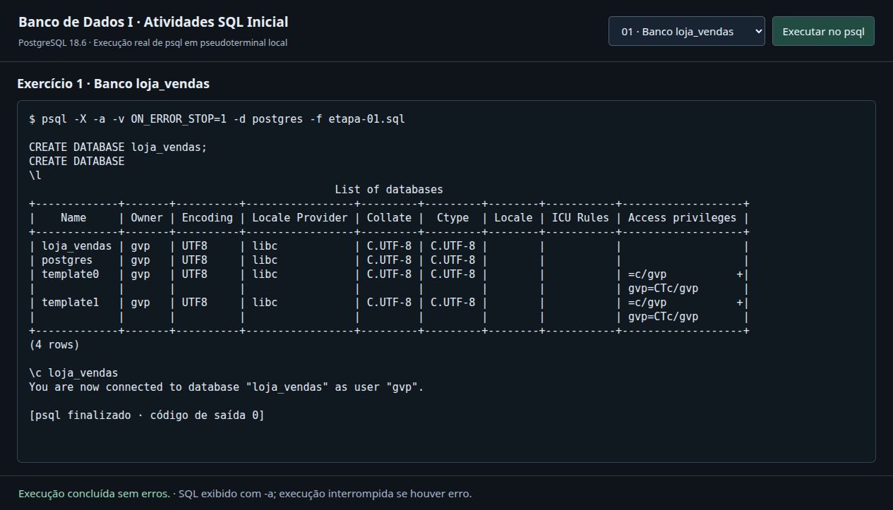
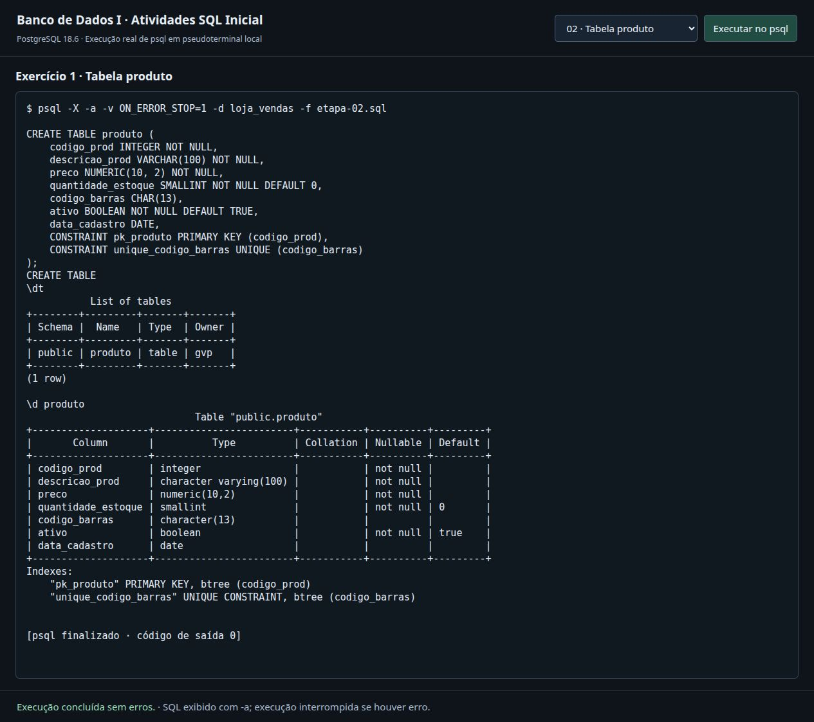
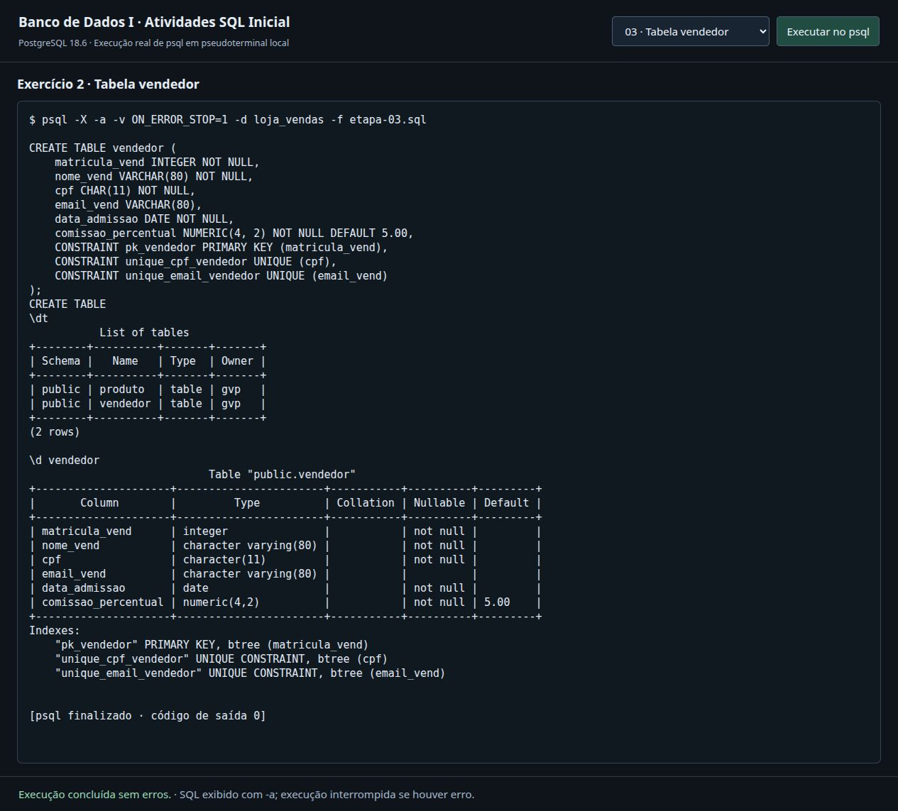
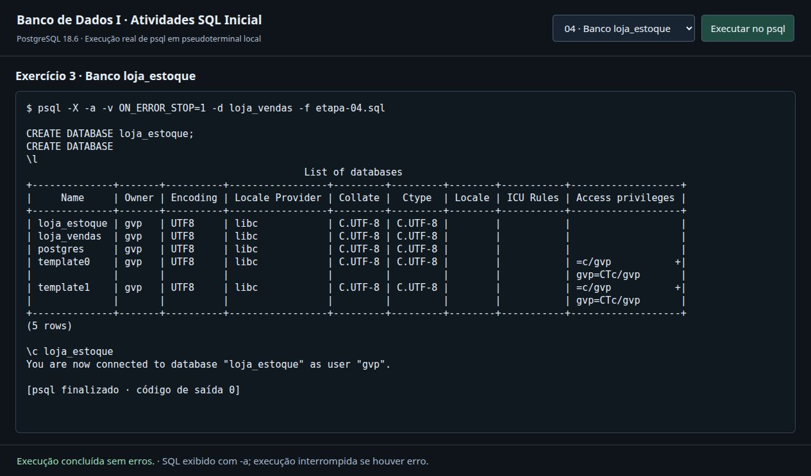
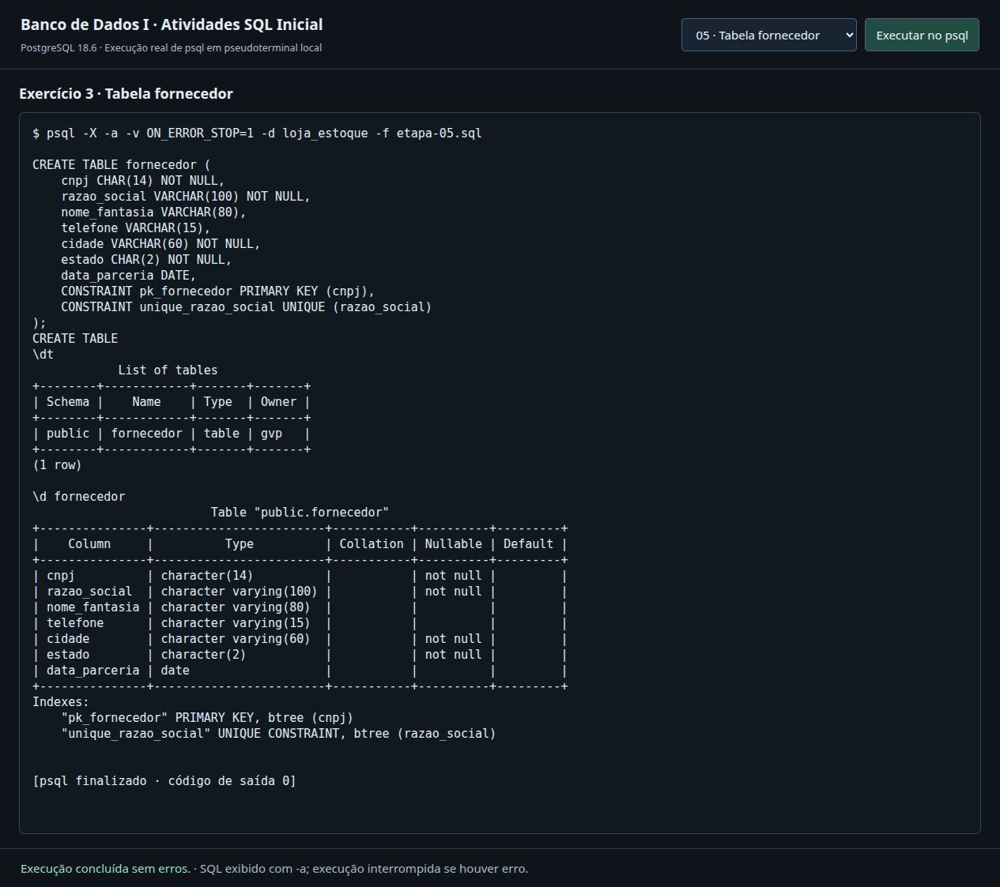
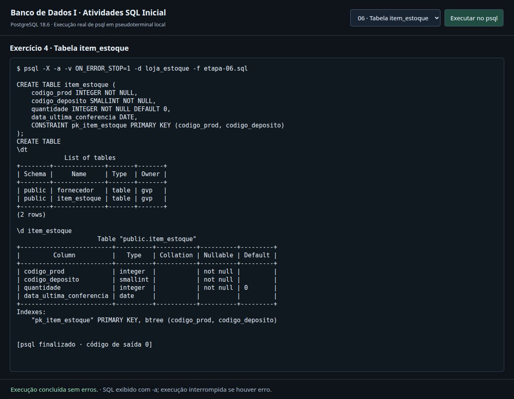

# Atividades SQL Inicial

**Disciplina:** Banco de Dados I — Bacharelado em Ciência da Computação, IFC Campus Concórdia.

**Professor:** Danimar Veriato.

**Enunciado:** [Atividades — SQL — Inicial](https://danimarveriato.notion.site/Atividades-SQL-Inicial-3f0f8b8ac564805fb070fc7638eb3ffc).

## Resolução

| Exercício | Banco | Objeto criado |
| --- | --- | --- |
| 1 | `loja_vendas` | Banco e tabela `produto` |
| 2 | `loja_vendas` | Tabela `vendedor` |
| 3 | `loja_estoque` | Banco e tabela `fornecedor` |
| 4 | `loja_estoque` | Tabela `item_estoque`, com chave primária composta |

O [arquivo atividade.sql](./atividade.sql) contém todos os comandos e as verificações exigidas: `\l`, `\c`, `\dt` e `\d`. Foram preservados os nomes dos bancos, tabelas, colunas e restrições do enunciado.

## Como executar

Com PostgreSQL instalado e em execução, abra um terminal nesta pasta:

```bash
psql -X -v ON_ERROR_STOP=1 -U postgres -d postgres -f atividade.sql
```

Substitua `postgres` após `-U` pelo seu usuário do PostgreSQL, se necessário. O usuário deve ter permissão para criar bancos. Para outra porta ou servidor, acrescente `-p PORTA` ou `-h SERVIDOR`.

Execute em uma instância em que os bancos `loja_vendas` e `loja_estoque` ainda não existam. O script não apaga bancos ou tabelas e interrompe a execução ao primeiro erro. Os comandos que começam com `\` são meta-comandos do **psql**; execute pelo terminal psql, não em um editor que aceite apenas SQL.

As [etapas separadas](./etapas/) são os arquivos utilizados nas capturas. Execute-as na ordem numérica, usando `-d postgres` na etapa 01, `-d loja_vendas` nas etapas 02 a 04 e `-d loja_estoque` nas etapas 05 e 06. Como cada comando inicia uma nova sessão, o argumento `-d` seleciona o banco de cada etapa.

## Tipos utilizados

- `INTEGER`: inteiro.
- `SMALLINT`: inteiro de 2 bytes.
- `VARCHAR(n)`: texto de até `n` caracteres.
- `CHAR(n)`: texto de comprimento fixo `n`, com preenchimento por espaços conforme o comportamento do PostgreSQL.
- `NUMERIC(p, s)`: decimal com precisão total `p` e `s` casas decimais.
- `BOOLEAN` e `DATE`: valores lógicos e datas.

`NOT NULL` define os campos obrigatórios; `DEFAULT` define os valores padrão. As chaves foram declaradas com `CONSTRAINT`, incluindo `pk_item_estoque (codigo_prod, codigo_deposito)`.

## Evidências de execução

Execução em **PostgreSQL 18.6**, em uma instância local separada. Os prints foram capturados de um terminal web xterm.js que exibe a saída real do processo `psql` executado em pseudoterminal. As imagens não foram montadas a partir de resultados inventados. Os [logs em texto](./logs/) permitem conferir a mesma saída sem depender das imagens.

### Exercício 1 — banco loja_vendas



### Exercício 1 — produto



### Exercício 2 — vendedor



### Exercício 3 — banco loja_estoque



### Exercício 3 — fornecedor



### Exercício 4 — item_estoque



## Conferência

Todas as seis etapas executaram com código de saída zero. O arquivo completo também foi executado em uma segunda instância vazia: [log da execução completa](./logs/07-execucao-completa.txt).

A conferência do catálogo do PostgreSQL confirmou os tipos, nulabilidade e valores padrão das 24 colunas, além dos nomes e definições das oito chaves primárias/únicas, nas duas instâncias. O [registro da conferência](./logs/verificacao-schema.json) contém os resultados.
