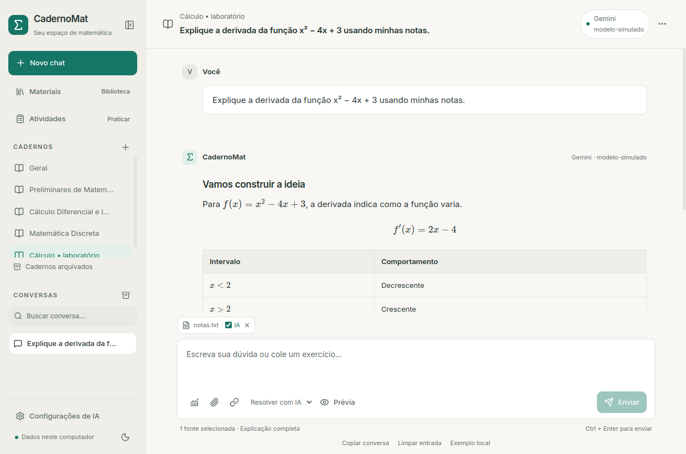

# CadernoMat

## ⏸️ Desenvolvimento pausado

Este projeto está pausado por tempo indeterminado. Pretendo voltar a mexer nele no futuro, mas ainda não há uma data definida para retomar o desenvolvimento.

O código e a documentação ficam guardados para consulta e continuidade. Uma cópia também está organizada em [`MATEMATICA GERAL/caderno-mat` no repositório projetos-IFC](https://github.com/JoaoGVP001/projetos-IFC/tree/main/MATEMATICA%20GERAL/caderno-mat).

As instruções e os recursos descritos abaixo registram o estado do projeto no momento da pausa.

Um espaço desktop para estudar matemática: chats, cadernos por matéria e uma
biblioteca de materiais e atividades com tentativas persistentes. Consulte
materiais com Ollama, Gemini ou OpenAI. Foco
inicial em Preliminares, Cálculo Diferencial e Integral I e Matemática Discreta.

A interface usa **React + TypeScript + Tailwind**, executada localmente pelo
**pywebview**. Python continua responsável por SQLite, matemática, extração,
OCR e recuperação textual/híbrida local. Markdown e fórmulas são apresentados com KaTeX.



## Cálculos e gráficos locais (L3)

No chat, abra **Cálculos e gráficos**, use **Exemplo da parábola** e clique em
**Calcular e salvar no chat**. Derivada, tangente, extremos de polinômios e
integrais próprias funcionam offline; o PNG fica salvo e pode ser exportado.
A IA pode propor parâmetros revisáveis e explicar os resultados, com prévia do
envio e sem alterar as verificações. [Uso, limites e testes](docs/MATEMATICA_LOCAL.md).

## Matemática Discreta (L3)

No chat, clique em **Matemática Discreta** (Σ), carregue um exemplo, **Conferir
dados interpretados** e **Calcular e salvar Discreta**. Conjuntos finitos,
propriedades de relações com contraexemplos e tabelas-verdade são calculados
localmente. Diagramas pequenos podem ser exportados em PNG. A IA propõe dados
revisáveis e explica resultados; atividades conservam versão/questão/tentativa,
com comparação separada de notas. [Uso, exemplos e limites](docs/DISCRETA.md).

## IA local: respostas completas e diagnóstico

Escolha **Configurações de IA → Ollama → Rápido no notebook** para uma primeira
explicação curta terminada. Estudo/Completo oferecem mais saída; configurações
antigas permanecem preservadas. Interrupções mantêm texto e métricas com aviso
separado. **Repetir curto** e **Próxima parte** exibem prévia e exigem envio explícito.

O botão **Ilustração de indução** produz um diagrama local revisável, reutilizável
nas páginas de estudo e exportações; não certifica a demonstração. O diagnóstico
mostra CPU/GPU/contexto observado e memória, sem inventar dados indisponíveis.
[Padrões, medições, limites e testes](docs/ESTABILIDADE_IA_LOCAL.md).
Para avaliar tarefas com dados fictícios e relatório privado, veja
[Calibração por tarefa](docs/CALIBRACAO_IA_LOCAL.md).

## Páginas de estudo e PDF/PNG (L4)

**Estudo com fontes:** marque materiais e escolha **Consultar materiais** para
respostas limitadas aos trechos. O envio documental mostra uma prévia validada;
na resposta, **Conferir fontes e operações** abre o snapshot, a página original
e ferramentas locais com vínculo à consulta. [Uso, testes e limites](docs/ESTUDO_CONFIAVEL.md).
Neste modo, citações são conferidas literalmente antes da exibição; números e
símbolos inventados ficam retidos. Fórmulas explicitamente ilegíveis na extração
geram aviso local sem chamar o provedor. [Proteções e limites](docs/PROTECAO_ERROS.md).

Abra **Páginas de estudo → Nova página**, edite seções Markdown/LaTeX e insira
resultados locais. **Salvar versão** conserva uma versão independente do
rascunho. Em **Versões, exportação e biblioteca**, gere PDF e um PNG por folha,
escolha o destino e adicione a cópia textual revisada à biblioteca. Mensagens
e questões também podem criar páginas, com origem e proteção de gabaritos.
**Organizar preservando o conteúdo** acrescenta rótulos às seções sem reescrever
fórmulas, texto ou imagens. Funciona localmente, com prévia e versão recuperável
do original; a assistência opcional da IA devolve apenas IDs/rótulos. O modo
**Nova explicação por IA** continua separado e exige revisão do conteúdo novo.
[Uso e limites](docs/PAGINAS_ESTUDO.md) · [Fidelidade e qualidade](docs/FIDELIDADE_QUALIDADE.md).

## Abrir no computador atual

Feche a versão anterior e abra **CadernoMat** pelo atalho da área de trabalho.
O mesmo atalho abre a interface nova. Também funciona:

```bash
./iniciar_desktop.sh
```

O pacote interno continua `tutor_calculo` para preservar os comandos. Os arquivos
da interface já estão compilados em `tutor_calculo/web`: **não é necessário Node,
Vite ou servidor de desenvolvimento para usar o aplicativo**.

## Instalação

Python 3.12+ e um ambiente virtual. No Linux:

```bash
python3 -m venv .venv
.venv/bin/python -m pip install -r requirements.txt
./iniciar_desktop.sh
```

Neste Ubuntu, a janela usa Qt/PySide6 e Qt WebEngine. Esses pacotes estão nas
dependências; a sessão gráfica e as bibliotecas do sistema continuam necessárias.
A instalação atual foi validada com Python 3.14, PySide6 6.12 e pywebview 6.2.
Veja [instalação e arquitetura](docs/INTERFACE.md) para diagnóstico.

No Windows, instale Python 3.12+ e o runtime Microsoft Edge WebView2:

```powershell
python -m venv .venv
.\.venv\Scripts\python.exe -m pip install -r requirements.txt
powershell -ExecutionPolicy Bypass -File .\iniciar_desktop.ps1
```

A execução em Windows ainda precisa de validação nessa plataforma. O menu de
terminal permanece: `python -m tutor_calculo.app` no ambiente preparado.

Durante a transição, a interface anterior pode ser aberta separadamente:

```bash
.venv/bin/python -m pip install -r requirements-legado.txt
./iniciar_desktop.sh --legado
```

Esse modo requer Tkinter. A interface nova não importa Tkinter ou Matplotlib.

## Usar os chats e cadernos

- Escolha **Geral** ou um caderno na lateral e clique em **Novo chat**.
  Visitar uma matéria vazia não cria conversas.
- Escreva sua dúvida e envie pelo botão ou **Ctrl + Enter**. Os modos são
  Resolver, Resolver com IA, Explicar e Corrigir.
- O menu **⋯** aparece ao passar o mouse e ao focar com teclado. Permite
  renomear, fixar, mover, arquivar, restaurar e excluir com confirmação.
  Títulos longos são abreviados; o tooltip mostra o título inteiro.
- **+** em Cadernos cria uma matéria. O menu do caderno permite editar,
  reordenar e configurar objetivo, nível, assuntos e preferência pedagógica.
  Excluir um caderno conserva chats, materiais e tentativas; chats e atividades
  passam para Geral.
- Use o botão de tema e recolha a lateral quando quiser mais espaço de leitura.
  Tema, última conversa e rascunhos ficam salvos neste computador.

Mensagens distinguem aluno e assistente; aceitam listas, títulos, tabelas,
citações, blocos de código e matemática com `$`, `$$`, `\(...\)` e `\[...\]`.
Fórmulas largas e tabelas podem rolar horizontalmente. Fórmulas inválidas têm
alternativa textual. **Copiar** preserva o Markdown/LaTeX original.

Os três cadernos iniciais são criados apenas na migração original. A migração atual para SQLite **v11** cria backup v10 e preserva IDs, mensagens, rascunhos, arquivos, índices e seleções existentes. Veja [Cadernos](docs/CADERNOS.md) e [IA local](docs/OLLAMA.md) e [busca híbrida](docs/BUSCA_SEMANTICA.md).

## Praticar com atividades

Abra **Atividades** no caderno escolhido. **Criar atividade** permite listas
manuais offline com respostas abertas, múltipla escolha, verdadeiro/falso e
números com tolerância absoluta. Responda, feche/reabra e continue na questão
salva; finalize para conferir a correção objetiva. Dicas e solução revelada
ficam registradas. Histórico permite retomar, iniciar outra tentativa e comparar.
Editar a lista cria outra versão e preserva todas as tentativas antigas.

**Gerar com IA**, dicas e feedback são opcionais: selecione as fontes, confira
provedor/modelo e os dados da prévia e confirme a consulta. A geração entrega
uma proposta para revisar/salvar; falhas não criam atividades nem notas zero.
Respostas abertas exigem revisão manual ou feedback pedagógico, sem nota da IA.
Há atalhos nos menus dos chats/materiais e ajuda em uma nova conversa isolada.
Veja [formatos, limites e versionamento](docs/ATIVIDADES.md).

## IA e cálculo local

Em **Configurações de IA**, escolha **IA local · Ollama**, Gemini ou OpenAI.
Ollama usa pesos instalados neste computador, sem chave e sem fallback online.
Permite configurar por conversa, testar conexão/modelos, escolher perfil 2K/4K
e tempo limite. Veja [configuração, estados e limites](docs/OLLAMA.md).
Nos provedores online, informe o modelo e sua
própria chave no campo protegido. Cada provedor mantém configurações separadas;
chave vazia reutiliza a anterior. Salvar não testa acesso nem faz consultas.
A chave permanece no `.env` local, ignorado pelo Git; ela não é devolvida ao
React, armazenada no navegador ou incluída na interface compilada.

A disponibilidade, cotas e cobrança dependem do projeto e modelo configurados.
Consulte [Google AI Studio](https://aistudio.google.com/api-keys),
[condições do Gemini](https://ai.google.dev/gemini-api/docs/pricing) e
[plataforma OpenAI](https://platform.openai.com/api-keys).
Não há troca automática entre provedores depois de falhas.

**Prévia do envio** mostra provedor, modelo e três partes separadas:
configurações do caderno, histórico recente da conversa atual e trechos dos
materiais explicitamente selecionados. Até dez pares completos recentes são
usados, limitados a 16 mil caracteres no fluxo online. O fluxo local tem orçamento
de entrada/saída explícito e pode omitir histórico/abreviar trechos, com indicação
na prévia. Erros e respostas parciais ficam fora do contexto.

**Resolver** analisa localmente continuidade de funções por partes no formato
suportado; outros enunciados usam o provedor escolhido nesta conversa, inclusive
Ollama. **Exemplo local** preenche:

```text
f(x) = {
sen(x)/x, se x diferente de 0
0, se x = 0
}
em x = 0
```

Os limites laterais são 1, mas `f(0)=0`, então a função não é contínua em 0.
O analisador aceita operações aritméticas e sen, cos, tan, exp, log e sqrt;
as condições devem comparar x com o ponto indicado. Para dúvidas abertas,
use Resolver com IA, Explicar ou Corrigir.

Consultas e processamento documental acontecem em segundo plano. Falhas
preservam a pergunta e o histórico. Ollama tem streaming, cancelamento e repetição
sem duplicar a pergunta. Respostas interrompidas são identificadas e recuperadas
após reiniciar. Gemini/OpenAI mantêm o fluxo sem streaming/cancelamento.
Alterações de organização ficam bloqueadas durante a consulta.

## Materiais e memória documental

A biblioteca oferece busca por palavra/significado com embeddings locais, indexação
incremental e retomada. Veja [ativar e usar](docs/BUSCA_SEMANTICA.md). A seleção
de fontes para chats/atividades continua explícita.

Anexe pelo clipe ou adicione um link. **Materiais** reúne os arquivos e links,
com busca por nome, conteúdo, assunto e etiquetas, filtros e paginação de 30
itens. É possível visualizar texto/original, editar, associar a vários cadernos,
reutilizar, desvincular, reprocessar e excluir com atualização do índice.

Formatos interpretados: PDF textual; PDF digitalizado/imagens com OCR opcional;
TXT, MD, CSV, JSON, LOG, TEX; DOCX e PPTX (texto, tabelas e fórmulas OMML básicas); links públicos HTML/texto/PDF. Outros formatos
podem ser guardados, mas são identificados como não interpretados. Limite de
20 MiB por arquivo, 500 páginas de PDF/slides e 10 páginas de OCR. OCR exige Tesseract;
a disponibilidade de idioma é informada pela extração.

Importar ou pertencer a um caderno **não seleciona fontes para a IA**. Marque
**Consultar neste chat**, confira a prévia e pergunte em um modo de IA. A busca
recupera trechos por palavras e, quando ativada, por significado; os originais binários ficam no computador.
Citações indicam referência e página ou slide quando disponível. Office continua
com texto parcial: figuras/diagramas/objetos embutidos não são interpretados,
e equações OMML desconhecidas são sinalizadas para conferir no original. Desmarcar um material
não apaga informações de respostas antigas do histórico.

Arquivos iguais usam uma cópia local, deduplicada por SHA-256. Dados ficam fora
do Git, no diretório CadernoMat do usuário:

- Linux: `~/.local/share/CadernoMat/` ou `$XDG_DATA_HOME/CadernoMat/`.
- Windows: `%LOCALAPPDATA%/CadernoMat/`.
- macOS: `~/Library/Application Support/CadernoMat/`.

Inclui banco, originais, índices, preferências visuais e cache da WebView.
Chats e materiais salvos podem ser acessados offline. Consultas online e
importação de links exigem conexão. Veja [Materiais](docs/MATERIAIS.md).

## Piloto experimental de IA local

No notebook Linux preparado, o atalho **IA Local - Testes** ou
`./iniciar_ia_local.sh` abre um chat de terminal com Ollama e Qwen3.5-4B.
Inferência offline, métricas, limitações e reprodução estão em
[Piloto local](docs/PILOTO_LOCAL.md). Modelos e dados ficam fora do Git.
A integração gráfica agora está disponível pelo atalho CadernoMat; o terminal
permanece um experimento separado. Consulte [Ollama integrado](docs/OLLAMA.md).

## Desenvolver, compilar e testar

Para alterar a interface, use Node 24 e pnpm 11:

```bash
cd frontend
pnpm install --frozen-lockfile
pnpm test
pnpm build
cd ..
./iniciar_desktop.sh --debug
```

`pnpm build` verifica TypeScript e substitui os assets de `tutor_calculo/web`.
O preview `pnpm dev` serve para desenvolvimento visual; a ponte Python só está
disponível dentro do pywebview. Recompile e reinicie a janela para testar o fluxo
integrado. Não abra duas instâncias no mesmo banco ao mesmo tempo.

Testes de Python e fluxo real de desktop:

```bash
.venv/bin/python -m unittest discover -s tests -v
cd frontend
pnpm e2e
pnpm e2e:atividades
pnpm e2e:local
pnpm e2e:semantica
pnpm e2e:matematica
pnpm e2e:discreta
pnpm e2e:paginas
pnpm e2e:estabilidade
```

A suíte atual tem **232 testes Python aprovados** (10 opcionais Tk ignorados).
A interface da entrega de estabilidade teve **35 testes**, build e oito fluxos
na janela Qt, incluindo reinício, dois temas, tamanho mínimo e teclado. A calibração
adicionou aceite Qt de recusa de notação alterada, preservação e proposta válida.
Exportação real: catorze folhas inspecionadas, incluindo gráficos e tabela de
64 linhas. Ollama real foi validado com rede externa bloqueada; Gemini/OpenAI
usaram simulações. Testes não consumiram créditos.
Os testes da interface anterior são opcionais sem Tkinter/display.

[Arquitetura e contrato](docs/INTERFACE.md) · [Sistema de design](docs/DESIGN.md) ·
[Continuidade](GUIA_CONTINUIDADE.md) · [Planejamento](PLANEJAMENTO.md) ·
[Resumo completo para o PC de casa](docs/TRANSFERENCIA_PC_CASA.md) ·
[Plano de IA local, gráficos e páginas de caderno](docs/IA_LOCAL.md) ·
[Piloto local executado](docs/PILOTO_LOCAL.md).

Atividades, tentativas, Ollama, busca híbrida local, gráficos e verificações
limitadas de Cálculo/Discreta estão disponíveis. Páginas de estudo/PDF/PNG também estão disponíveis. Provas cronometradas, visão
e verificações fora desse escopo permanecem planejadas. A trilha
local foi detalhada para um PC Windows com 16 GB RAM e RTX 3060 de 8/12 GB VRAM;
um piloto independente foi depois executado no notebook Linux. O computador
de casa ainda precisa ser testado.
