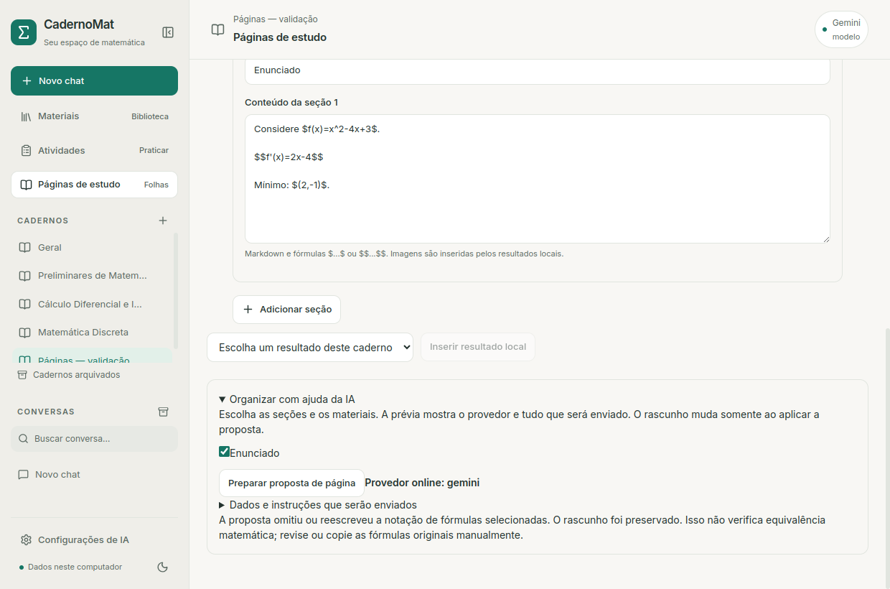

# Calibração da IA local por tarefa

Atualização documental: o avaliador registra o contrato de citações literais,
sem tratar isso como validação de relevância/OCR/provas. Casos bloqueados
localmente conservam `consulta_modelo: false` e não têm tempo/tokens de geração.
Novas amostras e limites em [Contenção de erros](PROTECAO_ERROS.md).

O catálogo de referência agora possui trinta casos adicionais (10 Cálculo,
10 Discreta, 10 documentais), com rubricas independentes e prefixos `ref_*`.
Cinco consultas novas e a falha de OCR no modo Explicar, comparada ao modo
Consultar materiais, estão registradas em [Estudo confiável](ESTUDO_CONFIAVEL.md).

Atualização posterior: o avaliador inclui `rotulos`, `sem_tentativa` e
`ocr_duvidoso`. A página fiel é montada localmente a partir dos IDs, sem
redigitação matemática pelo modelo. Resultados das nove consultas novas e
falhas restantes estão em [Fidelidade e qualidade](FIDELIDADE_QUALIDADE.md).

Continuidade da estabilidade em 12/10/2026, usando a fachada `ia.py` e o orçamento
real do aplicativo. O avaliador é uma ferramenta de desenvolvimento/diagnóstico;
não usa o acervo pessoal nem altera a configuração do CadernoMat.

## Executar com pesos já instalados

Com Ollama disponível em loopback:

```bash
.venv/bin/python -m tutor_calculo.avaliacao_local \
  --casos inducao calculo relacao --limite-s 600
```

No notebook preparado, para criar uma instância de teste com rede externa
bloqueada sem mudar a rede dos outros programas:

```bash
scripts/testar_integracao_offline_linux.sh --calibracao \
  --casos inducao calculo relacao fontes atividade --limite-s 720
```

O script encerra somente o runtime que ele iniciou no namespace de teste.
Downloads, configuração de driver e trocas no aplicativo não fazem parte do
avaliador. O script Linux não é um launcher Windows; o módulo Python pode ser
executado com o ambiente nativo e Ollama local, ainda sujeito ao aceite Windows.

## Catálogo e limites

| Caso | O que conferir |
| --- | --- |
| `saudacao` | Resposta curta sem iniciar uma aula desnecessária |
| `inducao` | Domínio, base, k arbitrário, hipótese, passo e conclusão |
| `hipotese` | Detectar que exemplos finitos não substituem o passo indutivo |
| `calculo` | Buraco no domínio versus limite, após simplificação |
| `relacao` | Contraexemplo de transitividade em relação finita |
| `fontes` | Informação presente, informação ausente e figura não extraída |
| `atividade` | JSON real de atividade e gabarito pontual de 2+2 |
| `pagina` | Prompt/esquema/validador reais de proposta, com notação da origem protegida |

`--modelos` aceita um ou dois modelos locais **já instalados**; `--perfis` aceita
Rápido/Estudo/Completo; `--contexto` permanece 2048 ou 4096. Completo exige 4096.
`--repeticoes` aceita 1–3. A combinação inteira tem máximo de **12 consultas**,
com orçamento de **30–1800 segundos** na rodada e timeout finito por chamada.
O timeout é reduzido quando falta tempo; abaixo de 30 segundos não começa outra
consulta. O orçamento global cancela a chamada em andamento e preserva o parcial.
Preparação inicial do runtime/diagnóstico fica fora desse orçamento de consultas.

Por exemplo, repetir o mesmo caso com dois perfis:

```bash
scripts/testar_integracao_offline_linux.sh --calibracao \
  --casos inducao --perfis rapido estudo --repeticoes 2 --limite-s 900
```

Isso solicita quatro respostas; não executar apenas para produzir estatísticas
quando não houver uma hipótese de comparação. Alterar simultaneamente modelo,
prompt, perfil e dispositivo não isola o efeito de nenhum desses fatores.

## Relatório privado e interpretação

O destino padrão é `CadernoMat/ia-local/relatorios/calibracao-<data>.json`, na
pasta de dados do usuário. `--saida` pode escolher outro destino fora de Git;
arquivos existentes e symlinks de destino são recusados. A gravação usa arquivo
temporário e substituição atômica, com permissão restrita no Linux. Um checkpoint
é salvo após cada consulta, inclusive erro/cancelamento por Ctrl+C.

O relatório conserva os pedidos fictícios, snapshot efetivo, fonte fictícia,
orçamento, texto/parcial, erro, métricas, rubrica e dispositivo antes da consulta.
O resumo agrupa somente o mesmo modelo/perfil/caso; a mediana de duração/velocidade
usa respostas concluídas e informa o número de amostras e falhas. Não calcula
p95, ETA ou ganho percentual com esse conjunto pequeno. Falhas não desaparecem
por serem excluídas da mediana de concluídas.

Estado de carga antes é uma observação da API, não garantia de cache quente.
Tempo de carga, tokens, duração e dispositivo durante a geração permanecem nas
métricas. O fluxo usa os parâmetros reais do aplicativo; amostragem do modelo
continua podendo variar a redação. Reprodução do protocolo não significa saída
idêntica nem experimento de velocidade completamente controlado.

**Contrato e matemática são avaliações distintas.** Para atividade, o validador
local confere estrutura e referências; checagens pontuais verificam uma questão,
quatro alternativas, pedido 2+2 e alternativa correta com valor numérico 4.
Uma estrutura válida com gabarito 3 continua sendo falha. Para páginas, validar
JSON não aprova as fórmulas ou a demonstração contida no texto. O caso de página
usa o mesmo prompt e esquema do serviço L4; presença literal das fórmulas de
origem é parte do contrato. Uma falha conserva o motivo em `erro_contrato`.

Narrativas ficam com `revisao_matematica: pendente`, sem aprovação por encontrar
palavras como “hipótese” ou “conclusão”. A revisão humana deve considerar a
rubrica e o argumento inteiro. Avisos sobre Mermaid/imagens são indicadores
de capacidade para revisar, não provas de alucinação ou incorreção matemática.

Código de saída: 130 para Ctrl+C; 1 para erro, limite total, contrato inválido
ou checagem pontual falsa; 0 significa rodada executada sem essas falhas, não
certificação matemática. Fontes presentes não autorizam outros documentos: o
avaliador envia apenas seu regulamento fictício, sem ler PDFs do usuário.

## Testes

```bash
.venv/bin/python -m unittest discover -s tests -p test_avaliacao_local.py -v
```

Cobertura: limites/modelos locais, recusa de URLs remotas/modelos ausentes,
destino privado/atomicidade, gabarito errado com JSON válido, preservação de
parciais/métricas, Ctrl+C, orçamento global e uso dos contratos/snapshots reais.

## Resultado real — 12/10/2026

Doze respostas em três rodadas, Qwen3.5 4B Q4_K_M, Ollama 0.40.3, perfil Rápido,
contexto 4096, thinking desativado, **CPU**, rede externa bloqueada. Todas as
gerações encerraram por `stop`; houve falhas de qualidade apesar desse estado.

| Caso | Observação medida |
| --- | --- |
| Indução | 87,27 s / 474 tokens; base, hipótese/passo e conclusão corretos; 191 palavras, acima da meta suave 180 |
| Domínio versus limite | 60,15 s inicialmente; confirmação 81,17 s, preserva o buraco, mas título “Extensão (Domínio)” ainda impreciso |
| Relação finita | 38,81 s / 192 tokens; contraexemplo (1,2),(2,3), ausência de (1,3) correto |
| Fonte parcial fictícia | 35,66 s; sete questões/23 minutos, página 7; sem inventar professor/figura |
| Atividade | 56,98 s inicial; 57,94 s confirmação; JSON válido, gabarito 4 e metadados sem aspas extras depois da orientação |
| Prova incompleta | 83,02 s; reconhece que testar três casos não prova a afirmação; termina o passo e a conclusão, com redação revisável |
| Página, contrato simplificado inicial | 31,88 s; JSON válido, identidade alterada e condição n!=−2 inventada: **reprovada na revisão matemática** |
| Página, contrato real com proteção | 76,28 s; modelo não conservou a notação selecionada e duplicou escapes LaTeX; **validador recusou** |
| Saudação, tarefa antiga | 38,72 s / 192 tokens; iniciou aula não solicitada: **falha** |
| Saudação, instruções específicas | 6,54 s / 22 tokens, 16 palavras; cumprimenta e pergunta assunto: caso atendido |

O primeiro caso de página usava contrato simplificado de documento. Após sua
falha, foi substituído pelo prompt/esquema real de proposta L4. Essas duas
medições de página não são comparação de velocidade da mesma tarefa. A saudação
tem o mesmo pedido, mas instruções/quantidade de saída e carga/cache diferiram:
o ganho observado é menos conteúdo desnecessário, não motor de inferência mais
rápido. Não há comparação de modelos, p95 ou certificação matemática geral.

### Correções aplicadas e limites

Saudações exatas têm uma tarefa própria; “Olá, explique indução” continua uma
pergunta de conteúdo. Orientações de Cálculo preservam domínio/valor/limite;
metadados de atividades usam texto simples. O modelo ainda pode usar termos
imprecisos; as respostas não recebem selo de prova correta.

Novas prévias de página capturam fórmulas marcadas em `$`, `$$`, `\(...\)` ou
`\[...\]` nas seções escolhidas. A proposta precisa conservar sua presença no
texto, ignorando espaços e trechos de código. O validador não confere equivalência
simbólica: reescrever `x^2` como `x*x` também é recusado nesse contrato de cópia.
Máximo de 128 fórmulas distintas/20 mil caracteres de notação. Texto matemático
sem delimitadores e novas fórmulas/prosa não recebem essa garantia de presença.
Preservar uma fórmula incorreta da origem não a torna correta.

A recusa não altera rascunho, versões ou resultados locais. Origem da proposta
continua IA; prévias antigas sem o campo são compatíveis. Não houve DDL: SQLite
v11. O modelo 4B ainda não passou o aceite de fidelidade de página nesta rodada;
revisão/manual e ferramentas locais continuam necessárias. Não houve fallback,
download ou correção administrativa. GPU segue indisponível no kernel ativo.

Validação: **232 testes Python aprovados**, dez opcionais ignorados, e janela
Qt real com erro de fórmula visível, ausência de Aplicar, rascunho/versão
preservados, depois proposta válida, PDF/PNG, autosave/reinício e temas. Nenhum
componente/asset React foi alterado; não se repetiu toda a matriz de oito fluxos.
Relatórios reais e auditorias são privados, fora de Git. Veja também
[páginas de estudo](PAGINAS_ESTUDO.md).

Auditoria final: dez arquivos essenciais/configurações iguais por hash,
incluindo banco, originais e `.env`; integridade/FKs aprovadas, SQLite v11.


