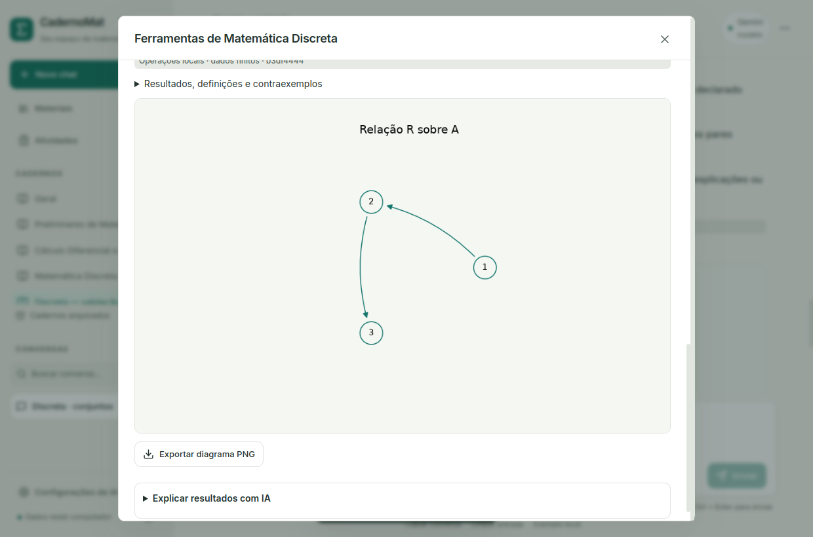
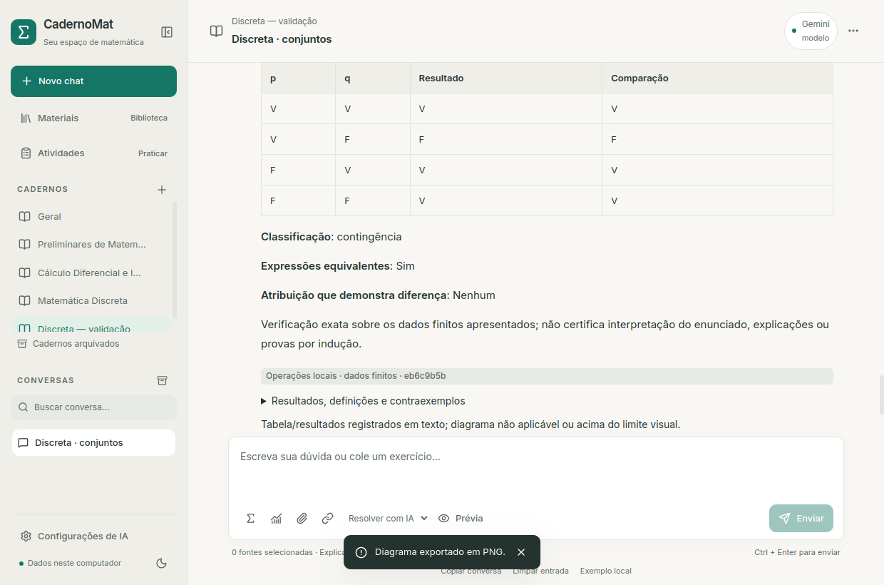

# Matemática Discreta — complemento L3

No chat, clique em **Matemática Discreta** (ícone Σ ao lado das ferramentas de
Cálculo). Escolha a ferramenta, informe os dados ou use **Carregar exemplo de
Discreta**, depois **Conferir dados interpretados**. Somente então aparece
**Calcular e salvar Discreta**. Editar a entrada invalida essa conferência.
O cálculo manual funciona sem IA, chave, GPU ou internet.

O resultado exato fica na conversa com os dados interpretados, escopo e versão
da ferramenta. Conjuntos e relações pequenos recebem diagrama local; **Exportar
diagrama PNG** abre o seletor nativo. Resultados e imagens permanecem ao reiniciar.




## Entrada e operações

Use `{1,2,3}`, `{1,2,"a"}` ou `{}`/`∅`. Nomes textuais simples também podem
aparecer sem aspas. São identificadores começando por letra, seguidos de letras,
números ou `_`, até 20 caracteres. Inteiros e textos têm identidades distintas;
duplicatas são removidas. A ordem de apresentação é estável: inteiros e depois
textos. Decimais, intervalos, conjuntos infinitos, listas Python, conjuntos
aninhados e expressões simbólicas não são interpretados como conjuntos finitos.

- **Conjuntos:** união, interseção, A−B, B−A, diferença simétrica, A×B,
  cardinalidades, igualdade e inclusão. Complementos exigem U explícito e
  A∪B⊆U. Sem U, as demais operações funcionam e o complemento recebe aviso.
  Exemplo: A={1,2,3}, B={2,3,4}, U={1,2,3,4,5}. União={1,2,3,4},
  interseção={2,3}, U−A={4,5}, |A|=3.
- **Relações:** R={(1,2),(2,3)}, com origem A e destino B declarados;
  domínio, imagem e inversa. No modo **Relação sobre A**, origem e destino são
  A. Reflexividade, irreflexividade, simetria, antissimetria e transitividade
  consideram todo A, incluindo elementos ausentes nos pares. Cada propriedade
  recebe definição, resultado, justificativa e testemunha de falha quando há.
  Para A={1,2,3} e o R acima, transitividade falha: (1,2) e (2,3) existem,
  (1,3) está ausente. Sobre A vazio, as cinco propriedades valem por vacuidade.
  No modo entre conjuntos, essas propriedades não são aplicadas automaticamente.
- **Composição:** S⊆B×C e R⊆A×B produzem **S∘R**, primeiro R e depois S.
  Sobre A, S também é sobre A. Pares fora dos produtos declarados são recusados.
- **Lógica:** variáveis de uma letra ASCII, negação `¬`, `~` ou `!`, conjunção
  `∧` ou `&`, disjunção `∨` ou `|`, implicação `→` ou `->`, bicondicional
  `↔` ou `<->`, e parênteses. Precedência: ¬ > ∧ > ∨ > → > ↔.
  Implicação associa à direita; os demais operadores binários à esquerda.
  `p -> q -> r` significa `p -> (q -> r)`. A prévia mostra a expressão
  normalizada com parênteses. A tabela ordena variáveis alfabeticamente e
  combinações começando por V. Classifica tautologia/contradição/contingência;
  comparar outra expressão verifica equivalência e fornece uma atribuição
  divergente. Exemplo: `p -> q` e `~p | q` são equivalentes.

Os diagramas mostram as regiões de A/B ou os pares de R, incluindo laços e dois
sentidos. Entre conjuntos, identificam origem e destino. S e S∘R ficam em texto;
o diagrama é de R. O desenho não lê figuras dos slides nem representa escala,
área/cardinalidade proporcional ou conjuntos infinitos.

## IA, fontes e atividades

Expanda **Preencher os campos com ajuda da IA**. Um pedido útil é:
`Verifique transitividade de R={(1,2),(2,3)} sobre A={1,2,3}.`
Selecione os materiais em **Materiais para a proposta da IA**. A seleção é salva
no chat; associação ao caderno sozinha não autoriza consulta.

**Preparar proposta da IA** salva a prévia com provedor, pedido, instruções,
orientações do caderno, trechos incluídos, avisos de extração e orçamento local.
**Pedir proposta à IA** usa exclusivamente Ollama/Gemini/OpenAI selecionado.
Não envia arquivos originais ou histórico e não muda para nuvem automaticamente.
Gemini/OpenAI requerem a chave do próprio usuário; o programa não ativa cobrança.

A proposta tem contrato JSON limitado. O programa copia campos rotulados A=,
B=, U=, R=, S=, C=, expressao= e comparar= presentes no pedido ou nos trechos
efetivamente incluídos na prévia. O pedido tem prioridade. Valores ausentes ou
ambíguos ficam em branco; notações inventadas pelo modelo são descartadas.
Formatos explícitos inválidos continuam sendo recusados. Revise tipo, escopo e
campos, confira novamente e calcule por ação explícita. Não há interpretação
universal de exercícios em linguagem natural. A indicação de fonte/página/slide
fica na proposta persistida; o cálculo conserva seu ID de origem e a entrada
efetivamente revisada. Fontes parciais exigem conferir o original.

**Explicar resultados com IA** cria outro registro, usando os resultados
calculados e orientações do caderno. Não altera o cálculo nem atesta a correção
da narrativa. O pedido inclui uma pergunta de prática ao final.

Na prática de uma atividade, **Ferramentas de Discreta** abre o mesmo formulário
e vincula o resultado à atividade, versão, questão e tentativa. Um chat auxiliar
guarda esses registros. Em resultados vinculados a tentativas, pode-se comparar
uma cardinalidade ou propriedade booleana com o gabarito **depois de revelar a
solução ou finalizar**. O estado coincide/divergência/não verificado é separado;
não modifica resposta, nota, snapshot ou gabarito. É preciso escolher o campo e
confirmar que os dados correspondem ao enunciado. Questões discursivas, indução
e alternativas arbitrárias continuam exigindo revisão.

## Limites e persistência

| Item | Limite |
| --- | --- |
| Conjunto informado | 40 entradas antes da deduplicação; inteiros entre −1.000.000 e 1.000.000 |
| Relação informada | 400 pares antes da deduplicação |
| Campo conjunto/relação | 6.000 caracteres |
| Produto cartesiano | Até 1.600 pares, decorrentes dos limites de A e B |
| Lógica | 300 caracteres, 150 tokens, profundidade 20 |
| Variáveis | Até seis no total das expressões comparadas; 64 linhas |
| Diagrama | A/B somados até 20 elementos, rótulos textuais até 10 caracteres, R até 30 pares |
| Worker | 25 segundos; no Linux também 22 s de CPU e 1,5 GB de espaço de endereçamento |
| Artefato/saída | PNG até 2 MB; saída do worker até 3 MB |
| IA | Pedido até 1.500 caracteres, resposta até 20.000; perfil/timeout do provedor existente |

Acima do limite visual, o texto continua completo e o PNG é omitido com aviso.
Lógica gera tabela textual, sem PNG fictício. Entrada fora do escopo, falha ou
cancelamento não recebe um resultado concluído. Ao reiniciar, tarefas
interrompidas ficam identificadas; não são reexecutadas automaticamente.

SQLite **v10**, com backup v9 e migração transacional, acrescenta referências de
questão/tentativa/proposta e comparação separada em `calculos`. A ferramenta usa
versão `discreta-v1`. Reutiliza o coordenador de tarefas, artefatos com hash,
escrita atômica e ponte permitida de L3. Parser próprio, sem eval/exec ou execução
de código documental. PNGs ficam em `~/.local/share/CadernoMat/calculos/` neste
Linux e `%LOCALAPPDATA%/CadernoMat/calculos/` no Windows, junto do banco e fora do
Git. Configurações, índices e materiais existentes são preservados.

## Validação e continuidade

Testes incluem vazios/vacuidades, duplicatas, tipos, complementos, produto,
relações incompatíveis, testemunhas, inversa/composição, lógica/precedência,
limites, cancelamento, propostas inventadas/incompletas/inválidas, fontes
selecionadas/parciais, proveniência, versões/tentativas e migração/rollback.
Gemini/OpenAI usam simulações. A janela Qt testa o build real, exportação,
reinício, temas e 1000×650; regressões de Cálculo, atividades e chat também são
executadas. Capturas publicadas usam apenas dados fictícios.

```bash
.venv/bin/python -m unittest discover -s tests
cd frontend
pnpm test
pnpm build
pnpm e2e:discreta
```

Aceite com os pesos Ollama já instalados, banco temporário e rede externa
bloqueada no Linux: `scripts/testar_integracao_offline_linux.sh --discreta`.
O relatório fica fora do Git em `~/.local/share/CadernoMat/ia-local/aceite-discreta.json`.
Windows ainda precisa de execução real. Páginas completas e PDF paginado ficam
em L4; leitura de figuras, indução, combinatória geral, algoritmos de grafos e
verificação universal de demonstrações permanecem futuras.

Validação final: **206 testes Python (196 aprovados, dez opcionais do legado
ignorados)**, **27 React**, build e quatro fluxos Qt (Discreta, Cálculo,
atividades e chat). No aceite real Qwen3.5 4B, proposta ~30 s e explicação ~46 s
com rede externa bloqueada; narrativa revisável, sem alterar o resultado. São
observações deste notebook, sem garantia de velocidade ou correção universal.
Migração pessoal v9→v10: hashes das 26 tabelas anteriores iguais, seis materiais
com 678 trechos conservados, arquivos/configurações idênticos, backup e
integridade/FKs conferidos. Nenhuma consulta online consumiu créditos.
