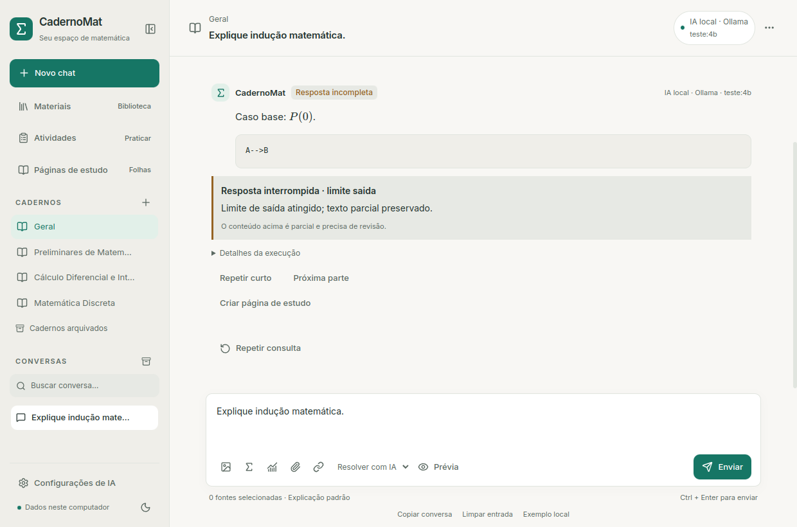
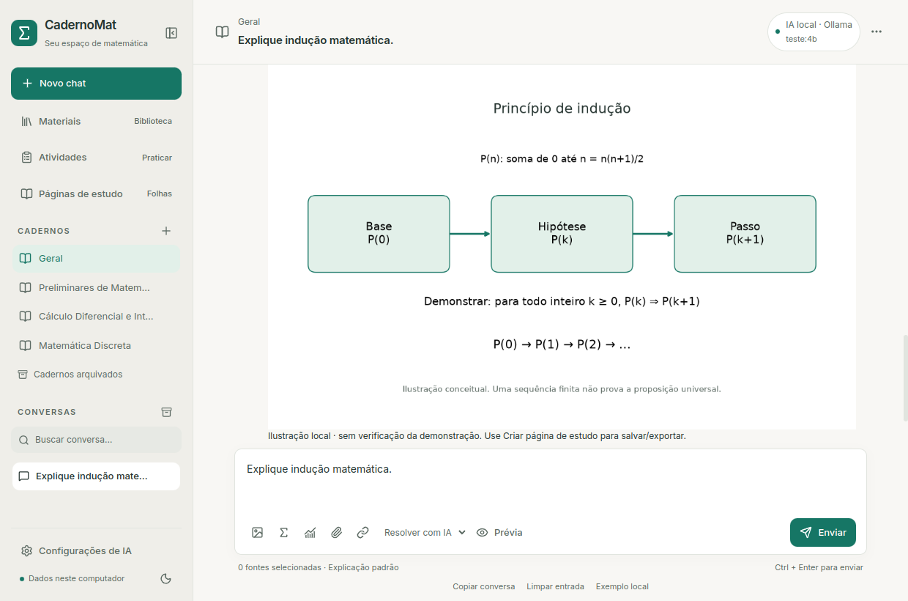

# Estabilidade da IA local

Entrega de 12/10/2026. Mantém SQLite v11 e as páginas de estudo L4.

## Usar os perfis

Em **Configurações de IA → IA local · Ollama → Perfil de resposta**, escolha:

| Perfil | Saída narrativa máxima | Tempo sugerido ao selecionar |
| --- | --- | --- |
| Rápido no notebook | 640 tokens | 180 s |
| Estudo | 1024 tokens | 240 s |
| Completo | 1536 tokens, contexto 4096 obrigatório | 360 s |
| Configuração anterior | 640 em contexto 2048; 1024 em 4096 | 180 s |

Selecionar um perfil preenche o tempo sugerido; o campo ainda pode ser ajustado.
O tempo efetivamente configurado aparece na prévia e nas métricas. Completo
seleciona contexto 4096 visível no formulário e pode demorar bastante em CPU.
Não existe saída ilimitada nem aumento oculto do contexto para acomodar dados.

Configurações antigas continuam reconhecidas como **Configuração anterior**,
sem regravar o arquivo ou mudar modelo/provedor. Novas configurações locais têm
Rápido como padrão. Herança e configuração por chat continuam funcionando.
O texto inicial prioriza um exemplo terminado; a narrativa do modelo ainda
exige revisão. Preferência completa do caderno não exige uma aula longa numa
única resposta. Saudação, dica e feedback têm instruções curtas específicas.

Atividades, páginas e propostas JSON reservam pelo menos 1024 tokens para não
reduzir seu contrato a um tamanho inadequado. Dica tem teto 384 e feedback 512.
A mesma soma de entrada estimada + saída + margem deve caber no contexto;
enunciado excessivo é recusado antes do envio. Trechos omitidos/abreviados
continuam identificados. Estimativa por bytes não é tokenizer exato.

## Interrupções e próxima parte

O aviso fica **fora do Markdown**, mesmo quando o texto termina numa cerca de
código aberta ou equação incompleta. Todo o corpo não fica vermelho. O trecho
parcial permanece e não vira uma resposta correta/concluída por ser renderizado.
Registros antigos usam o parcial/erro da consulta, sem reescrever as mensagens.

**Repetir curto** prepara outra resposta com perfil rápido apenas naquela chamada,
sem mudar sua configuração. **Próxima parte** envia a pergunta original e até
1800 caracteres finais da resposta anterior. Ambas mostram dados, instruções,
fontes, modelo e orçamento antes de **Enviar esta parte**. Não ocorre continuação
ou retry automático, fallback online ou envio de originais/histórico inteiro.

Cada parte tem snapshot e ID próprios, relação à origem e botão **Ver resposta
de origem**. Repetir o mesmo envio é idempotente. Provedor/modelo/configuração,
origem e seleção documental são conferidos novamente antes do envio. Material
removido ou desmarcado impede enviar aquela prévia. O limite do enunciado
original é 5000 caracteres; acima disso, exige selecionar dados numa nova
pergunta. Conteúdo da resposta anterior entra como dado, nunca como instrução
de sistema. Sucesso sem streaming (Gemini/OpenAI) também pode ser continuado.
Respostas incompletas não entram silenciosamente no histórico normal.

## Diagnóstico e métricas

**Testar conexão e listar modelos** informa modelo instalado, carregado agora,
CPU/GPU/memória de modelo e contexto observado. Sem modelo carregado, não presume
o dispositivo da consulta anterior. GPU detectada no computador não confirma
aceleração do runtime.

**Detalhes da execução** mostra tempos, tokens, motivo e amostras de memória.
Mesmo no corte por saída, timeout, cancelamento, conexão interrompida ou dados
inválidos, dados conhecidos são preservados; desconhecidos ficam nulos. Motivo
de runtime é separado de qualquer julgamento matemático. Modelo ausente possui
motivo próprio; só relata falta de memória quando o runtime explicitamente a
informou, não a partir de um HTTP 500 genérico.

Persistem digest, parâmetros, thinking, tempo até primeiro conteúdo, duração
local, tempos de carga/entrada/geração, contagens/cache, frame final/done_reason,
velocidade e dispositivo observado. Dados não incluem chave nem prompt nas
métricas. A resposta/consulta mantém sua persistência habitual fora do Git.

No Linux, amostra `/proc` a cada dois segundos, até 180 amostras: RAM disponível,
swap, RSS do processo, filhos e runtime. São máximos/mínimos **observados**, não
picos exatos; somar RSS pode contar páginas compartilhadas mais de uma vez.
Outras plataformas exibem memória desconhecida, sem inventar zero.
`size_vram` da API informa alocação observada do modelo, não uso total da GPU.

Geração, indexação, cálculo e exportação evitam iniciar outra operação pesada
em paralelo. O editor de páginas continua salvando. Busca de biblioteca pedida
como híbrida durante operação local usa FTS com aviso, preservando filtros e
seleção. A frequência de persistência/streaming existente foi conservada;
a ponte foi medida no fixture: cinco chamadas de estado ficaram entre 7,9 e
8,4 ms (média 8,18 ms). É medição da ponte, não FPS ou custo isolado do KaTeX.
Não se atribuiu a lentidão do modelo ao React.

## Ilustração de indução

No compositor do chat, o botão **Ilustração de indução** abre título, proposição
em texto simples e índice inicial (0–100). **Criar ilustração local** desenha
base, hipótese, passo e sequência com reticências usando Matplotlib em worker
encerrável. É ilustração do princípio, **não verificação da demonstração**.
Uma cadeia finita não prova uma afirmação universal.

Rótulos têm limites de 80/120 caracteres e quebra de linha. Não aceitam tags HTML,
LaTeX ou blocos de código. Rótulos nunca são comandos/arquivos a executar; não
recebem SVG produzido pelo modelo.
Símbolos ausentes na fonte local são recusados. Worker limita entrada a 2000
caracteres, 15 s e PNG a 2 MB, com publicação atômica/hash pelos artefatos L3.
PNG tem 1080 × 672 pixels; falha não publica uma imagem concluída.

**Criar página de estudo** na mensagem aproveita essa imagem congelada. As
versões/legendas preservam a distinção de ilustração não verificada. A exportação
PDF/PNG L4 e inclusão explícita de versão revisada na biblioteca continuam
funcionando. Mermaid genérico, fotos e geração artística seguem fora desta
entrega. O modelo é instruído a indicar recursos reais, sem prometer imagem que
não foi produzida pelo botão.

## Medições reais e limites

Qwen3.5 4B Q4_K_M no i5-13420H / 8 GB RAM, **CPU**, Ollama 0.40.3,
contexto 4096, thinking desativado, rede externa bloqueada:

| Caso | Perfil | Tempo | Saída | Encerramento |
| --- | --- | --- | --- | --- |
| Indução, primeiras instruções | Rápido, carga fria | 82,57 s | 404 tokens | stop |
| Indução, primeiras instruções | Estudo, quente | 95,36 s | 452 tokens | stop |
| Testes numéricos versus prova | Rápido, quente | 46,27 s | 237 tokens | stop |
| Indução com caderno pedindo explicação completa, instruções finais | Rápido, frio | 98,73 s | 488 tokens | stop |

No último caso, a prova contém domínio, caso base, k arbitrário na explicação do
princípio, identidade do passo e conclusão para todo n>=1. O exemplo ainda usa
“algum k” na frase da hipótese, embora o argumento mantenha k arbitrário e a
conclusão universal. Essa precisão de redação permanece revisável; nenhum selo
de demonstração verificada é aplicado. Não houve Mermaid ou promessa falsa de
imagem. Não há garantia universal de correção por validar formato/encerramento.

Referência do problema: 164 s, 1024 tokens e corte. As novas respostas são menores
e completas; a velocidade medida (~5,8 tokens/s) **não aumentou** em relação à
referência (~6,7). Carga do sistema/cache diferem; isso não é comparação controlada
com resposta do mesmo tamanho nem ganho comprovado do motor de inferência.
Não há p95 com quatro amostras, ETA exato ou validação Windows.

A confirmação observou RSS agregado do runtime até ~3,55 GiB, swap até ~1,39 GiB
e RAM disponível mínima ~1,28 GiB. A pressão de memória continua relevante.
Os relatórios ficam em `~/.local/share/CadernoMat/ia-local/relatorios/`:
`estabilidade.json` e `estabilidade-confirmacao.json`.

O kernel 7.0.0-38 não tinha módulo NVIDIA disponível; o pacote de módulos
instalado correspondia a 7.0.0-34, com Secure Boot desativado. Não houve mudança
administrativa nem alegação de GPU recuperada. Diagnóstico/correção de driver
segue separado e requer verificar o estado atual antes de propor uma ação.

Candidato futuro documentado: [qwen3:1.7b no Ollama](https://ollama.com/library/qwen3:1.7b),
aproximadamente 1,4 GB Q4_K_M, licença Apache-2.0;
[model card textual do fornecedor](https://huggingface.co/Qwen/Qwen3-1.7B).
Não foi instalado/trocado automaticamente nem benchmarkado nesta entrega.
Só o 4B existente foi medido; modelo menor pode perder qualidade matemática.
Threads/cache/atenção também não foram alterados sem medição comparativa.

## Validação e arquitetura

Sem nova migração: estados de prévia e relações ficam no snapshot de
`consultas_ia`; métricas no JSON existente. `desempenho.py` contém perfis/medição,
`continuacao.py` cria/revalida partes, adapter Ollama preserva erros com métricas,
`LocalStudy.tsx` apresenta avisos, prévia e ilustração. `inducao_servico.py`
reutiliza tarefas, PNG, hash e versões de cálculos/páginas existentes.

Testes cobrem motivos/métricas em falhas, perfis antigos/JSON, orçamento inválido,
fontes desmarcadas, idempotência e partes encadeadas sem alterar configuração,
ilustração/PNG/página, reinício e dados preservados. Qt real verifica avisos,
prévia, envio explícito, CPU, perfis, exportação, temas e 1000×650. Provedores
pagos são simulados. Validação final: 218 testes Python aprovados (dez opcionais
ignorados), 35 React, build e oito fluxos Qt, incluindo os sete anteriores.
Preservação pessoal conferida por hashes das 33 tabelas e nove arquivos/
configurações; integridade/FKs aprovadas. Não houve nova migração. PNG e a folha do PDF de ilustração foram inspecionados.

```bash
.venv/bin/python -m unittest discover -s tests
cd frontend
pnpm test
pnpm build
pnpm e2e:estabilidade
```

Piloto real com namespace sem rede externa:
`scripts/testar_integracao_offline_linux.sh --estabilidade`;
confirmação com caderno fictício:
`scripts/testar_integracao_offline_linux.sh --estabilidade --confirmacao`.

[API chat](https://docs.ollama.com/api/chat),
[modelo carregado](https://docs.ollama.com/api/ps),
[parâmetros](https://docs.ollama.com/modelfile),
[memória e keep_alive](https://docs.ollama.com/faq),
[hardware](https://docs.ollama.com/gpu).



