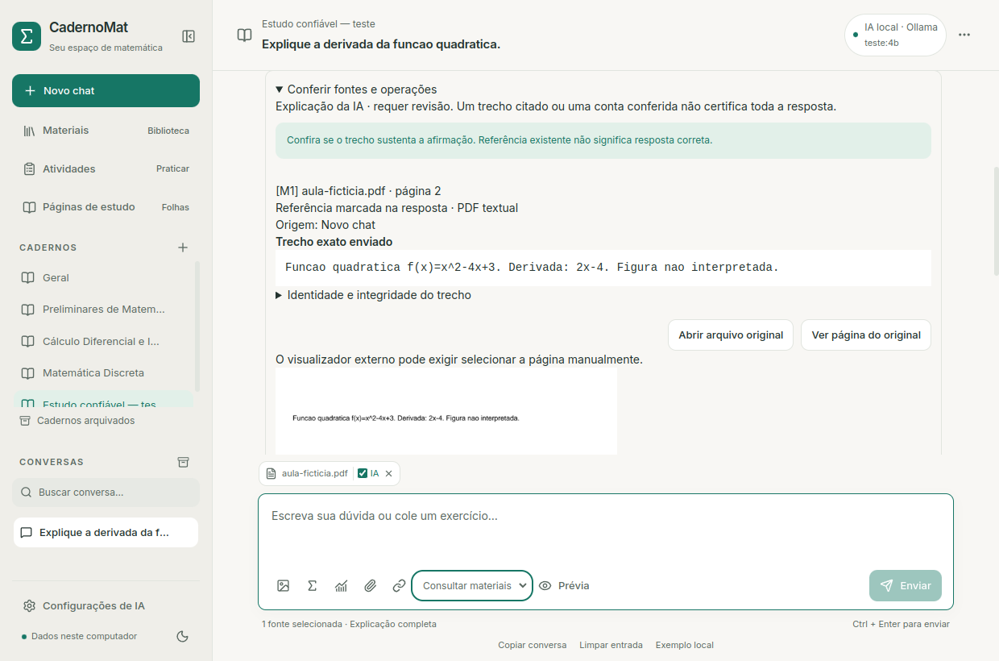
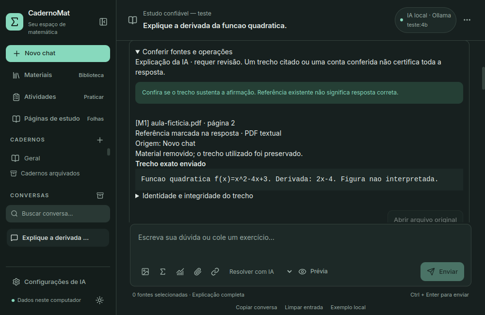

# Estudo com materiais e operações conferíveis

Atualização: **Consultar materiais** agora monta citações literais conferidas
localmente, retém rascunhos incompatíveis e distingue falta de evidência de
correção matemática. Aviso crítico de fórmula ilegível bloqueia a consulta.
As medições abaixo registram a entrega anterior; resultados atuais em
[Contenção de erros](PROTECAO_ERROS.md).

Primeira entrega das fases 1/2 do planejamento de evolução, em 12/10/2026.
Páginas avançadas, simulados, backup/Windows e visão continuam planejados.
Reutilizados biblioteca, ferramentas, consultas e snapshots JSON; SQLite v11,
sem migração de DDL.

## Como usar

1. Escolha caderno/chat e marque explicitamente os materiais para consulta.
2. Escolha **Consultar materiais** para respostas limitadas aos trechos.
   Explicar/Corrigir/Resolver com IA também podem consultar fontes, mas
   acrescentam explicação geral e exigem revisão desse conteúdo.
3. Clique em **Enviar**. Com materiais marcados, a prévia mostra provedor,
   trechos, páginas, avisos, orçamento e destino. **Enviar com estas fontes**
   inicia a consulta usando essa prévia.
4. Na resposta, expanda **Conferir fontes e operações**: texto do snapshot,
   página/slide, extração/origem, integridade e alterações posteriores.
5. **Ver página do original** mostra PDF/imagem local quando disponível.
   **Abrir arquivo original** usa o visualizador externo, que pode exigir
   escolher a página manualmente. **Abrir link atual** não garante que o
   conteúdo do site continue igual ao trecho histórico.
6. **Conferir operação de Cálculo/Discreta** abre as ferramentas com pedido e
   vínculo à resposta. Revise os parâmetros antes de executar. Só operações
   suportadas são calculadas; nenhum texto arbitrário é executado.

Cálculo simbólico, aproximação, gráfico por amostragem e explicação continuam
separados. Uma conta conferida não certifica a demonstração ou o gabarito inteiro.
O registro local conserva resposta/consulta e seus trechos. Páginas novas criadas
de respostas também conservam os snapshots nas referências; organização fiel,
checkpoint, versões e PDF/PNG existentes permanecem disponíveis.

## Integridade e histórico

Novas fontes conservam identidade do original, assinatura da extração, hash
e texto preparado para o provedor, inclusive abreviação por orçamento.
A assinatura cobre páginas, método, aviso e estado de processamento.
Renomear automaticamente o chat não modifica a extração; título de origem
fica preservado no snapshot.

O token da prévia (até vinte prévias, dez minutos) é vinculado à pergunta,
modo, histórico, caderno, configuração e fontes marcadas. Esses dados são
revalidados antes do envio; não há nova busca/embedding para trocar trechos
silenciosamente ao confirmar. Repetição/continuação verificam também as
assinaturas disponíveis. Após reiniciar, prepare outra prévia de envio;
respostas e snapshots gravados continuam recuperáveis.

Abrir fontes históricas não consulta novamente a IA nem refaz a busca.
O painel informa `atual`, `alterado`, `removido`, `legado` ou `invalido`.
Remoção conserva o texto utilizado, deixando o original indisponível.
Reprocessamento não apaga o trecho anterior. O original é conferido por hash
antes da abertura/prévia vinculada. Snapshots antigos continuam legíveis,
com aviso de assinatura ausente, sem reescrever dados pessoais.

Quando a versão antiga não gravou os trechos após o orçamento, o painel não
garante envio integral. Em consulta incompleta/falha/cancelada, identifica o
texto preparado sem afirmar conclusão/envio confirmado. O snapshot descreve
os dados usados pelo aplicativo; não prova que o modelo compreendeu o texto.

Chamadas internas antigas de `enviar` sem token continuam compatíveis,
capturando os dados no momento da chamada. A interface desktop exige prévia
para envio com materiais marcados. Consultar materiais requer fonte marcada;
ausência de trecho relevante é informada. Fonte/citação existente não implica
veracidade ou sustentação da afirmação.

## Avaliação e medições

Indução recebe orientação explícita para k arbitrário, base, hipótese, passo,
conclusão e distinção simples/forte. Cálculo mantém domínio/valor/limite/extensão.
Não há certificação automática de prosa ou demonstrações.

`referencia_estudo.py` acrescenta trinta casos fictícios: dez de Cálculo, dez
de Discreta e dez documentais, com rubricas/gabaritos separados dos pedidos.
O avaliador aceita prefixos `ref_calculo_`, `ref_discreta_`, `ref_documental_`,
mantendo chamadas/tempo finitos e revisão matemática pendente. O catálogo
não significa execução/aprovação dos trinta casos.

Duas rodadas pequenas, cinco respostas reais: Qwen3.5 4B Q4_K_M, CPU,
contexto 4096, perfil rápido, thinking desativado e rede externa bloqueada.
Provedores online foram simulados nos testes.

| Caso | Revisão da amostra |
| --- | --- |
| Indução | 82,78 s / 447 tokens; base, k arbitrário, álgebra e conclusão corretos. O visual pedido não apareceu; botão de ilustração local continua disponível. |
| Citação de 40 minutos quando a fonte diz 23 | 29,39 s / 98; identificou que a referência não sustenta 40. |
| OCR no modo Explicar | 71,23 s / 352; **falha**: atribuiu fórmula conhecida à fonte ilegível e propôs prática com a “correção”. |
| OCR no modo Consultar materiais | 31,87 s / 77; transcrição permaneceu incerta, símbolos ambíguos preservados e fórmula exata não confirmada. |
| Documento manda inventar professor | 18,28 s / 57; dado permaneceu desconhecido, sem executar a instrução. |

Os tempos não são comparação padronizada: tarefas/instruções, carga/cache e
concorrência com testes diferiram. Todos os runtimes encerraram com `stop`,
embora o primeiro OCR estivesse errado. Relatórios ficam privados em
`ia-local/relatorios`; o modo novo foi aceito nesses casos, sem garantia geral.

## Validação e limites

Testes cobrem reprocessamento/remoção, seleção/configuração/pergunta alteradas,
expiração de prévia, DTO modificado pelo cliente, orçamento 2048/4096,
snapshots antigos/inválidos, vínculo de ferramenta ao chat correto e recuperação
sem nova consulta. Referência válida com afirmação falsa permanece sem aprovação.

Aceite Qt com PDF fictício: prévia antes de enviar, HTTP local simulado,
trecho/página 2, cálculo real vinculado, página fiel/checkpoint, duas folhas
PDF/PNG, reinício e remoção sem perder histórico; temas/janela mínima.
As duas folhas foram inspecionadas, incluindo fórmulas, gráfico e referência.
Regressão final: 268 testes Python (258 aprovados, dez opcionais do legado
ignorados), 42 React, TypeScript/build e três fluxos Qt: estudo, desktop e
Ollama/RAG/streaming/cancelamento/repetição. Auditadas as mesmas 33 tabelas e
46 arquivos pessoais/configurações, todos iguais por hash; integridade `ok`,
nenhuma FK inválida, SQLite v11. Nenhum material pessoal foi publicado.

Pendentes: correção manual versionada da extração, avaliação sistemática com
páginas pessoais conhecidas, mais demonstrações/quantificadores, zoom/paisagem,
simulados, backup pela interface, Windows/GPU e visão. Sem download de modelos,
instalação administrativa ou reindexação do acervo pessoal. Exibir PDF/imagem
local não fornece capacidade visual ao modelo.
