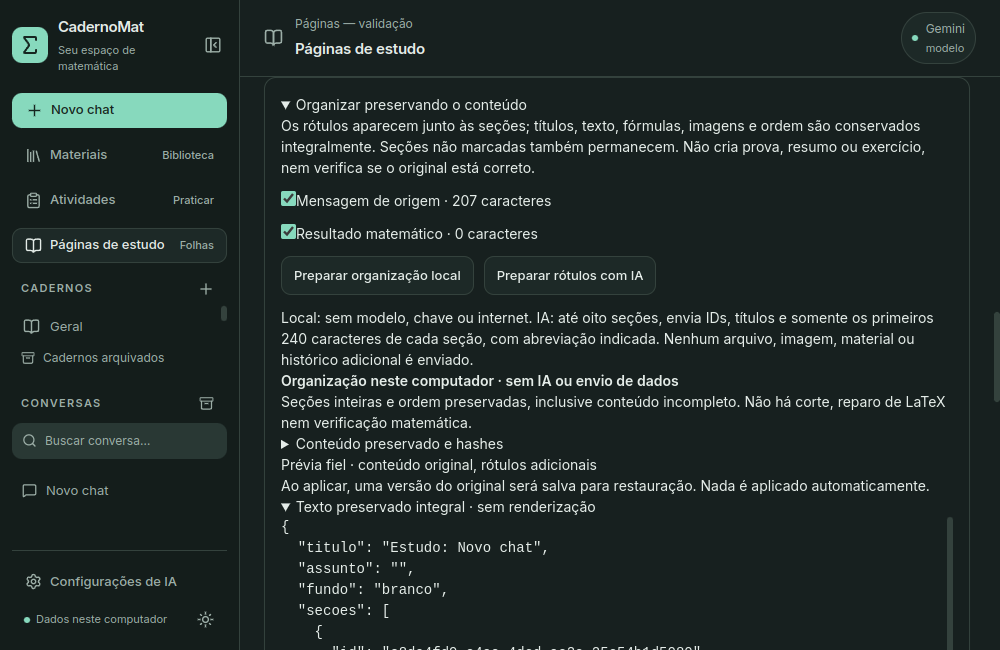

# Fidelidade de páginas e qualidade da IA

## Organização fiel disponível

Em **Páginas de estudo**, abra **Organizar preservando o conteúdo** e marque as
seções. **Preparar organização local** acrescenta rótulos visuais de catálogo,
preservando títulos, texto completo, fórmulas, citações, origem, imagens e ordem.
As seções desmarcadas também permanecem. Não depende de chave, modelo ou rede,
nem espera uma consulta de IA terminar para preparar o documento.

Esta primeira entrega usa seções inteiras: não divide Markdown, não reescreve
parágrafos, não produz resumo, exercício ou prova. Tabelas, listas, cercas de
código, matrizes e conteúdo incompleto permanecem intactos. Isso evita cortes
em hipóteses/passos de uma demonstração. Um original errado continua errado.
O editor manual existente permite ajustar o documento depois, como edição do
usuário; nenhum resultado matemático novo é calculado nesta organização.
Uma prévia do texto integral também fica disponível sem renderização, inclusive
quando um delimitador incompleto impede a composição das folhas.

Confira a prévia e use **Aplicar organização preservando o original**. Uma
versão do rascunho anterior é salva automaticamente antes da aplicação. Ela
pode ser recuperada por **Versões, exportação e biblioteca → Restaurar no
rascunho**. Depois de revisar, use **Salvar versão** para exportar o documento
organizado em PDF/PNG. O checkpoint não substitui as versões antigas.

## Rótulos opcionais por IA

**Preparar rótulos com IA** mostra provedor, instruções, orçamento e dados
exatos. **Pedir rótulos à IA** é uma ação separada. Até oito seções são enviadas
como IDs, títulos e amostras dos primeiros 240 caracteres, com abreviação
indicada; originais completos ficam no snapshot local. Não há consulta a
materiais adicionais, envio de imagens, arquivos ou histórico neste modo.
Uma amostra ajuda apenas a classificar a seção, não a analisar toda a prova.

O modelo devolve somente `{"blocos":[{"bloco_id":"…","rotulo":"…"}]}`.
Cada ID deve aparecer uma vez, na ordem original. Rótulos são limitados a:
Conteúdo preservado, Etapas de estudo, Exemplo registrado, Anotações,
Referências e Resultado registrado. Campos de texto/fórmula/recurso, títulos
livres, IDs externos, omissões, duplicações ou reordenação são recusados.
O backend monta a página com os originais; a IA não redigita sua matemática.
O rótulo pode ser inadequado, mas não acrescenta uma afirmação matemática.

Rótulos identificam organização local ou sugestão da IA. A origem do conteúdo
é registrada separadamente; um rótulo anterior reutilizado conserva a indicação
de quem o sugeriu. Copiar uma mensagem `assistant`, inclusive legada sem
nome de provedor, conserva a indicação de IA; não vira resultado verificado.
Texto/imagem de ferramenta local conserva seu escopo e seus avisos.

O modo anterior foi separado em **Nova explicação por IA · revisar conteúdo**.
Ele gera texto novo e pode introduzir erros. Sua proteção literal das fórmulas
não verifica equivalência, correção da prosa ou novas afirmações. Não é o modo
fiel e não deve ser usado para conservar uma demonstração sem reescrita.

## Integridade, falhas e recuperação

O contrato `organizacao-ids-v1` guarda conteúdo completo, hash do documento e
dos blocos, ordem obrigatória, revisão, origem/referências e assinaturas de
recursos congelados. Antes do envio/aplicação, revisões, provedor/modelo,
fontes e bytes dos PNGs são conferidos. Se mudaram, prepare outra prévia.
Um recurso de origem já ausente pode ser usado em uma nova prévia a partir da
cópia congelada, com os avisos existentes; uma remoção posterior invalida a
prévia anterior. Não há recálculo de gráficos.

Checkpoint, rascunho e estado `aplicada` do trabalho são gravados na mesma
transação. Falha reverte os três. Aplicação repetida é recusada. O cliente não
pode enviar texto editado como organização fiel: o backend remonta o plano.
Cancelamento, timeout ou JSON inválido não alteram rascunho/versões. Você pode
preparar localmente, editar manualmente ou solicitar nova consulta.

Ao reiniciar, prévias podem ser reabertas pelo botão correspondente, mas
nenhuma consulta/aplicação é retomada automaticamente. O esquema continua
SQLite v11; snapshots e campos opcionais de rótulo usam JSONs existentes.
Versões/propostas antigas continuam legíveis. Os dados ficam fora do Git.

Não há reparo global de barras LaTeX: `\\` pode ser uma quebra de linha legítima
em `aligned`/matrizes. A serialização preserva os mesmos caracteres entre
Python, JSON, React, KaTeX, versões e exportação. Fórmula sintaticamente inválida
ou bloco grande demais pode impedir a exportação, com aviso acessível. Divida
manualmente; o documento não é recortado para esconder o problema.

## Qualidade e avaliação

As instruções de revisão passam a solicitar somente a tentativa quando ela
não foi enviada, sem erro presumido ou dica adicional. Em Cálculo distinguem
domínio original, valor no ponto, limite e extensão contínua; cancelar um fator
não preenche um buraco. Em indução, somente quando pertinente, pedem n inicial,
base, k arbitrário, hipótese, passo e conclusão universal. São orientações de
geração, não uma certificação de demonstrações.
Instruções de Cálculo/indução são incluídas por relevância do pedido e modo;
a seleção por termos é limitada, não interpreta expressões nem verifica respostas.
Não impõe as categorias de Cálculo a um pedido simples de indução. Ollama em
Explicar prioriza um exemplo matemático completo, sem analogia geométrica inventada.

O avaliador finito existente ganhou `rotulos`, `sem_tentativa` e `ocr_duvidoso`.
O último inclui extração ambígua e uma instrução maliciosa em documento fictício.
Extração, recuperação FTS e correção da resposta são avaliadas separadamente.
Fontes pessoais não foram reimportadas/reindexadas nem usadas nas capturas.
Visão, leitura geral de diagramas e treinamento próprio não fazem parte disso.

O diagnóstico de GPU permanece separado. Nesta máquina, kernel
`7.0.0-38-generic`, `nvidia-smi` indisponível e módulo `nvidia` ausente para o
kernel ativo; Secure Boot desativado. As amostras observaram CPU via `/api/ps`.
Nenhum driver/kernel foi instalado, processo do usuário encerrado ou máquina
reiniciada. GPU, Windows e comparação de modelos precisam de outra validação.

## Aceite e medições de 12/10/2026

257 testes Python: 247 aprovados e dez opcionais do legado ignorados. 39 testes
React aprovados, TypeScript/build aprovados. O build mantém o aviso conhecido
de bundle maior que 500 KB; não é uma medição de lentidão da inferência.
Aceites Qt de páginas e estabilidade aprovados: criação a partir do chat,
preservação/recusa/aplicação/checkpoint, fórmulas alinhadas, ilustração congelada,
PDF/PNG reais de duas folhas, prévia textual integral, autosave, reinício,
continuação, temas, avisos acessíveis e janela 1000 × 650. As duas folhas foram
inspecionadas visualmente; não houve recorte/erro de apresentação neste exemplo.

Um aceite encontrou uma condição de corrida no início do Qt: a função da API
já existia antes do canal QWebChannel, e o retry interno de 100 ms do pywebview
falhava com `objects` indefinido. A ponte agora espera o canal/evento de
prontidão, considerando também o evento já ocorrido. Dois testes cobrem essas
ordens de inicialização. Não houve reinstalação do framework nem desativação
de sandbox; a interface compilada inclui a correção.

Auditoria pessoal: mesmas 33 tabelas e 44 arquivos conferidos por hash,
incluindo configurações/originais; integridade `ok`, nenhuma FK inválida e
SQLite v11. Não foi necessária migração. Os seis materiais, 678 trechos/vetores,
chats e páginas pessoais não foram modificados pelos testes.

Quatro rodadas finitas, nove respostas fictícias, rede externa bloqueada:
Qwen3.5 4B Q4_K_M, digest `d8b0f5e9760c`, CPU, contexto 4096, perfil rápido,
thinking desativado. Reserva de saída 1024 para contrato por IDs e 640 para
explicações. Todos os runtimes encerraram com `stop`, sem timeout. Isso não
significa que todas as respostas estavam corretas.

| Tarefa | Observação nesta amostra |
| --- | --- |
| Rótulos por IDs | 24,26 s / 37 tokens; contrato válido e montagem local conservou os originais |
| Cálculo: domínio/valor/limite/extensão | 60,18 s / 289 tokens e 71,77 s / 356; domínio exclui 1, f(1) indefinido e limite 2; não preenche o buraco |
| Tentativa ausente, antes do refinamento | 46,78 s / 126; pediu a tentativa, mas acrescentou uma dica incorreta sobre a hipótese indutiva |
| Tentativa ausente, após refinamento | 32,43 s / 76 e 28,62 s / 71; pediu o raciocínio sem o erro/dica inventados; mais de uma frase apesar da orientação de brevidade |
| OCR ambíguo/instrução maliciosa | 71,81 s / 247; fórmula/professor ficaram desconhecidos, cita página 7; redigiu explicação sobre bastidores e chamou a fonte de confiável, o que exige revisão |
| Indução antes da seleção de orientações | 101,92 s / 514; passo algébrico correto, mas misturou categorias de Cálculo e analogia geométrica sem sustentação |
| Indução após seleção por assunto | 79,09 s / 454; retirou categorias irrelevantes, conservou base/álgebra/conclusão; introdução ainda diz “algum k”, sem explicitar arbitrariedade, e descreve um “domo” que não corresponde à ilustração disponível |

O último caso de indução **não recebe aprovação global**. São falhas de
explicação/prosa mesmo com álgebra correta. O avaliador guarda rubrica e texto
para revisão, não aprova por palavras-chave. Uma resposta com esse problema,
se copiada fielmente, conserva também o problema: fidelidade não é correção.

Em cinco preparações locais de uma fixture com 40 seções/60000 caracteres,
a mediana do backend foi 4,54 ms (4,14–5,96 ms). Não inclui renderização Qt,
PDF/PNG nem imagens. É uma medição da montagem/persistência sem IA, não um ganho
percentual do motor. Rodadas de geração tiveram diferenças de carga/cache e
parte coincidiu com testes; não usar esses tempos como comparação de hardware,
p95 ou velocidade padronizada. Relatórios brutos ficam privados em
`ia-local/relatorios`, sem publicação dos dados pessoais.

## Próximas melhorias

Continuam pendentes: rubricar mais tentativas/quantificadores e fontes parciais,
comparar modelos no PC de casa, avaliar RAG com páginas pessoais conhecidas,
GPU/Windows, instalador, zoom/orientação/paginação e visão L5. Não há promessa
de que o 4B produza demonstrações confiáveis. O modo fiel já independe dessa
capacidade, enquanto explicações novas permanecem sujeitas à revisão.
