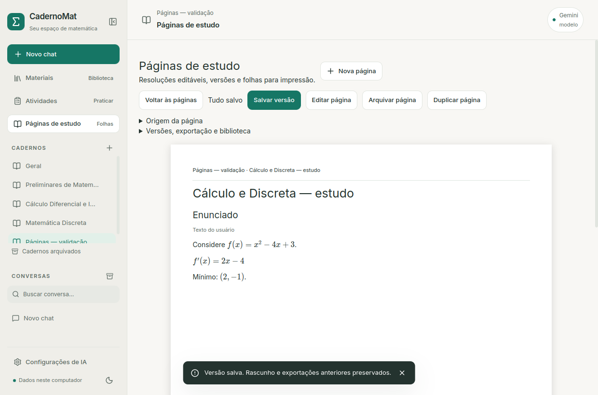
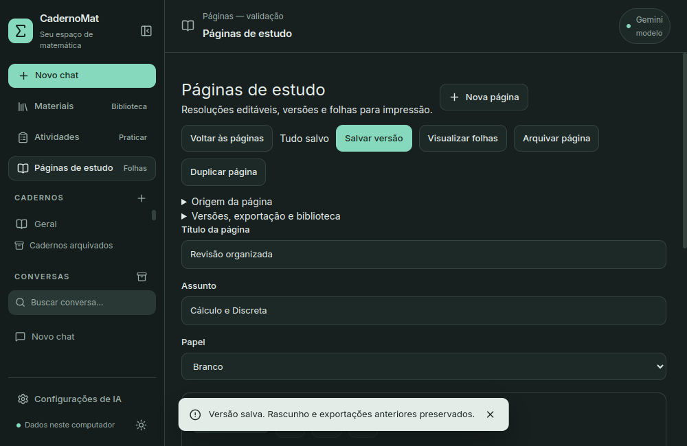

# Páginas de estudo - L4

**12/10 — organização fiel:** disponível em **Organizar preservando o conteúdo**.
Rotula seções inteiras localmente ou por IDs com IA, conservando texto/ordem/
fórmulas/imagens e salvando uma versão recuperável do original ao aplicar.
O fluxo anterior agora se chama **Nova explicação por IA · revisar conteúdo**,
pois gera texto novo. Uso, contratos e limites em [Fidelidade e qualidade](FIDELIDADE_QUALIDADE.md).

Atualização de 12/10: novas propostas por IA preservam a presença literal das
fórmulas marcadas nas seções selecionadas. Omissão/reescrita da notação é recusada,
sem mudar rascunho/versões. Não é teste de equivalência nem de correção matemática;
prosa e fórmulas novas continuam revisáveis. Matemática sem delimitadores não
possui essa proteção. Previews antigos permanecem compatíveis. Limites, falhas
reais do 4B e procedimento em [Calibração local](CALIBRACAO_IA_LOCAL.md).

Abra **Páginas de estudo** na lateral do caderno e clique em **Nova página**.
Edite título, assunto, papel e seções em Markdown/LaTeX. **Adicionar seção**,
setas e remover permitem organizar enunciado, etapas, resumo e prática. Imagens
matemáticas e ilustração conceitual de indução entram por **Inserir resultado local**, escolhendo um cálculo
concluído do mesmo caderno. Não há execução de código da página.

O rascunho salva automaticamente com estado visível. **Salvar versão** cria uma
versão independente; editar o rascunho depois não altera essa versão. A opção
**Versões, exportação e biblioteca** permite visualizar e restaurar versões no
rascunho, gerar PDF/PNG e adicionar uma versão revisada à biblioteca.

Uma página de estudo é um documento; sua exportação pode ocupar várias folhas.
Há papéis branco, pautado e quadriculado. A prévia usa o compositor local com
fontes Inter/KaTeX e texto matemático, sem geração artística. Na janela pequena,
a prévia A4 tem rolagem própria e os formulários continuam acessíveis.




## Chats, resultados e atividades

**Criar página de estudo** em uma mensagem copia somente aquela mensagem.
Páginas relacionadas aparecem no chat pelo botão **Ver página**, com prévia e
acesso ao editor. Mensagens muito longas ou com imagens externas exigem escolher
os trechos manualmente; não são truncadas silenciosamente. O original permanece.

Resultados locais inseridos conservam dados, versão, hipóteses, avisos,
contraexemplos/tabelas e uma cópia do PNG conferida por hash. Remover o chat ou
cálculo de origem não remove a página ou seu gráfico. **Origem da página** e a
seção correspondente na folha identificam os registros. Referências removidas
recebem aviso na visualização atual; versões antigas preservam seu snapshot.

Textos do usuário e da IA têm indicação de origem. Um bloco de ferramenta
mantém seu resultado original; comentários são separados e não modificam o
cálculo. A página inteira não recebe selo de resposta correta. Aproximações e
operações não verificadas continuam identificadas pelo resultado L3.

Na prática, **Criar página da questão** copia o enunciado da versão da tentativa.
**Criar página com solução** aparece após revelar/finalizar. O backend também
verifica essa permissão. Não altera gabaritos, respostas, notas ou snapshots.

## PDF e PNG

Salve uma versão, escolha-a e use **Gerar PDF e PNG**. A exportação usa exatamente
a versão escolhida, mesmo quando existe um rascunho diferente. Depois:

- **Salvar PDF no computador** abre o seletor nativo de arquivo.
- **Salvar folhas PNG** escolhe uma pasta e cria uma subpasta própria, com uma
  imagem por folha. Uma subpasta existente não é sobrescrita silenciosamente.

Os originais exportados ficam junto dos dados do aplicativo. Nova exportação
cria outro registro; os arquivos anteriores permanecem. Cópias são verificadas
por tamanho/hash. Cancelamento ou erro não publica arquivos concluídos; ao
reiniciar, trabalhos interrompidos ficam identificados e temporários são limpos.

A prévia e o renderizador usam o mesmo componente React/Markdown/KaTeX. Um
subprocesso Qt carrega somente assets locais e dados em loopback com token
aleatório. O interceptor bloqueia outras requisições. Aguarda fontes/imagens,
compõe folhas, imprime com `QWebEnginePage.printToPdf` e confirma a contagem do
PDF com a composição. PDFium gera PNGs a 144 DPI. Texto do PDF é selecionável;
extração linear de fórmulas pode reordenar símbolos, então a biblioteca usa a
representação Markdown original em vez de presumir fidelidade do texto do PDF.

Folhas A4 possuem margem, cabeçalho e numeração. Tabelas longas são divididas por
linhas, repetindo cabeçalhos. Figuras mantêm proporção. Fórmulas podem ajustar
até 20% de tamanho; uma fórmula/bloco/tabela que não caiba é recusada com aviso,
sem recortar o conteúdo. Use equações alinhadas e parágrafos menores nesses
casos. Um parágrafo isolado maior que uma folha não é dividido automaticamente.
Não há orientação paisagem, edição por arrastar ou zoom nesta entrega.

A geometria interna tem pequena tolerância à conversão de milímetros do Qt para
pontos; isso evita folhas vazias extras. O PDF produzido tem formato A4. O estilo
de impressão é claro, independentemente do tema da interface.

## Organização com IA

Expanda **Nova explicação por IA · revisar conteúdo**. Marque as seções e materiais que a IA
poderá consultar; nenhum material é selecionado automaticamente.
**Preparar proposta de página** mostra provedor, instruções, dados e trechos
incluídos, com origem/avisos de extração e orçamento local. **Pedir organização
à IA** usa o provedor padrão escolhido, sem fallback online. Não envia histórico,
originais ou imagens dos gráficos.

A proposta JSON tem até oito seções e IDs de recursos autorizados. Referências
[M1] etc devem existir nos trechos incluídos. Fontes removidas são conferidas
antes do envio. Revise/edite a proposta e use **Aplicar proposta ao rascunho**.
Isso não salva uma versão automaticamente. Se o rascunho/provedor mudou depois
da prévia, a operação é recusada para conservar sua edição.

Ollama, Gemini e OpenAI são compatíveis. A narrativa é revisável: formato JSON
válido não garante correção matemática ou qualidade pedagógica. No aceite real,
Qwen3.5 4B organizou o exemplo em etapas e gerou PDF, mas não incluiu sempre o
resumo/pergunta de prática solicitados. O editor permite acrescentá-los.

## Biblioteca e proveniência

**Adicionar versão revisada à biblioteca** publica localmente uma cópia textual
Markdown daquela versão, com fórmulas, resultados e origem. Não adiciona
automaticamente o PDF/PNG nem interpreta suas imagens. A página/exportação
conserva os gráficos; a cópia textual identifica essa limitação.

A inclusão é idempotente por página/versão, usa deduplicação de arquivos,
associação ao caderno e busca textual existentes. Não cria chat nem seleciona
fontes. Embeddings seguem a indexação explícita da biblioteca.

O texto e os metadados de cada trecho identificam o material produzido pelo
CadernoMat, inclusive nas buscas textual/híbrida. Uma explicação gerada não é
tratada como confirmação independente de si mesma. Materiais e exportações
pessoais permanecem fora do Git.

## Persistência, limites e plataformas

SQLite **v11**, backup v10 e migração transacional acrescentam `paginas_estudo`,
`pagina_versoes`, `pagina_recursos`, `pagina_jobs`, `pagina_materiais` e
`pagina_navegacao`. A tabela `paginas` da extração documental é preservada.
Rascunhos usam revisão para detectar conflitos. Recursos são deduplicados por
hash; versões armazenam texto/metadados e referências, sem duplicar PNGs em JSON.

O fechamento drena a fila de autosave. Falha mantém a janela e o conteúdo abertos
para tentar novamente. Navegação e ações também salvam o rascunho primeiro.
O PDF é produzido fora do lock SQLite; é possível editar enquanto ele é gerado.
Há uma exportação ativa por vez e cancelamento de subprocesso.

| Item | Limite |
| --- | --- |
| Título / assunto | 180 / 500 caracteres |
| Seções | 1 a 40; até 15.000 caracteres por texto |
| Texto total | 60.000 caracteres por documento |
| Recursos matemáticos | Seis distintos; PNGs de até 2 MB |
| Folhas | Até vinte |
| Dados enviados ao renderizador | Até vinte milhões de caracteres JSON |
| Exportação | 60 s no Qt; supervisor encerra em 90 s |
| Arquivos | PDF até 20 MiB; conjunto PNG até 40 MiB |
| Proposta da IA | Até oito seções e 20.000 caracteres de resposta |

No Linux, dados em `~/.local/share/CadernoMat/paginas/`. Windows utiliza o
diretório de dados existente em `%LOCALAPPDATA%/CadernoMat/`. O renderizador
requer PySide6/Qt WebEngine e PDFium; os requisitos incluem PySide6 também fora
do Linux, separadamente do backend da janela WebView2/Cocoa. Falta de runtime
produz mensagem clara, preservando o editor. Windows/macOS não foram executados.

## Validação

Validação final: **207 testes Python aprovados** (dez opcionais ignorados),
**33 testes React**, build e seis fluxos na janela Qt (páginas, chat, atividades,
Cálculo, Discreta e busca semântica). Testes Python/React cobrem versões, reinício, conflito, arquivo/duplicação,
origens removidas, recursos, fontes geradas, biblioteca sem seleção, gabarito
oculto, três provedores simulados, propostas inválidas, cancelamento,
interrupção/recuperação e migração/rollback. Qt real cobre editor, KaTeX, PDF/PNG,
seletor nativo simulado, proposta revisável, fechamento imediato/falha ao salvar,
reinício, temas e 1000x650. Os dados publicados são fictícios.

```bash
.venv/bin/python -m unittest discover -s tests
cd frontend
pnpm test
pnpm build
pnpm e2e:paginas
```

Aceite de exportação: `tests/aceite_paginas_exportacao.py /tmp/cadernomat-l4-aceite`.
Inclui página curta, cinco folhas de texto, equação alinhada, parábola, relação
com contraexemplos e tabela de 64 linhas; fórmula inválida/larga são recusadas.
Os seis casos válidos produziram catorze folhas no total, sem cortes ou folhas
vazias extras; os dois inválidos foram recusados. Os PDFs foram reabertos e todas
as folhas renderizadas/inspecionadas com Poppler.
Ollama real com rede externa bloqueada:
`scripts/testar_integracao_offline_linux.sh --paginas`. Relatório fora do Git em
`~/.local/share/CadernoMat/ia-local/aceite-paginas.json`.

Ollama Qwen3.5 4B real em CPU gerou uma proposta revisável em aproximadamente
72 segundos; aplicação explícita/exportação e preservação da versão anterior
passaram com a rede externa bloqueada. Nenhuma consulta paga foi usada.

Migração pessoal v10 → v11 conferida por hashes de todas as 27 tabelas anteriores
(incluindo sqlite_sequence), nove arquivos/configurações e backup v10. Os seis
materiais, 678 trechos e 678 vetores foram preservados. Relatório de auditoria
fica no diretório pessoal, fora do Git. O atalho existente usa o bundle novo.

Continuam futuras: visão/fotos e ilustrações L5; instaladores e teste Windows;
melhor organização pedagógica por modelo; quebra de parágrafos excessivamente
longos, orientação/zoom e inserção de imagens gerais. Não houve treinamento,
novo corretor universal ou geração artística.

Referências do mecanismo: [impressão PDF do Qt](https://doc.qt.io/qt-6.11/qwebenginepage.html#printToPdf)
e [API PySide6](https://doc.qt.io/qtforpython-6.8/PySide6/QtWebEngineCore/QWebEnginePage.html).

A etapa de estabilidade acrescentou a ilustração local de indução. Sua legenda,
texto e PNG são preservados por ID/hash, com indicação de não verificação.
[Uso do recurso](ESTABILIDADE_IA_LOCAL.md).
