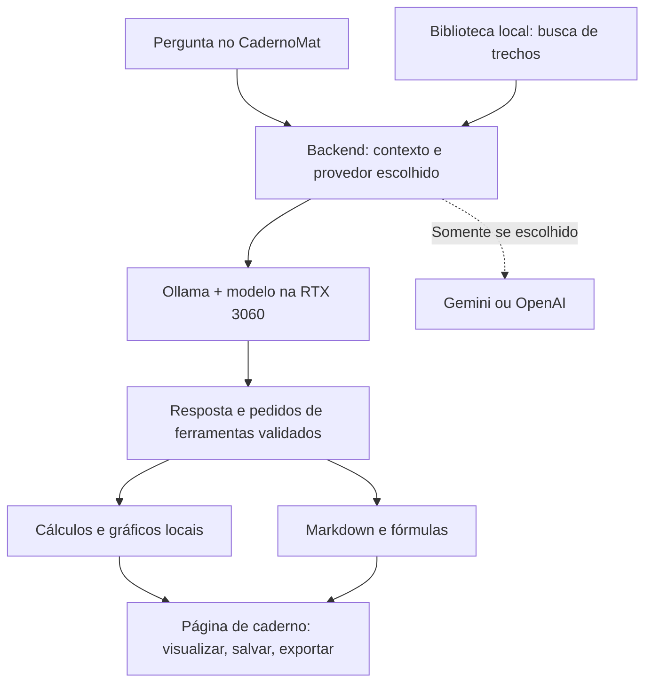

# CadernoMat — plano de IA local, gráficos e páginas de estudo

Planejamento elaborado em **11/10/2026**. A revisão inicial foi somente de
documentação. Depois, a pedido do usuário fora de casa, foi executado um
[piloto real no notebook](PILOTO_LOCAL.md): Ollama/Qwen3.5-4B, medições e teste
offline. A integração gráfica L1 foi entregue depois ([Ollama integrado](OLLAMA.md)); o teste no PC Windows continua pendente;
nenhum fork foi necessário.

Este documento detalha a etapa de IA local do [planejamento geral](../PLANEJAMENTO.md).
A solicitação atual abre uma trilha específica para preparar o computador de
casa e integrar um provedor local. Provas, simulados e demais melhorias continuam
no backlog de produto; não é necessário reescrever os recursos já entregues.

## 1. Decisão recomendada

Manter o **CadernoMat como aplicativo** e usar **Ollama como primeiro motor de
inferência**, instalado separadamente. Implementar um adaptador Python para sua
API local, conservando Gemini e OpenAI como escolhas explícitas. Começar com
texto e os materiais já extraídos; acrescentar gráficos e exportação de páginas
antes de experimentar geração artística de imagens.

Ollama oferece uma API de chat e gerenciamento de modelos e tem licença MIT.
Seu uso como serviço evita manter um fork do motor para uma integração comum.
[Projeto oficial](https://github.com/ollama/ollama),
[API de chat](https://docs.ollama.com/api/chat).

**llama.cpp** será a alternativa se medições revelarem necessidade de controlar
GGUF, quantização, distribuição CPU/GPU ou desempenho. **LM Studio** é uma
alternativa para testar modelos com interface gráfica e servidor local; sua
compatibilidade de API não significa que o aplicativo inteiro possa ser copiado
como código aberto. Usar a integração documentada.
[llama.cpp](https://github.com/ggml-org/llama.cpp),
[servidor llama.cpp](https://github.com/ggml-org/llama.cpp/blob/master/tools/server/README.md),
[LM Studio](https://lmstudio.ai/docs/developer).

Não há motivo identificado para substituir agora o CadernoMat por um fork de
um chat genérico: já temos cadernos, atividades versionadas, tentativas e uma
biblioteca integrados ao mesmo banco. Um fork será considerado somente quando
uma alteração concreta no projeto externo for mais barata de manter do que
uma integração por API. Copiar um componente exige conferir sua licença,
preservar avisos e registrar origem/versão.

## 2. O que os artigos e a discussão sugerem

O [primeiro artigo da XDA](https://www.xda-developers.com/im-not-paying-20-for-chatgpt-claude-or-gemini-because-a-free-local-llm-does-everything-i-need/),
publicado em 06/10/2026, descreve Qwen 3.8-27B quantizado em uma RTX 4070 Ti Super
de **16 GB de VRAM**. O autor relata utilidade em extração de informações e
programação. Isso apoia testar modelos locais em tarefas reais; não demonstra
correção de Cálculo/Discreta nem prevê desempenho na RTX 3060. O modelo e a
quantização descritos não serão nosso ponto de partida.

O [segundo artigo da XDA](https://www.xda-developers.com/run-claude-chatgpt-local-llm-through-one-interface/),
publicado em 29/09/2026, usa Cherry Studio com múltiplos provedores e um servidor
LM Studio. Sua contribuição de produto é separar interface e motor, preservar
preferências e escolher modelos por tarefa. Para nós: uma interface, provedor
identificado e segunda opinião opcional. Cada consulta online continua sujeita
à cobrança/cota do respectivo provedor.

A [discussão no LocalLLaMA](https://www.reddit.com/r/LocalLLaMA/comments/1l3qvbu/how_good_is_local_llm_compared_with_claude_chatgpt/)
tem experiências divergentes. Há relatos favoráveis à privacidade e a tarefas
cotidianas, e outros que ressaltam hardware, trabalho de configuração e limites
dos modelos pequenos. Trataremos esses relatos como hipóteses para experimentar,
não como benchmark. A comparação útil é resolver nossos exercícios e consultar
nossas apostilas, com gabaritos e medições reproduzíveis.

## 3. Como funciona a IA local

- **Modelo/pesos:** arquivos que contêm os parâmetros aprendidos durante um
  treinamento prévio. Baixaremos um modelo existente; criar o aplicativo e
  importar apostilas não treinam esses parâmetros.
- **Inferência:** executar esse modelo para gerar uma resposta. Ollama gerencia
  o carregamento; a GPU acelera os cálculos; a RAM também é utilizada.
- **Quantização:** representar os pesos com menos precisão para diminuir o
  tamanho. Q4 é um ponto de partida para testar o equilíbrio entre memória e
  qualidade; não garante o mesmo resultado da versão de maior precisão.
- **Tokens/contexto:** pedaços de texto e a quantidade que o modelo consegue
  considerar na consulta. Contexto maior consome mais memória. Toda a conversa
  pode ficar no banco, mas somente uma parte entra em cada chamada.
- **RAG:** buscar trechos dos materiais e colocá-los no contexto da pergunta.
  O conhecimento persistente é mantido na biblioteca/índice, não pela alteração
  dos pesos. Embeddings são vetores usados para procurar conteúdo de significado
  parecido; não são um arquivo com todo o conhecimento dentro do modelo.
- **Ferramentas:** funções do nosso backend que calculam, produzem gráficos e
  formatam páginas. Uma resposta fluente da IA não substitui uma verificação.
- **Visão e geração de imagens:** interpretar uma fotografia de um exercício e
  criar uma ilustração são capacidades diferentes, possivelmente de modelos
  diferentes. Um modelo de chat com visão não é automaticamente um gerador de
  imagens.

O modo local poderá funcionar sem internet depois das instalações e downloads.
Não haverá tarifa de API para a inferência local, mas haverá consumo de energia,
espaço em disco e processamento. Atualizações, downloads e buscar novos links na
web continuam exigindo conexão. Os provedores online seguem opcionais.



## 4. Hardware e modelos candidatos

Premissa fornecida pelo usuário: PC de casa com **Windows, 16 GB de RAM**, RTX
NVIDIA 3060 com **8 GB ou 12 GB de VRAM**, a confirmar. Não confundir esse PC com
o notebook de desenvolvimento inventariado anteriormente. CPU, versão do Windows,
driver, VRAM livre e espaço em disco ainda precisam ser verificados no PC de casa.

A RTX 3060 aparece na relação de GPUs NVIDIA suportadas pelo Ollama. Isso indica
compatibilidade, não uma velocidade garantida.
[Compatibilidade oficial](https://docs.ollama.com/gpu).

| Cenário | Primeiro teste | Comparação posterior | Contexto inicial proposto |
| --- | --- | --- | --- |
| 16 GB RAM + 8 GB VRAM | Qwen3.5-4B em Q4_K_M | Qwen3-8B em Q4_K_M, se houver folga | 4.096 tokens; testar 8.192 no 4B após medir |
| 16 GB RAM + 12 GB VRAM | Mesmo 4B para validar o fluxo | Qwen3.5-9B em Q4_K_M | 4.096 tokens; testar 8.192 após medir |
| Memória livre insuficiente | Reduzir contexto; testar modelo menor | CPU/GPU parcial como experimento | Uma consulta por vez; indicar degradação |

Os tamanhos publicados para os candidatos estão aproximadamente em **3,3–3,4 GB**
(4B), **5,2 GB** (Qwen3-8B) e **6,6 GB** (Qwen3.5-9B). São tamanhos de pacotes,
**não o consumo total em execução**: buffers, contexto, componentes visuais,
driver e outros programas também ocupam memória. A tabela é uma hipótese de
dimensionamento que depende do teste real.
[4B](https://ollama.com/library/qwen3.5:4b-q4_K_M),
[8B](https://ollama.com/library/qwen3:8b),
[9B](https://ollama.com/library/qwen3.5:9b-q4_K_M).

Qwen3.5-4B/9B serão candidatos, não vencedores presumidos por serem recentes.
Confirmar licença e capacidades na versão exata; os cartões oficiais atualmente
informam Apache 2.0. O modelo de 27B do artigo fica fora do perfil inicial.
[Cartão 4B](https://huggingface.co/Qwen/Qwen3.5-4B),
[cartão 9B](https://huggingface.co/Qwen/Qwen3.5-9B).

Política inicial de recursos, a validar:

- Reservar **15–25 GB livres em disco** para piloto, downloads temporários,
  um ou dois candidatos e índices. É orçamento de planejamento; imagens poderão
  exigir espaço adicional depois.
- Carregar apenas um modelo de chat; limitar a uma geração simultânea. Fechar
  jogos/programas que usem muita GPU durante as medições.
- Começar com contexto 4K e saída até 1.024 tokens; testar 8K/2.048 tokens depois.
  Uma explicação extensa poderá ser dividida em etapas pelo usuário. A janela
  nominal anunciada pelo modelo não é a configuração apropriada para este PC.
- Gerar embeddings em CPU/lotes pequenos ou fora do período de conversa; não
  manter chat, OCR, embedding e difusão disputando a GPU sem controle.
- Ajustar o contexto pelo modelo/perfil e registrar a RAM/VRAM efetivamente usada.
  Não somar 16 GB de RAM com 8/12 GB de VRAM como se fossem uma memória única.
- Caso falte memória, mostrar o motivo e opções de reduzir contexto/trocar modelo.
  Não mandar a pergunta para um serviço online automaticamente.

A documentação do runtime confirma que aumentar contexto aumenta uso de memória.
[Contexto Ollama](https://docs.ollama.com/context-length).

### Destino prioritário: Windows

O usuário confirmou Windows durante a preparação deste plano. Usar a instalação
nativa oficial do Ollama e conferir seus requisitos de Windows/driver na versão
adotada; não exigir WSL2 ou Docker. O servidor local usa a porta 11434. Se os
modelos forem guardados em outro disco, configurar `OLLAMA_MODELS` fora do Git
e reiniciar o Ollama. [Guia oficial Windows](https://docs.ollama.com/windows).

O CadernoMat já tem `iniciar_desktop.ps1`, mas a interface nova só foi validada
no Linux/Qt. L0/L1 incluem instalar/verificar Python, dependências e WebView2,
testar seletor de anexos, salvar ao fechar e criar/manter um atalho Windows.
A migração dos dados pessoais entre computadores precisa de backup/restauração
verificados; clonar o Git não traz banco, materiais ou chaves do outro PC.
Distribuir um executável/instalador único será uma entrega posterior, após
funcionar pelo atalho e validar as bibliotecas nativas.

## 5. Projetos pesquisados e estratégia de reaproveitamento

Estrelas aproximadas consultadas em **11/10/2026** pela API pública do GitHub;
mudam com o tempo e não medem qualidade matemática. Os projetos abaixo estavam
ativos e não arquivados. Licença de software e licença de cada modelo são coisas
separadas.

| Projeto | Estrelas aproximadas | Papel no plano | Licença/atenção |
| --- | ---: | --- | --- |
| [Ollama](https://github.com/ollama/ollama) | 183 mil | Runtime inicial; integrar por API | MIT |
| [llama.cpp](https://github.com/ggml-org/llama.cpp) | 131 mil | Alternativa para GGUF/CUDA e controle fino | MIT |
| [Open WebUI](https://github.com/open-webui/open-webui) | 154 mil | Referência e comparação de chat/RAG | Licença própria com condições de marca |
| [AnythingLLM](https://github.com/Mintplex-Labs/anything-llm) | 67 mil | Referência para biblioteca, workspaces e RAG | MIT |
| [LibreChat](https://github.com/LibreChat-AI/LibreChat) | 46 mil | Referência de interface com múltiplos provedores | MIT |
| [Cherry Studio](https://github.com/CherryHQ/cherry-studio) | 53 mil | Referência desktop usada no segundo artigo | AGPL-3.0 |
| [ComfyUI](https://github.com/Comfy-Org/ComfyUI) | 137 mil | Serviço opcional de imagens em fase posterior | GPL-3.0 |

Open WebUI pode ser usado gratuitamente, mas sua licença atual tem condições
para alterar a marca e exceções, incluindo implantações com até 50 usuários.
Não assumir uma licença MIT ou proibição absoluta de personalização. Conferir
o texto da versão efetivamente adotada.
[Licença oficial](https://docs.openwebui.com/license/).

**Escolha:** integração Ollama + serviços próprios de estudo; aproveitar as
bibliotecas existentes em vez de copiar um aplicativo inteiro. Consultar
AnythingLLM/LibreChat para padrões de produto ou componentes concretos. Cherry
Studio e ComfyUI permanecem referências/serviços independentes, com análise de
licença antes de incorporar ou distribuir código.

Se surgir um componente reutilizável, registrar repositório, commit, arquivos
incorporados, licença e avisos em THIRD_PARTY_NOTICES, testar a adaptação e definir
como receber atualizações. Se um fork for realmente necessário, mantê-lo separado
e vinculado ao upstream; não misturar sua história de Git com o CadernoMat.

## 6. O código atual e as mudanças necessárias

Análise do checkout em `215a2c7`:

- React/TypeScript/Tailwind apresenta a interface via pywebview; assets e KaTeX
  locais já permitem visualizar o conteúdo sem CDN.
- `ia.py` concentra configuração, contexto e chamadas Gemini/OpenAI. Seu contrato
  exige chave; o validador do modelo aceita apenas letras/números/ponto/hífen.
  Tags Ollama contêm `:` e podem ter `/`, portanto exigem validação específica.
- `servico.py` e `estudo.py` também assumem que uma chave identifica um provedor
  disponível. Precisam consultar disponibilidade/capacidades, não inventar uma
  chave para o modo local.
- A seleção atual de provedor é global; a preferência por conversa será um novo
  recurso, preservando os registros de provedor/modelo das mensagens existentes.
- `materiais.py` e `estudo.py` recuperam trechos com FTS5 por caminhos distintos.
  Extrair um contrato comum de recuperação antes de adicionar busca semântica,
  conservando suas regras de seleção e a amostra explicitamente indicada.
- O limite atual de histórico é por caracteres; fontes têm outro limite e a
  saída online pode chegar a 4.096 tokens. Isso não cabe automaticamente em um
  contexto local de 4K. Planejar um orçamento para a consulta inteira.
- `matematica.py` já converte expressões por AST restrita e verifica continuidade
  por partes; `correcao.py` corrige questões objetivas. Ainda não existe um
  verificador universal de matemática, ferramentas gráficas ou geração de imagens.
- SQLite está em **v6**, com backup/migração e histórico de versões/tentativas.
  Arquivos e índices estão fora do Git. Novos índices precisam respeitar isso.
- Não há streaming/cancelamento no fluxo atual. A nova integração deve introduzir
  estados corretos de resposta parcial e término, sem perder o rascunho.

Estrutura sugerida, a ajustar sem romper os imports públicos atuais:

```text
tutor_calculo/
  provedores/
    contratos.py          # consulta, capacidades, eventos, erros
    openai.py             # adaptador existente extraído
    gemini.py             # adaptador existente extraído
    ollama.py             # API nativa localhost; sem dependência do React
  recuperacao.py          # FTS atual; busca híbrida posterior
  ferramentas_estudo.py   # registro restrito de cálculos/diagramas
  artefatos.py            # gráfico/página, metadados e arquivos locais
frontend/src/
  ...                     # componentes seguindo os tokens existentes
```

`ia.perguntar` pode permanecer como fachada de compatibilidade. A interface
continua usando operações permitidas da ponte; não recebe shell, SQL, arquivos
arbitrários, credenciais ou acesso direto à API do runtime.

O contrato de provedor terá identidade/localidade, estado, capacidades de texto,
visão, JSON e streaming, modelo e orçamento de contexto; consultas e respostas
receberão IDs estáveis. Expor eventos `inicio`, `trecho`, `fim`, `erro` e
`cancelado`, com métricas quando disponíveis. A existência de um endpoint
compatível não prova que todas as suas capacidades foram implementadas.

## 7. Entregas em ordem, com critérios verificáveis

### L0 — Diagnóstico e piloto no PC de casa

- [ ] Confirmar versão do Windows, CPU, driver, 16 GB reais, VRAM total/livre e disco.
- [ ] Fazer backup dos dados do CadernoMat antes de qualquer migração futura.
- [ ] Instalar runtime por fonte oficial e baixar somente o candidato 4B inicial,
  mostrando tamanho e licença; sem Docker ou uma plataforma completa de RAG no MVP.
- [ ] Configurar servidor em loopback e desabilitar recursos de nuvem do runtime.
- [ ] Executar exercícios conhecidos em português e registrar métricas.
- [ ] Repetir no candidato 8B/9B somente se a memória e os primeiros resultados
  justificarem o segundo download.

Concluir com relatório de modelo/tag/digest, quantização, versões, contexto,
RAM/VRAM, tempo de carregamento, primeiro token, tokens/s e qualidade. Ainda não
prometer qual modelo será o padrão nem exigir upgrade de hardware.

Para descobrir a GPU no PC de casa, este comando é somente leitura e funciona
quando o utilitário NVIDIA está disponível:

```text
nvidia-smi --query-gpu=name,memory.total,memory.free,driver_version --format=csv
```

No Windows, a alternativa é Gerenciador de Tarefas → Desempenho → GPU → memória
dedicada. Se o comando falhar, diagnosticar o driver; não inferir que a GPU não
existe. Nesta máquina de desenvolvimento o comando não confirma o PC de casa.

### L1 — Um chat local completo no CadernoMat

- [x] Refatorar contrato de provedores conservando os testes Gemini/OpenAI.
- [x] Adicionar “IA local — Ollama”: testar conexão, listar modelos instalados,
  identificar modelo local e selecionar perfil de contexto, sem campo de chave.
- [x] Usar `/api/tags`, `/api/chat` e `/api/ps`; ler capacidades do modelo pela
  API de metadados suportada na versão instalada.
- [x] Armazenar preferências de modelo local no diretório de dados. Criar migração
  transacional/backup para preferência por conversa, mantendo valores antigos.
- [x] Montar instruções + contexto pedagógico + histórico + fontes + pergunta
  dentro do orçamento do modelo, com reserva para saída e margem. Usar tokenizer
  compatível quando disponível; caso contrário, estimativa conservadora explicitada.
- [x] Introduzir streaming, cancelar, repetir com IDs idempotentes e estados de
  resposta incompleta. Texto parcial não pode parecer uma conclusão validada.
- [x] Timeout configurável para carregamento/geração local; erros de servidor,
  modelo ausente, memória e JSON inválido preservam a pergunta.
- [x] Integrar geração de atividades, dicas e feedback à disponibilidade do
  provedor; para gerar atividades, usar esquema JSON e validação Python existente.
  Começar com listas curtas de 1–3 questões no perfil 4K.
- [x] Segunda opinião online somente por ação explícita, com nova prévia dos dados.

Entrega do núcleo L1: [uso e validação](OLLAMA.md). Streaming/cancelamento são
locais; provedores online mantêm seus adaptadores anteriores. A segunda opinião
se faz por troca explícita e nova prévia, sem botão de comparação automática.

**Aceite:** continuar um chat existente usando modelo local, gerar uma atividade
revisável, consultar uma dica, fechar/reabrir e retomar. Repetir sem internet;
falha local não causa nenhuma chamada a Gemini/OpenAI. Trocar o modelo conserva
caderno, fontes e histórico sem misturar conversas.

Não enviar mensagens para `/v1/responses` apenas porque outro runtime é
“compatível com OpenAI”: o contrato nativo de Ollama e os endpoints suportados
por cada servidor devem ser adaptados explicitamente.

### L2 — Consulta documental local e memória com recuperação

Núcleo entregue em 11/10/2026: [uso, validação e limites](BUSCA_SEMANTICA.md).
Índice exato Qwen3-Embedding 0.6B em CPU, FTS+RRF, publicação atômica e recuperação
por IDs explicitamente autorizados. Resumos opcionais continuam posteriores.

- [x] Primeiro reutilizar o RAG **textual já entregue**, incluindo OCR existente,
  IDs de material/página, prévia e seleção explícita. Nada de reenviar PDFs
  inteiros por padrão ou alegar leitura onde a extração falhou.
- [x] Separar vincular material ao caderno de autorizar sua consulta pela IA.
  Oferecer “buscar na biblioteca deste caderno”, com escolha explícita de escopo.
- [x] Acrescentar embeddings **locais** depois de medir a busca textual. Candidato:
  Qwen3-Embedding-0.6B, publicado em cerca de 639 MB; testar português e fórmulas
  antes de adotá-lo. Evitar o tag `latest`, que pode selecionar um modelo maior.
- [x] Começar com índice vetorial local simples de precisão exata, adequado ao
  acervo pessoal; medir antes de adicionar FAISS/Qdrant ou serviços extras.
  Manter FTS5 disponível quando o índice semântico não estiver pronto.
- [x] Busca híbrida por palavra/significado, filtrada por IDs autorizados **antes**
  de formar candidatos; recuperação final respeita contexto, diversidade de
  páginas e relevância. Uma semelhança alta não comprova uma afirmação.
- [x] Registrar por vetor material/trecho/hash, extrator e versão, modelo/digest,
  dimensão e normalização. Mudança de modelo/dimensão exige reindexação, sem
  misturar espaços vetoriais incompatíveis.
- [x] Indexação em segundo plano, incremental, cancelável e retomável. Publicar
  índice completo atomicamente; exclusão de material limpa vetores e FTS.
- [ ] Contexto recente e resumos opcionais de conversa persistidos separadamente
  das fontes; resumir não altera nem apaga a transcrição original.

**Aceite:** perguntar sobre uma apostila antiga sem anexá-la novamente, com
escopo escolhido, arquivo/página verificáveis e processamento offline. Remover
o material impede recuperação futura; reindexar e reiniciar não perde os chats.

Referências: [modelo de embedding](https://ollama.com/library/qwen3-embedding:0.6b),
[projeto Qwen](https://github.com/QwenLM/Qwen3-Embedding),
[API local de embeddings](https://docs.ollama.com/api/embed).

### L3 — Matemática verificável e gráficos

Núcleo entregue em 11/10/2026: [uso, arquitetura e limites](MATEMATICA_LOCAL.md).
Fluxo manual offline/PNG/reinício primeiro; depois propostas revisáveis e
explicações pelos três provedores. Integrais impróprias ficam fora deste escopo.


- [x] Criar ferramentas locais com entrada estruturada e validada. Reutilizar
  o parser AST restrito, acrescentando limites de nós/profundidade/expoentes,
  amostras e tempo; executar operações custosas em processo encerrável.
- [x] Primeira ferramenta: gráfico de função de uma variável em intervalo
  especificado, com domínio, descontinuidades, eixos e legenda corretos.
- [x] Acrescentar derivada, ponto/linha tangente e área de integral definida,
  distinguindo resultado simbólico, aproximação numérica e não verificado.
- [ ] Discreta: tabelas-verdade, conjuntos/diagramas e grafos finitos a partir de
  especificações limitadas. A verificação só cobre operações implementadas;
  demonstrações por indução/argumentos não recebem selo automático de prova.
- [x] Usar SymPy para cálculo e Matplotlib para PNG local. SVG/PDF ficam posteriores. Avaliar
  Plotly no frontend depois, se zoom/sliders justificarem o peso adicional.
- [x] Mostrar ao usuário a função, intervalo, hipóteses e dados usados. Salvar
  especificação, resultado e artefato vinculados à mensagem/atividade.
- [x] Permitir pedir gráficos mesmo quando o modelo não usa ferramentas nativas;
  o backend valida uma proposta JSON e executa somente operações registradas.

**Aceite:** para `f(x)=x²−4x+3`, verificar `f'(x)=2x−4`, mínimo `(2,−1)` e
tangente em `x=3`: `y=2x−6`; renderizar a função e a tangente. Para `1/x`, não
desenhar uma linha atravessando a singularidade. Entrada fora do escopo retorna
uma limitação, nunca execução de código fornecido pelo modelo.

[Cálculo SymPy](https://docs.sympy.org/latest/modules/calculus/index.html),
[exportação Matplotlib](https://matplotlib.org/stable/api/_as_gen/matplotlib.pyplot.savefig.html).

### L4 — Resposta com aparência de página de caderno

- [ ] Criar um formato de página com título, enunciado, interpretação, etapas,
  fórmulas, gráficos/diagramas, resultado, hipóteses, referências e uma prática.
- [ ] A IA propõe conteúdo estruturado; o aplicativo sanitiza e compõe HTML/CSS
  com KaTeX e os gráficos gerados. Texto e equações permanecem editáveis.
- [ ] Layout de folha pautada/quadriculada opcional, contraste legível, margens,
  fonte local e cores discretas; manter o design atual do aplicativo.
- [ ] Visualizar no chat e em tela de página; salvar versão vinculada ao caderno
  e permitir revisar antes de marcar como material de estudo.
- [ ] Exportar PDF e PNG paginados, com limites de resolução/duração. Fazer prova
  de exportação no Qt/WebView2 real antes de escolher o mecanismo de captura;
  evitar depender de recursos inexistentes no backend gráfico.
- [ ] Reabrir a mesma versão após reiniciar e indicar as verificações realizadas.
  A página bonita não transforma explicações não verificadas em prova.

**Aceite:** resposta curta e resposta de várias páginas, fórmulas largas e
gráfico legível exportam sem cortes ou caracteres perdidos. Exportação offline
na plataforma de destino e recuperação do artefato após reiniciar.

Uma imagem de caderno contendo toda a resolução será, portanto, uma **renderização
da página com matemática tipográfica**. A precisão do texto não dependerá de um
modelo de difusão conseguir desenhar letras ou símbolos corretamente.

### L5 — Leitura de fotos e ilustrações opcionais

- [ ] Visão: testar uma foto de exercício por vez com modelo compatível, limites
  de pixels e uso de memória; mostrar a transcrição para o usuário corrigir
  símbolos antes de resolver. OCR disponível não garante leitura de manuscrito.
- [ ] Ilustrações: avaliar ComfyUI como serviço separado, com workflow fixo e
  modelo licenciado de tamanho adequado. Medir um modelo leve antes de modelos
  maiores; a compatibilidade com 8/12 GB depende do workflow e da resolução.
- [ ] Serializar uso da GPU: descarregar/pausar modelo de chat quando necessário,
  gerar imagem e só então retomar. Não presumir execução simultânea confortável.
- [ ] Usar arte generativa para contexto visual e decoração opcional, com status
  de geração, cancelar e guardar origem/modelo/seed/workflow.
- [ ] Equações, valores, rótulos e gráficos matemáticos continuam no compositor
  determinístico. Manter modo de imagens estritamente local e workflows de
  confiança; plugins/nós externos não entram por instrução de documentos.

**Aceite:** ilustração opcional completa sem bloquear/perder o chat e sem
chamadas a provedores de imagem online. Se o hardware não suportar, preservar
gráficos e páginas de caderno, que já cumprem o objetivo principal.

[ComfyUI: API, modelos e execução offline](https://github.com/Comfy-Org/ComfyUI).
Treinamento próprio, fine-tuning, áudio, vídeos e agentes com acesso irrestrito
ao PC ficam fora desta primeira trilha.

## 8. Rede, dados e confiabilidade

- Modo “Local” significa inferência e recuperação no PC. No Ollama, configurar
  `OLLAMA_NO_CLOUD=1` e reiniciar o serviço; conferir a configuração efetiva.
  Loopback é o padrão, mas o aplicativo deve validar o destino e impedir
  redirecionamentos para outro host. Endpoints remotos ficam fora do MVP.
  [Configuração oficial](https://docs.ollama.com/faq).
- Não usar “local” para modelos hospedados na nuvem por trás de uma API local.
  Identificar capacidades/modelos e rejeitar uma seleção online nesse modo.
- Uploads, consultas a links e downloads são ações distintas e visíveis. Testar
  local com conexões externas bloqueadas e registrar tentativas de saída, não
  somente remover as chaves de API.
- Materiais e respostas do modelo são dados não confiáveis. O backend não aceita
  comandos, shell, Python/JavaScript arbitrário, caminhos ou URLs para ferramentas.
  HTML/Markdown e SVGs precisam permanecer sanitizados ou ser produzidos pelo app.
- Persistência: arquivos originais/artefatos/índices fora do Git, IDs estáveis,
  gravação atômica, backup antes de migração e reconciliação de arquivos órfãos.
- Logs sem chaves ou conteúdo pessoal por padrão. Diagnóstico registra versões,
  métricas e IDs; incluir texto de consulta em exportação só quando escolhido.
- Fechar/reabrir, falha de energia e cancelamento não devem marcar um job parcial
  como concluído. Histórico original e tentativas continuam preservados.

## 9. Avaliação e testes planejados

Criar um conjunto inicial de **30 casos com gabaritos independentes**: 10 de
Cálculo, 10 de Discreta e 10 de materiais/formatos/robustez. Incluir variantes
além dos exemplos usados para configurar os prompts.

| Área | Casos e verificações |
| --- | --- |
| Cálculo | Domínio, limites laterais, continuidade, derivadas, tangente, integral; correção do resultado e dos passos |
| Discreta | Conjuntos/inclusão-exclusão, lógica, relações, combinatória, grafos e indução; separar checagem finita de prova geral |
| Materiais | Informação presente/ausente, páginas, OCR com símbolo ambíguo, citações inventadas, escopo e documento removido |
| Formato | JSON de atividade, LaTeX, alternativa correta existente, resposta truncada, gráfica/página válida |
| Robustez | Documento com instruções maliciosas, expressão excessiva, servidor ausente, memória insuficiente e cancelamento |

Métricas por modelo/perfil: qualidade matemática, adequação pedagógica,
fidelidade às fontes, formato válido, RAM/VRAM máxima, tempo frio/quente,
primeiro token e tokens/s. Comparar mesmas perguntas/contexto e versão do prompt;
usar avaliações manuais e ferramentas determinísticas. Concordância entre
modelos não é gabarito. Rodadas online opcionais dependem da escolha e cota do
usuário; não são exigidas para validar o modo local.

Metas iniciais de piloto, **não promessas de desempenho**:

- Nenhuma consulta enviada à nuvem, perda de dado ou vazamento entre cadernos.
- Todos os 20 casos de Cálculo/Discreta avaliados e erros documentados; buscar
  pelo menos 80% de resultados corretos no subconjunto objetivamente verificável,
  com demonstrações avaliadas separadamente, sem apresentar isso como certificação.
  Se ficar abaixo, limitar usos e comparar outro candidato antes de torná-lo padrão.
- Citações de materiais aceitas apenas quando existentes no contexto autorizado;
  toda geração inválida deve ser rejeitada sem criar atividade/artefato falso.
- Dez consultas sequenciais sem falta de memória. Buscar primeiro token quente
  até 10 s e resposta curta até 60 s; medir carregamento inicial separadamente.
  Rever metas/perfil se o hardware real não atender.

Testes automatizados usarão servidor HTTP local simulado e dados fictícios;
testes reais de GPU ficam separados. Cobrir adaptador, streaming/NDJSON partido,
timeout, interrupção, esquema/capacidades, tags, contexto, migração/backup,
isolamento, limpeza/reindexação e exportação. Executar os testes existentes de
Python/frontend e os dois fluxos Qt ao mudar esses contratos. Windows requer
validação real com WebView2 antes de prometer compatibilidade final.

## 10. Piloto inicial executado e próxima implementação

O PC de casa permanece indisponível. O piloto L0 foi antecipado no notebook
Ubuntu com i5-13420H, RAM de classe 8 GB e RTX 3050 Laptop 6 GB. São plataformas
diferentes; esse piloto não confirma a configuração ou desempenho do Windows.
Resultado: baseline 10/14; perfil revisado 15/18 no critério estrito, incluindo
erro real de lógica e duas falhas de formato. Inferência isolada da rede externa
confirmada. Runtime/modelos, logs e chats experimentais ficam fora do Git.
Consulte [relatório e reprodução](PILOTO_LOCAL.md).

**L0 + L1, com texto e RAG textual existente.** Entregar diagnóstico, contrato de
provedores, configuração Ollama e uma conversa local completa, persistente e
cancelável. Usar o 4B como candidato do piloto; escolher o modelo padrão depois
do relatório no PC de casa. Gráficos, página exportável e ilustrações têm suas
próprias entregas e critérios acima.

O piloto de terminal não muda o provedor do aplicativo, nem o banco pessoal.
Ainda não houve comparação entre modelos, embeddings, gráficos ou geração de
imagens. O núcleo L1 foi integrado na interface e validado neste notebook (consulte [Ollama](OLLAMA.md)). L0 do PC de casa e L2–L5 continuam planejados. Revalidar modelos,
versões, licenças e recursos na data de cada implementação.
