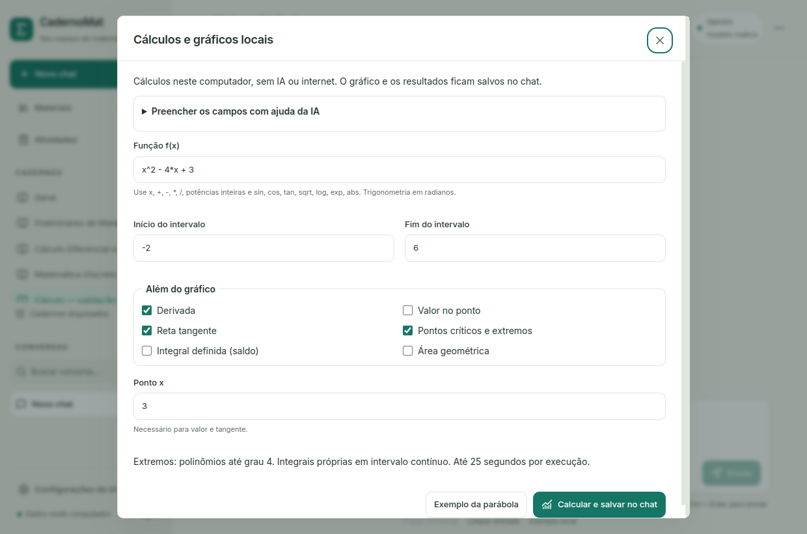
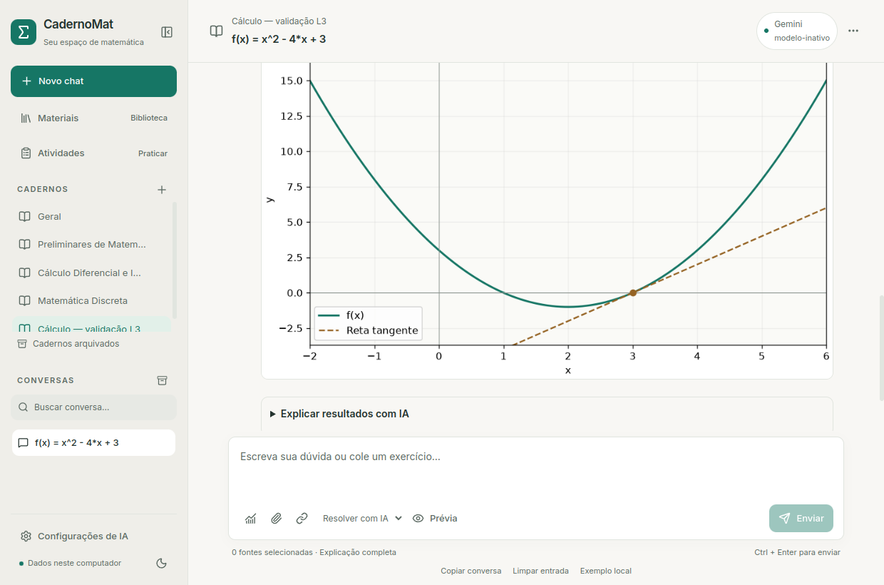

# Cálculos e gráficos locais — L3

No chat, abra **Cálculos e gráficos** (ícone de gráfico ao lado do clipe), preencha
`f(x)`, início/fim e operações. **Exemplo da parábola** configura
`x^2 - 4*x + 3`, intervalo `[-2,6]`, derivada, extremos e tangente em `x=3`.
**Calcular e salvar no chat** executa sem modelo, chave de API ou internet.
O gráfico e os resultados aparecem como uma mensagem e permanecem após reiniciar.
**Exportar PNG** abre o seletor nativo; cancelar o seletor não escreve arquivo.

O exemplo retorna derivada `2*x-4`, mínimo absoluto `(2,-1)` e reta `y=2*x-6`.
No intervalo solicitado há máximos em **ambas** as extremidades: `(-2,15)` e
`(6,15)`. O gráfico usa eixos/legenda, curva verde e tangente tracejada.




## Expressões e operações

Variável `x` real; constantes `pi` e `e`; números decimais com ponto; operadores
`+ - * / ^` ou `**`; potências inteiras de -12 a 12; `sin`/`sen`, `cos`, `tan`,
`exp`, `log` (natural), `sqrt` (raiz quadrada) e `abs`. Trigonometria em radianos.
No formulário, use multiplicação explícita (`4*x`). Não há parser de LaTeX,
unidades, expressões multivariáveis, código Python, potências variáveis ou raízes
fracionárias arbitrárias. Decimais de entrada são convertidos em racionais exatos.

- **Gráfico:** amostragem de cada componente contínuo do domínio real original.
  `1/x` e `tan(x)` não recebem linha através dos polos. Denominadores/raízes/logs
  que foram cancelados continuam restringindo o domínio. Buracos racionais com
  valor limite finito recebem círculo aberto. Domínios fora da representação
  suportada (até 40 intervalos) são recusados, sem presumir continuidade.
- **Derivada:** expressão simbólica onde existe. A fórmula não certifica a
  derivabilidade em cada ponto; cúspides e fronteiras têm aviso próprio.
- **Valor:** substituição apenas em ponto pertencente ao domínio original.
- **Tangente:** compara quocientes incrementais laterais e exige inclinação
  bilateral real finita, dentro do domínio. `abs(x)` em zero e pontos na
  fronteira do domínio são recusados. O ponto pode estar fora do intervalo do
  gráfico, com aviso; os limites exibidos continuam os solicitados.
- **Críticos/extremos:** polinômios até grau 4 sobre um intervalo fechado contínuo.
  Classificação pelo sinal da derivada, comparação simbólica dos candidatos e
  inclusão dos extremos do intervalo. Extremos absolutos em R são identificados
  somente para o subconjunto demonstrado de polinômios pares com domínio R.
  Empates preservam todos os candidatos encontrados. Funções constantes recebem
  explicação específica. Outros casos são indicados como não verificados.
- **Integral definida:** saldo algébrico de áreas. **Área geométrica:** integral
  de `abs(f)`. Suporte a integrais próprias com função contínua em todo o
  intervalo fechado. Integrais impróprias (mesmo convergentes) e valor principal
  permanecem fora desta versão. Sem resultado simbólico, tenta aproximação
  numérica a 12 dígitos, claramente sem certificação de erro.

Cada operação tem estado **Calculado simbolicamente**, **Aproximação numérica**
ou **Não verificado**. Uma operação não suportada não invalida automaticamente
as outras. Falhas do domínio, timeout ou do worker impedem a publicação do gráfico.
A escala vertical automática pode recortar valores perto de polos; o gráfico,
limitado a 700 amostras, não constitui prova. Não há selo de correção da resposta
inteira, nem alteração de gabaritos, notas ou tentativas.

## Ajuda da IA e dados enviados

No formulário, expanda **Preencher os campos com ajuda da IA** e descreva, por
exemplo: `Trace f(x)=x^2-4*x+3 no intervalo [-2,6] e a tangente em x=3.`
**Preparar proposta da IA** apenas salva uma prévia. Ela mostra destino, pedido,
instruções e orientações do caderno. **Pedir proposta à IA** utiliza o provedor
escolhido para o chat. Não há troca automática para a nuvem.

O backend valida JSON, catálogo, AST e constantes em subprocesso. Copia parâmetros
explicitamente identificados no pedido: função rotulada `f(x)=...`, um intervalo
`[a,b]` (ou `intervalo (a,b)`) e um ponto `x=...`. Campos ausentes, múltiplos ou
fora dessa notação limitada ficam vazios para preenchimento manual; números
inventados pelo modelo não preenchem os campos. O modelo propõe operações, que
continuam visíveis/editáveis. **Calcular e salvar no chat** é a ação que executa.
Fechar o diálogo conserva a proposta na conversa: **Revisar proposta da IA** a
reabre após reiniciar. Nenhum documento ou chat dispara ferramentas sozinho.

No gráfico salvo, **Explicar resultados com IA** permite uma nova prévia explícita.
São enviados somente os resultados registrados, domínio/avisos e orientações do
caderno — sem PNG, amostras, arquivos originais, documentos recuperados ou histórico.
A explicação é uma nova mensagem, identificada como IA, ligada ao ID do cálculo;
não modifica nem recebe o estado de verificação dos resultados locais.

Ollama usa schema JSON para a proposta; Gemini/OpenAI usam o mesmo contrato com
instruções de JSON e validação posterior, sem dependência de ferramentas nativas.
Consultas online podem consumir créditos da conta configurada. O cancelamento
local interrompe o stream; para provedores online, descarta a resposta ao terminar
a chamada existente, sem prometer interromper a cobrança ou a conexão imediatamente.

## Arquitetura, limites e persistência

`matematica.py` mantém sua API de continuidade anterior e reforça o parser AST:
300 caracteres, 100 nós, profundidade 16, literais até um milhão, expoentes
inteiros/efetivos até 12 e constantes intermediárias limitadas. Rejeita valores
não finitos, resultados constantes complexos, atributos, imports, listas,
comprehensions, subscritos, lambdas e funções desconhecidas. Não usa `eval/exec`
ou parsing simbólico irrestrito de strings.

`ferramentas_matematicas.py` calcula em processo separado, com SymPy e Matplotlib
Agg. O domínio é a interseção das restrições das subexpressões **originais não
avaliadas**, antes da normalização. Limites/ponto: constantes reais até 10000 em
módulo; início menor que fim, largura mínima 1e-6. Figura 960×576, PNG até 2 MB.
O controlador encerra o processo em cancelamento/25 segundos; no Linux também
aplica teto de espaço de endereçamento de 1,5 GB e CPU de 22/23 segundos. BLAS
usa uma thread. No Windows há timeout/cancelamento/limites de entrada; o teto
adicional via `resource` é específico do Linux.

`calculos.py` coordena tarefas, snapshots de IA e arquivos. SQLite **v9** cria
backup `.v8.backup` antes da migração transacional. A tabela `calculos` guarda
spec, estado, resultado, versão do motor/bibliotecas, hash do PNG, origem no chat,
mensagem e referência opcional a versão de atividade. A ponte oferece apenas
operações registradas `math_*`; a interface não recebe caminhos internos.

No Linux, o armazenamento padrão é `~/.local/share/CadernoMat/calculos/`, ao lado
do banco; Windows usa `%LOCALAPPDATA%/CadernoMat/calculos/`. Os arquivos são
publicados por escrita temporária + replace e conferidos por hash ao visualizar
ou exportar. Falhas não publicam artefato concluído. Reiniciar marca trabalhos
interrompidos e remove temporários/arquivos órfãos, sem executar novamente.
Banco, configurações e originais existentes são preservados. Artefatos não vão
para Git; apenas a interface compilada e capturas com dados fictícios.

## Validação e continuidade

Testes cobrem a quadrática, empates nos extremos, domínio de raízes/logs, polos,
buracos, cúspides, integrais/área, entradas maliciosas, limites, timeout,
cancelamento, exportação nativa, reinício e migração/rollback. IA: contratos dos
três provedores por mocks, parâmetros ausentes/inventados, JSON inválido,
mudança de provedor e explicação que não altera cálculo. Qt real: fluxo completo,
proposta revisável, explicação, persistência, temas e 1000×650.

```bash
.venv/bin/python -m unittest discover -s tests -v
cd frontend
pnpm test
pnpm build
pnpm e2e:matematica
```

Aceite real do modelo instalado, sem internet (Linux com unshare/ip disponíveis):
`scripts/testar_integracao_offline_linux.sh --matematica`. Usa banco fictício,
API online proibida, registra métricas fora do Git e confere reinício. No notebook,
Qwen3.5 4B gerou proposta e explicação válidas; a narrativa permanece não verificada.
Aceite final: **185 testes Python (175 aprovados, 10 opcionais do legado
ignorados)**, **24 testes React**, compilação e os cinco fluxos Qt (chat,
atividades, Ollama, busca híbrida e matemática). No aceite real isolado, a
proposta levou cerca de 24 s e a explicação 49 s, sob a carga deste notebook;
é uma observação pontual, não uma garantia de velocidade. O banco pessoal v8
foi migrado para v9 preservando os hashes das 25 tabelas anteriores, com backup,
integridade/FKs e configurações conferidos. Não foram consumidos créditos
online. Windows não foi executado neste ambiente.

Continuam planejados: tabelas-verdade, conjuntos e grafos finitos; retomada direta
pela tela de atividades (a referência versionada já existe no backend); integrais
impróprias; mais funções/domínios; zoom; exportações SVG/PDF; páginas completas de
caderno L4 e ilustrações opcionais L5. As páginas de caderno usarão composição
local de texto/KaTeX/gráficos, separada de geração artística de imagens.

Referências consultadas: [cálculo SymPy](https://docs.sympy.org/latest/modules/calculus/index.html)
e [exportação Matplotlib](https://matplotlib.org/stable/api/_as_gen/matplotlib.pyplot.savefig.html).
