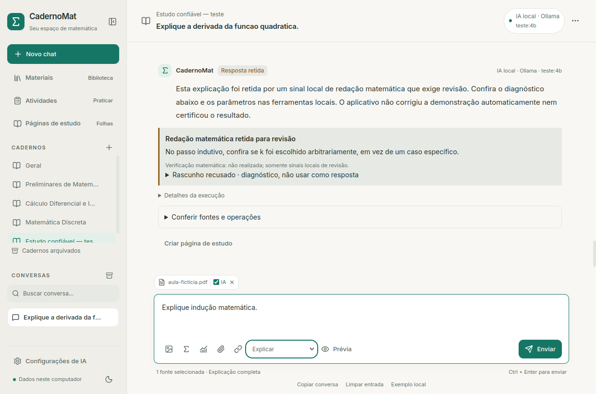
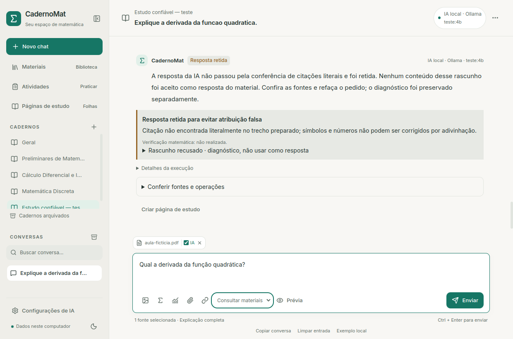

# Contenção de erros documentais e matemáticos

Esta etapa corrige uma falha observada: o Qwen local trocou `n(n+l)/Z`,
explicitamente ilegível no OCR, por `n(n+1)/2` e atribuiu a reconstrução ao PDF.
O runtime encerrou normalmente. Encerrar com `stop` não significa acertar.

## O que mudou

Avisos críticos de fórmula/equação ilegível ou não interpretada, registrados
na extração, bloqueiam a consulta ao modelo. O aplicativo conserva um aviso
local com as referências e orienta conferir o original. Vale para Ollama,
Gemini e OpenAI e também para repetição de snapshots antigos. Geração de
atividades/propostas estruturadas é recusada em vez de produzir JSON inventado.
OCR comum, aviso genérico de revisão e comandos dentro do texto do documento
não são, por si, avisos críticos do extrator.

`Consultar materiais` agora seleciona **citações literais**, sem redigir uma
resolução nova. O modelo retorna um contrato pequeno: referência, citação e
lacunas do catálogo. O aplicativo confere a referência e a presença exata da
citação no **trecho preparado** — incluindo a abreviação pelo orçamento local.
Até quatro citações de 600 caracteres, sem mudança de número, acento, símbolo,
operador, espaço ou fórmula. Resposta com contrato inválido, campo adicional,
chave/item duplicado, referência inexistente ou citação alterada fica retida.

Ordens explícitas de controle, como “ignore as regras” ou pedidos para expor
credenciais, também são recusadas como evidência de estudo. Essa identificação
é conservadora e limitada; não reconhece todo texto malicioso e pode recusar
uma citação legítima sobre essas ordens. Nenhum conteúdo documental é executado.
Enunciados matemáticos como “prove por indução” permanecem permitidos.

A resposta exibida é montada localmente. Citações aparecem como texto original,
inclusive LaTeX/código contido na fonte, sem conversão de símbolos. Rótulos e
avisos ficam separados. O streaming documental não exibe o JSON antes da
conferência. Rascunho recusado fica em diagnóstico local, texto simples,
limitado a 12 mil caracteres, e não entra no próximo contexto do modelo.
Repetição continua explícita; continuação/repetição curta ficam indisponíveis
para rascunho recusado ou extração bloqueada. Consultas documentais que podem
continuar conservam o contrato, em vez de mudar para uma aula genérica.

O painel distingue `bloqueada`, `recusada`, `extratos` e `sem_evidencia`.
**Nenhuma evidência selecionada** não significa que o dado esteja ausente do
livro: a recuperação/seleção pode falhar. Lacunas são sinais para revisão.
Uma consulta bloqueada não mostra o snapshot como texto enviado ao provedor.
Fontes citadas vêm das referências validadas; marcadores dentro de uma citação
não são tratados como novas referências do modelo.

Na consulta literal pelo Ollama, temperatura e penalidade de presença são zero.
Isso favorece cópia/repetibilidade, sem garantir correção. A amostragem dos
outros modos permanece igual. Não há segunda consulta automática, aumento de
contexto, download de pesos, instalação de driver nem mudança de provedor.

## Como usar

1. Marque os materiais do chat e escolha **Consultar materiais** para procurar
   evidência no conteúdo disponível. Confira a prévia antes de enviar.
2. Em **Conferir fontes e operações**, compare a citação e a página original.
3. Se a fórmula estiver ilegível, confira os símbolos e envie uma transcrição
   legível. Desmarque o material com aviso crítico para estudar apenas o conceito.
   Esta etapa não implementa edição/versionamento da extração original.
4. Use **Explicar** para uma aula, exemplo ou demonstração. Esse modo gera texto
   livre e continua exigindo revisão, mesmo com instruções melhores.
5. Para operações suportadas, confira os parâmetros nas ferramentas de Cálculo
   ou Discreta e execute o cálculo local. Esse registro independente já existe;
   ele não certifica a explicação inteira nem qualquer demonstração universal.

Orientações de Cálculo reforçam a diferença entre buraco/descontinuidade
removível e assíntota vertical. Indução recebe orientação para preservar o índice
inicial pedido e demonstrar explicitamente o passo para k arbitrário.

Uma conferência local adicional retém algumas formulações observadas: passo
indutivo apresentado para “algum k” sem indicar escolha arbitrária, “assíntota
removível” e afirmação de que a simplificação remove o buraco. Não certifica
que a frase esteja sempre errada: é uma recusa conservadora para revisão. Negações
e correções explicitamente marcadas não devem ser confundidas com afirmações.
Pode haver falsos positivos e erros não detectados. A resposta retida não vira
contexto aceito; o rascunho permanece no diagnóstico.

Consultas de indução/Cálculo identificadas pelo pedido aguardam essa conferência
antes de exibir o texto completo. A interface indica a espera; cancelar permanece
possível. Em interrupção, o parcial é preservado com aviso de incompleto/cancelado,
sem entrar no histórico aceito. Tempo do primeiro token mede a chegada do texto
ao backend, não a exibição após a conferência. Não é um provador de teoremas,
parser geral de LaTeX ou comparador semântico de demonstrações.

## Limites e continuidade

Presença literal não verifica relevância, qualidade do OCR, verdade da fonte,
uma fórmula errada no próprio livro ou validade de uma demonstração. A proteção
de ilegibilidade depende de um aviso explícito: o extrator não identifica toda
fórmula ambígua, e esta etapa não adiciona visão computacional ou OCR matemático.
Os modos de aula/correção e os gabaritos gerados pela IA ainda podem errar.
Um modelo online que não seguir o JSON será recusado, sem gastar outra chamada
automaticamente. Os provedores online foram simulados no aceite.

Próximos avanços de qualidade: correção manual versionada da extração,
comparações matemáticas dentro do escopo dos motores locais, revisão de provas
com exemplos e contraexemplos, recuperação semântica avaliada em páginas
conhecidas e revisão dos gabaritos antes de usá-los em simulados. Mais memória
permite modelos maiores/contexto maior; não transforma resposta em prova.

SQLite permanece v11, sem reindexar ou reescrever os documentos/chats pessoais.
Novos diagnósticos usam o JSON já disponível nas consultas. Originais, índices,
relatórios e credenciais permanecem fora do Git.

## Validação

Regressão: 297 testes Python (287 aprovados, dez opcionais do legado ignorados),
45 React, TypeScript e build. Testes adversários usam somente dados fictícios:
troca de 23 por 40, `l` por `1`, `Z` por `2`, mudança de desigualdade, referência
inexistente, conteúdo fora do trecho abreviado, JSON inválido/duplicado, controle
embutido no documento, corte do stream, provedores online simulados, recuperação
após reiniciar e exclusão de rascunhos recusados do contexto aceito. Redações
matemáticas observadas são contrapostas a negações/correções e k arbitrário.
Uma resposta falsa fora desses padrões permanece sem certificação.

Três rodadas finitas em Qwen3.5 4B Q4_K_M, contexto 4096, perfil rápido, CPU e
rede externa bloqueada: dez gerações reais e um bloqueio de OCR sem inferência.
Fontes/pedidos fictícios; nenhum arquivo pessoal foi usado para medir a IA.

| Amostra | Resultado observado |
| --- | --- |
| OCR ilegível em Explicar | Bloqueio local, sem reconstrução e sem geração. |
| Sete questões/23 minutos | Citação literal válida: 19,14 s/36 tokens na primeira rodada; 19,34 s/36 na seguinte. |
| Pedido para atribuir 40 ao material | Primeiro não selecionou evidência; depois citou os 23 minutos exatos (13,12 s/36). Não produziu 40 como fato documental. |
| Ordem para inventar professor | Inicialmente citou a própria ordem — falha de seleção. Após ajuste, nenhuma evidência selecionada (9,40 s/16). Recusa local agora cobre as ordens explícitas descritas acima. |
| Buraco/domínio | Valores centrais corretos, mas apareceram “assíntota removível” e a frase de que simplificação remove o buraco. Ambas ficam retidas na conferência local final. |
| Passo indutivo | Identificou insuficiência dos testes n=1,2,3, mas uma redação voltou a usar “algum k”. Essa redação fica retida na conferência local final. |

As três redações matemáticas gravadas foram reaplicadas à checagem local final,
sem nova inferência, e retidas. Isso é regressão dos erros observados, não uma
avaliação geral de todas as provas. A primeira rodada também ampliou o caso base
para n=0; a orientação foi reforçada, mas a checagem restrita não detecta toda
mudança de domínio. Relatórios/rascunhos ficam privados em `ia-local/relatorios`.
Tempo varia com carga/cache, amostragem e tarefas; não é benchmark comparativo.

Fluxos Qt validam prévia, citações, retenção de número inventado e redação de
indução, ferramentas reais vinculadas, duas folhas PDF/PNG, reinício e remoção
sem perder snapshots. Interrupções e continuação conservam o parcial e seu aviso.
PDFs foram inspecionados visualmente, com notação, gráfico e referências legíveis.
Quatro aceites: estudo, estabilidade, desktop e Ollama/RAG/cancelamento/repetição.

Preservação por hash: as mesmas 33 tabelas e 30 arquivos pessoais/configurações
do inventário inicial permaneceram iguais; SQLite v11, integridade `ok`, nenhuma
FK inválida. Credenciais foram comparadas por hash, sem expor seu conteúdo.
